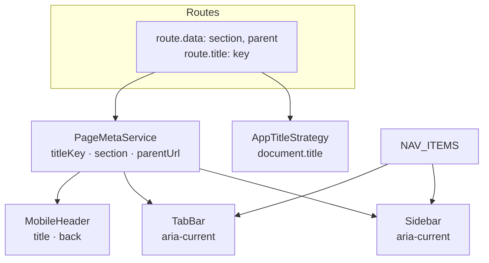
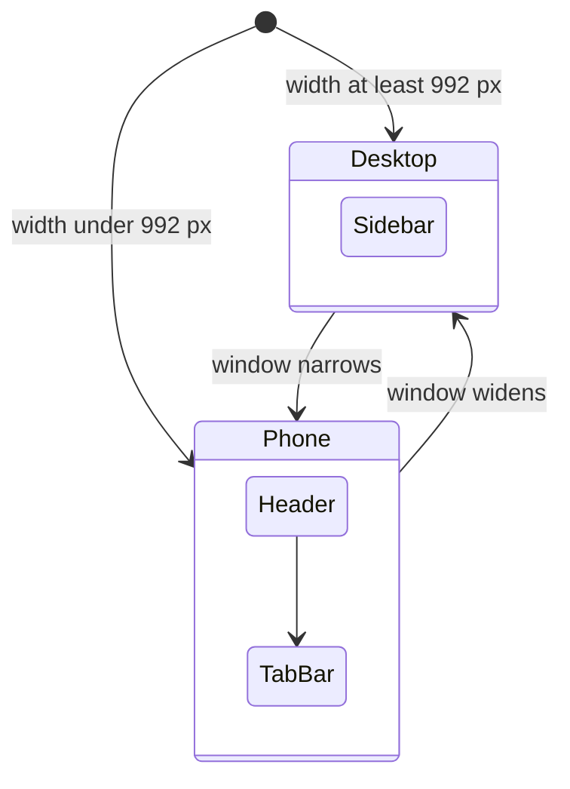

# Design

## Context

- **Current shell** (`projects/home/src/app/layout/`):
  - `app-layout` is a grid with a toolbar row on top and, below it, a sidebar column plus the main area, with a chat button (`app-chat-bot-container`) and toast and loader outlets.
  - `toolbar` holds the hamburger, the logo and "My Farm", a language dropdown, and an avatar menu (My profile, Settings (unused), Logout).
  - `sidebar` is an offcanvas on screens under 992 px (`lg`), with a backdrop, and a column at 260 px above that. It lists Home, Lands (`/map`), Crops, Activities, Weather, Reports and Profile.
  - `main` wraps the router outlet and a footer, and adds 200 px of bottom padding under 768 px so floating buttons never cover content.
- **Floating buttons** are fixed to the viewport: the per-page add and back buttons (`.fab`, `.fab-soft`, `.fab-stack-*` at `bottom: 25px` to `145px`, right side) and the chat button (`.chat-fab`, bottom left, 20 px). A bottom tab bar would cover them.
- **Routing** (`app.routes.ts`): about 17 routes; `provideRouter` already uses `withComponentInputBinding()` and `paramsInheritanceStrategy: 'always'`, so child routes see their parents' params and data. The page `<title>` is the static "Home" from `index.html`. There is no route metadata today.
- **Prototype**: `NAV` (Home, Lands, Crops, Activity, Reports, Prices, Weather, plus Assistant on desktop), `TITLES` and `PARENT` maps (child screen → parent section), a desktop `aside.side` with a `who` account button, a phone `nav.tabs` with every item except Weather, and no top bar. Back links appear on child screens.
- **Profile** has Account, Agronomic and Land cards and a language row, but no Sign out. Language is changed in the toolbar dropdown and in the profile edit dialog; both write `preferredLanguage` through `AuthService.updateProfile`.
- The e2e golden path does not touch the toolbar or sidebar.

## Goals / Non-Goals

**Goals**
- The prototype's frame: sidebar on desktop, tab bar and compact header on phones, no toolbar.
- One declaration per route drives title, active section and back target.
- Nothing becomes unreachable: language and sign out move to Profile, and floating buttons stay usable.

**Non-Goals**
- Prices and Assistant items, the quick-actions dial, screen content redesigns, tablet layouts, changing the wordmark. See the proposal.

## Decisions

1. **One navigation list.** `layout/nav/nav-items.ts` exports `NAV_ITEMS`: `{ key, labelKey, icon, link, exact?, phoneTab }` for Home, Lands, Crops, Activity, Reports and Weather (Weather has `phoneTab: false`). The sidebar and the tab bar both render from it. Prices (task 4.2) and Assistant (task 4.4) are added there with one line each.
   - Icons stay Bootstrap Icons (the app's icon font). The prototype's custom icon set is a later polish item.
2. **Route metadata as `data`, titles through Angular's `TitleStrategy`.**
   - Every route gets `data: { section, parent? }` and `title: '<translation key>'`. `section` is a nav key (or absent, as for the 404 page). `parent` is an absolute path that may contain route params, for example `/crops/:cropId`.
   - Because params and data are inherited (`'always'`), a child route that needs a different title or parent declares its own; the deepest route wins.
   - A custom `AppTitleStrategy` (provided as `TitleStrategy`) translates the key and sets `document.title` to `"<title> · My Farm"`, and re-applies it on language change.
   - Alternative: a central `TITLES` map as in the prototype. Rejected: it duplicates the route table and drifts from it.
3. **`PageMetaService` (root-provided) exposes the current page.**
   - On `NavigationEnd` it reads the deepest snapshot and exposes signals: `titleKey`, `section`, and `parentUrl` (the `parent` path with `:param` tokens replaced from the merged route params). No effect and no API call: it listens to router events.
   - The sidebar and tab bar read `section` to set `aria-current`; the phone header reads `titleKey` and `parentUrl`.
4. **Responsive by CSS, not by JavaScript.** Both the sidebar and the tab bar and header are in the DOM; Bootstrap's `d-none d-lg-flex` and `d-lg-none` show one or the other at the 992 px breakpoint. Hidden navigation is not exposed to assistive technology, so only the visible landmark is read.
5. **Layout grid.**
   - At 992 px and up: columns `260px | 1fr`, one row.
   - Under 992 px: rows `auto | 1fr | auto` (header, main, tab bar), one column. The tab bar is part of the grid, not fixed, so the scrolling area ends above it and content never hides behind it.
   - The tab bar height is a token-like CSS variable `--mf-tabbar-h` (`calc(64px + env(safe-area-inset-bottom))`) set on the shell, so floating buttons can offset themselves.
6. **Floating buttons offset.** Under 992 px, `.fab`, `.fab-button`, `.fab-soft`, the `fab-stack-*` offsets and `.chat-fab` add `var(--mf-tabbar-h, 0px)` to their `bottom`. Outside the shell the variable is unset and the offset is zero.
7. **Account block and avatar.** A small `userInitials()` helper (extracted from the toolbar) gives the avatar letter(s). The sidebar block shows the initials, the full name, and `village` (or `district`) plus the farm area when known. It is a button-like link to `/profile` with `aria-label` "Open profile".
8. **Sign out in Profile.** A full-width outline-danger "Sign out" button at the bottom of Profile calls `AuthService.logout()`, as the old menu did. The avatar menu's "Settings" item did nothing and is dropped.
9. **Toolbar removal.** `toolbar.ts/html/scss/spec` are deleted. Translation keys used only by the toolbar are removed from `en`, `hi` and `mr`; keys the new shell needs are added under `shell.*`.
10. **Skip link.** The first focusable element is "Skip to content". With `<base href>`, a plain `#id` link would navigate, so it focuses `#main-content` (`tabindex="-1"`) in a click handler.
11. **Footer.** The footer ("© year My Farm", version and build) stays at the bottom of the scrolling area on every size; it is not part of the frame.

## Risks / Trade-offs

- **Language is one level deeper.** The toolbar's language dropdown is gone; it lives in Profile (and Marathi switching, task 1.5, will make Marathi the default for new farmers). A farmer who cannot read English and opens the app set to English must find Profile. Mitigation: the avatar and account block are always visible and open Profile; do task 1.5 soon after this change. Alternative considered: keep a language chip in the phone header and sidebar. Not done, to match the prototype; easy to add if wanted.
- **Every screen's top edge changes.** Screens that assumed the toolbar's height (sticky headers with negative margins, full-height map) may sit wrong. Mitigation: a route and width pass with screenshots; the map page is checked explicitly.
- **Floating buttons overlap risk.** Pages with three stacked buttons on short phones. Mitigation: the offset and the existing bottom padding, checked on crop detail and activity detail.
- **Route table edit touches every route.** A missed route would show a missing title. Mitigation: a unit spec walks the route config and fails if a route lacks `title` or `data.section` where required (the 404 page excepted).
- **Hidden nav in the DOM** costs a little markup. Accepted for a simpler, flicker-free responsive switch.

## Open Questions

- Should the language chip stay in the shell until Marathi switching ships? Default here: no, follow the prototype. Say if you want it kept.
