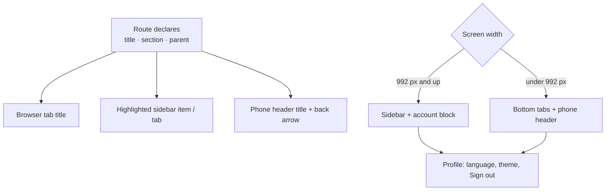

# Proposal

## Why

The app's frame does not match the prototype. It has a top toolbar with a hamburger, a language dropdown and an avatar menu, and a sidebar that slides over the page on phones. The prototype uses a fixed sidebar on desktop and a bottom tab bar on phones, which is how farmers already use their phones: thumb reach, one tap between the main sections. Page titles and back buttons are also ad hoc today, and the browser tab always says "Home". This change is task 1.4 of `prototype-adoption-roadmap`. Every later screen is drawn inside this frame, so it comes before them.

Prototype references:
- Prototype → desktop frame (sidebar with logo, items and account block) and phone frame (bottom tabs): `design/prototype/myfarm-prototype.html`
- Design system → Navigation (sidebar, tab bar, account row, back and title rules): `design/prototype/myfarm-design-system.html`

## What Changes

- **Desktop (992 px and wider): a fixed sidebar** with the logo and app name, the section links, and an account block at the bottom (avatar, name, village and area) that opens Profile. The top toolbar is removed.
- **Phone (under 992 px): a bottom tab bar** with the five main sections, always visible, with the current section highlighted. The slide-in menu and hamburger are removed.
- **Phone header:** a compact bar with a back arrow on pages that have a parent (otherwise the logo), the page title, and the avatar that opens Profile.
- **Page titles and back targets come from the routes.** Each route declares its title (translated), which section it belongs to, and its parent page. That one declaration drives the browser tab title, the phone header, the highlighted tab or sidebar item (so Crop detail highlights Crops), and the back button.
- **Language and sign out stay reachable.** Language is already in Profile; Profile gets a **Sign out** button, as in the prototype, since the avatar menu that held it goes away.
- **Floating buttons make room.** The chat button and the per-page add buttons sit above the tab bar on phones.
- **Accessibility:** labelled navigation landmarks, `aria-current="page"` on the current item, and a "Skip to content" link.

## Capabilities

### New Capabilities

- `app-shell`: the frame around every signed-in screen: desktop sidebar, phone tab bar and header, route-driven titles, back targets and active section, and where account actions live.

### Modified Capabilities

(none)

## Non-goals

- **A Prices or Assistant item.** Those features do not exist yet. The navigation is one list, so each feature's own change adds its item (Prices in task 4.2, the full-page Assistant in 4.4).
- **A quick-actions speed dial** (the prototype's "+" menu). Screens keep their current floating buttons until their own redesign tasks.
- **Redesigning any screen's content,** including the Home greeting with the avatar (task 3.1) and the Profile layout (task 2.2). Only Profile's Sign out button is added here.
- **Moving the language switch or adding one to login.** Language is changed in Profile (Marathi switching, task 1.5, and login, task 2.1, come later).
- **Changing the app name or wordmark text.** It stays "My Farm".
- **Tablet-specific layouts.** One breakpoint (992 px) separates desktop from phone.

## Impact

- **Frontend:**
  - `layout/`: new navigation list and state, a redesigned `sidebar`, a new phone `tab-bar` and `mobile-header`, a simplified `app-layout`; `toolbar` is removed; `main` and `footer` are adjusted.
  - Route data for every route in `app.routes.ts`, and a custom `TitleStrategy`.
  - `profile` gets a Sign out button; `sidebar.*` strings are renamed and extended in `en`, `hi` and `mr`.
  - The floating-button offsets in `_buttons.scss` and the phone padding in `main.scss`.
- **Removed:** the toolbar component and its spec, the sidebar backdrop, and the avatar dropdown.
- **Backend and API:** none. **Routes and URLs:** unchanged.
- **Tests:** new specs for the title strategy, navigation state, sidebar, tab bar and header; the Playwright golden path should pass unchanged.
