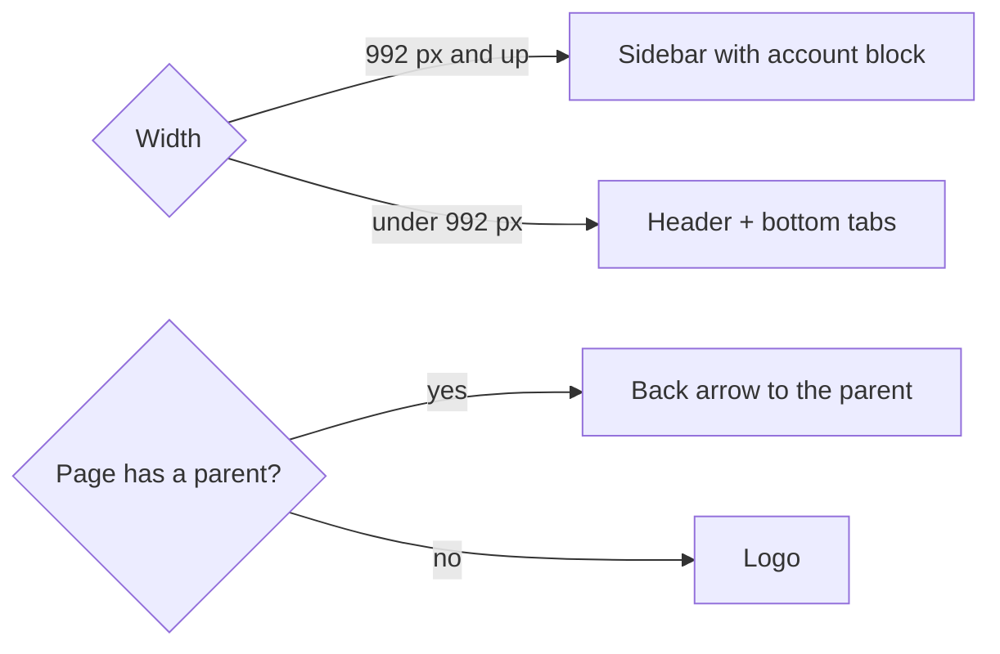

# Spec Delta

## Purpose

The app shell is the frame around every signed-in screen. On a wide screen it is a sidebar; on a phone it is a bottom tab bar with a small header. Each page's title, section and parent come from one place, so the tab title, the highlighted item and the back button always agree.

## ADDED Requirements

### Requirement: Wide screens show a fixed sidebar
At 992 px and wider, the signed-in app SHALL show a fixed sidebar on the left with the logo and app name, the main section links, and an account block at the bottom. The account block SHALL show the farmer's initial, name and village or area, and SHALL open Profile. The app SHALL NOT show a top toolbar.

#### Scenario: Sidebar contents
- **WHEN** a signed-in farmer opens any screen on a wide screen
- **THEN** the sidebar lists Home, Lands, Crops, Activity, Reports and Weather in that order, and the account block shows their initial and name

#### Scenario: Open Profile from the account block
- **WHEN** the farmer selects the account block
- **THEN** the Profile screen opens and the account block shows as current

#### Scenario: Current section on a child page
- **WHEN** the farmer opens a crop's detail page
- **THEN** Crops is highlighted in the sidebar

### Requirement: Phones show a bottom tab bar
Under 992 px, the signed-in app SHALL show a bottom tab bar, always visible, with the main sections Home, Lands, Crops, Activity and Reports. The current section SHALL be highlighted and exposed as the current page. The app SHALL NOT show a hamburger button or a slide-in menu. Page content and floating buttons SHALL NOT be hidden behind the tab bar.

#### Scenario: One tap between sections
- **WHEN** a farmer on a phone selects the Crops tab
- **THEN** the Crops screen opens in one tap and the Crops tab shows as current

#### Scenario: Tab bar stays in view
- **WHEN** the farmer scrolls a long page
- **THEN** the tab bar stays at the bottom of the screen

#### Scenario: Floating buttons clear the tab bar
- **WHEN** a screen shows the chat button or add buttons on a phone
- **THEN** they sit above the tab bar, not under it, and the last item of the page can be scrolled fully into view

#### Scenario: Weather on a phone
- **WHEN** a farmer on a phone wants the weather
- **THEN** they reach it from the Home weather card, since Weather has no tab

### Requirement: Phones show a compact header
Under 992 px, each signed-in screen SHALL have a compact header with the page title and the farmer's avatar, which opens Profile. On a page that has a parent, the header SHALL show a back arrow that goes to that parent; otherwise it SHALL show the logo.

#### Scenario: Top-level page
- **WHEN** a farmer on a phone opens Activity
- **THEN** the header shows the logo, the title "Activity" and the avatar

#### Scenario: Child page with a back arrow
- **WHEN** the farmer opens Add crop
- **THEN** the header shows a back arrow, the title "Add crop", and the arrow returns to Crops

#### Scenario: Avatar opens Profile
- **WHEN** the farmer selects the avatar
- **THEN** Profile opens

### Requirement: Titles, sections and parents come from the routes
Each signed-in route SHALL declare a translated title, the section it belongs to, and optionally a parent page. The browser tab title, the phone header title, the highlighted sidebar item or tab, and the back target SHALL all be taken from that declaration, so they cannot disagree. The browser tab title SHALL read "<page title> · My Farm", and SHALL update when the language changes.

#### Scenario: Browser tab title
- **WHEN** the farmer opens Reports
- **THEN** the browser tab title is "Reports · My Farm"

#### Scenario: Language change updates the title
- **WHEN** the farmer switches the app language
- **THEN** the browser tab title and header title change to the new language without a reload

#### Scenario: Parent with a route parameter
- **WHEN** the farmer opens a page whose parent includes an id, such as a crop's activity list
- **THEN** the back arrow returns to that same crop's page

#### Scenario: Unknown page
- **WHEN** the farmer opens an address that does not exist
- **THEN** the not-found page is shown inside the shell with no section highlighted, and the tab title is "Page not found · My Farm"

### Requirement: Sign out and language are in Profile
With the top toolbar and its avatar menu removed, Profile SHALL provide a Sign out button, and SHALL keep the language setting. Signing out SHALL end the session and return to the login page.

#### Scenario: Sign out
- **WHEN** the farmer selects Sign out in Profile
- **THEN** the session ends and the login page is shown without the shell

#### Scenario: Signed out visitors see no shell
- **WHEN** nobody is signed in
- **THEN** the login page is shown with no sidebar, tab bar or header

### Requirement: The shell is accessible
The sidebar and the tab bar SHALL each be a labelled navigation landmark, the current item SHALL be exposed with `aria-current="page"`, and every control SHALL be reachable and usable by keyboard with a visible focus. A "Skip to content" link SHALL be the first focusable element and SHALL move focus to the main content.

#### Scenario: Skip link
- **WHEN** a keyboard user presses Tab on a freshly loaded screen
- **THEN** the first focus stop is "Skip to content", and activating it moves focus to the main content

#### Scenario: Current item announced
- **WHEN** a screen reader reads the navigation
- **THEN** the current section is announced as the current page
