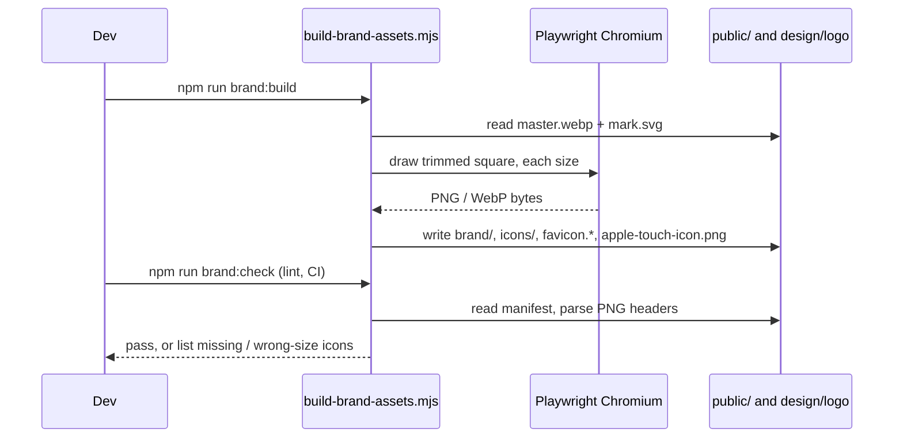

# Design

## Context

- **Today the brand is the Angular default.** `public/favicon.ico` and every `public/icons/icon-*.png` (72 to 512 px) are the Angular shield. `manifest.webmanifest` lists those eight icons, all with `purpose: "maskable any"`, with `theme_color #2a6f47` and `background_color #ffffff`. `index.html` links only the favicon and manifest; there is no Apple touch icon.
- **In the UI the brand is a glyph.** The header (`layout/toolbar/toolbar.html`) shows `<i class="bi bi-tree-fill">` and "My Farm". The login page shows the same glyph in a 64 px rounded tile (`.brand-logo-container`). Other `bi-tree-fill` uses (home KPI, weather land card) are meaningful icons for "land", not the brand, and stay.
- **The new logo exists as a high-resolution original.** A 1261 × 1247 WebP with a transparent background (sprout, sun, field and roots inside a leaf ring), recovered from the design session. The prototype holds only a 128 px copy of it (`var LOGO`), fine for the UI mock but too small for a 512 px icon. Its shape is nearly but not exactly square.
- **No image library is installed** (no `sharp`, `jimp` or `canvas`). Playwright's Chromium is already a dev dependency and can rasterise an image or SVG at any size.
- **Service worker:** `ngsw-config.json` already caches `svg|png|webp` lazily, so new assets need no config.
- The design system page says logo sizes under 32 px need a simpler version, and the prototype shows the emblem in a white circle on the login screen.

## Goals / Non-Goals

**Goals**
- The real logo everywhere a brand mark appears, readable at every size, in both themes.
- Correct installable icons (normal and maskable) so the home-screen icon is not the Angular shield.
- One master image and one command to regenerate everything.

**Non-Goals**
- Header or login redesign, wordmark text, splash screens, share images, animation. See the proposal.

## Decisions

1. **One master, generated outputs.**
   - The original is committed as `design/logo/myfarm-logo-master.webp` (about 490 KB, not shipped to users).
   - `scripts/build-brand-assets.mjs` trims the transparent margin, pads it to a square, and writes every output with Playwright's Chromium (`page.screenshot` with `omitBackground`) so no new dependency is added.
   - Alternative: add `sharp`. Rejected for one rarely-run script; it adds a native dependency to every install.
2. **Emblem for 48 px and up, a drawn mark below.**
   - The mark is a hand-drawn SVG (`public/brand/mark.svg`, 64 × 64 viewBox): the leaf-green ring, a soil line, and a three-leaf sprout (two side leaves and a taller centre leaf), in the brand greens. It reuses the emblem's colours, so it reads as the same logo.
   - The 48 px threshold comes from the emblem test render: at 64 px it is clear, at 32 px it turns to mush.
3. **Asset set** (all generated unless noted):

   | File | Size | Use |
   |---|---|---|
   | `public/brand/logo-96.webp`, `logo-192.webp`, `logo-512.webp` | emblem, transparent | UI (header 48 to 96 px, login 96 to 128 px, retina) |
   | `public/brand/mark.svg` (hand-drawn) | vector | small UI placements |
   | `public/favicon.svg` (copy of the mark) | vector | modern browsers |
   | `public/favicon.ico` | 16, 32, 48 (PNG-in-ICO) | older browsers |
   | `public/apple-touch-icon.png` | 180, opaque light background, emblem padded | iOS home screen |
   | `public/icons/icon-{72,96,128,144,152,192,384,512}.png` | emblem, transparent | manifest, `purpose: any` |
   | `public/icons/maskable-192.png`, `maskable-512.png` | emblem at 72% on the solid light background | manifest, `purpose: maskable` |

   - The current icons mix `maskable any` in one entry, which makes launchers crop an unpadded icon. They are split into separate `any` and `maskable` entries.
   - Maskable safe zone: the emblem is scaled to 72% of the canvas and centred, inside the 80% circle the platform guarantees.
4. **A reusable `app-brand-logo` component** (`layout/brand-logo/`).
   - Standalone, `OnPush`, inputs `size` (number, default 40) and `decorative` (boolean, default true).
   - At `size >= 48` it renders `` (`NgOptimizedImage`, explicit width and height, `srcset` through `ngSrcset`) of the emblem inside a round backing; below 48 it renders the mark SVG.
   - `decorative` gives `alt=""` and `aria-hidden="true"`; otherwise `alt="MyFarm"`.
   - `NgOptimizedImage` cannot react to a changed `width` or `height` after creation (it throws NG02953), so the emblem is wrapped in an `@for` keyed by `size`, which re-creates the image if the size changes.
   - Styling uses Bootstrap utilities plus a few lines of component SCSS for the round backing.
5. **A logo backing token.** `--mf-logo-backing: #ffffff` is added to `_tokens.scss` under both theme blocks (same value), because the emblem's dark ring and soil disappear on the dark surface. Using a token keeps the no-hard-coded-colour guard happy and lets the backing change in one place. The login uses the same backing, as in the prototype.
6. **Where the component is used now.** The header brand (replacing the tree glyph, at 32 px so it takes the mark) and the login card (replacing the tile, at 96 px so it takes the emblem). Task 1.4 (shell) and 2.1 (login) will reposition them; this change keeps their layout.
7. **Manifest and head.**
   - `manifest.webmanifest`: the new icon list, `theme_color #2f7a3f` (the design leaf green) and `background_color #eef1ec` (the light page background, what the splash shows).
   - `index.html`: `<link rel="icon" href="favicon.svg" type="image/svg+xml">`, `<link rel="icon" href="favicon.ico" sizes="48x48">` and `<link rel="apple-touch-icon" href="apple-touch-icon.png">`.
   - The favicon is a fixed-colour image, so it does not follow the theme. A theme-aware SVG favicon is possible but is not worth the browser inconsistency.
8. **An asset check.** `npm run brand:check` (`scripts/build-brand-assets.mjs --check`) reads `manifest.webmanifest` and fails if a listed icon is missing or its PNG pixel size differs from the stated `sizes` (reads the PNG header, no image library). It also checks the favicon and Apple icon exist. It is chained into `npm run lint`, so CI blocks a manifest that points at nothing.

## Risks / Trade-offs

- **Raster logo, hand-drawn small mark.** The emblem is a raster, so it cannot scale infinitely; 512 px is the largest size needed (the master is 1261 px). The small mark is my drawing, not the designer's, so it may need a touch-up. Mitigation: it is one SVG file, and the render comparison against the emblem is part of the checks.
- **Maskable cropping differs by launcher.** Mitigation: 72% scale is inside the safe zone; the maskable icons are previewed with a circle and a squircle mask in the checks.
- **Generated binaries in git.** About 15 PNG/WebP files, about 1.3 MB in total, almost all of it the large installed-app PNGs (`icon-384`, `icon-512`, `maskable-512`), which browsers fetch only when installing. The UI images the app loads on every visit are 11 to 32 KB. Acceptable; regenerating is deterministic.
- **ICO written by hand.** PNG-compressed entries in an ICO are supported by every current browser. Mitigation: the check parses the entry count and sizes, and the file is verified by loading it.
- **Favicon colours are fixed** and do not follow the dark theme. Accepted.

## Open Questions

- None blocking. If you want the mark redrawn by a designer later, replacing `public/brand/mark.svg` and running `npm run brand:build` updates the favicon and icons.
