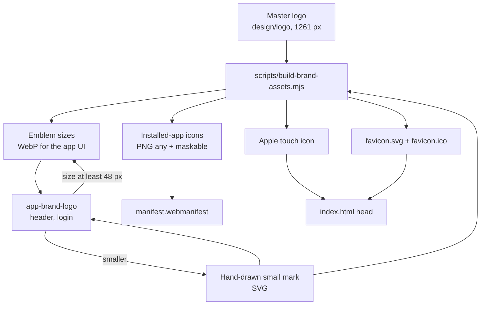

# Proposal

## Why

The app still shows the default Angular logo as its favicon and as every installed-app (PWA) icon, and uses a generic tree glyph as its brand mark in the header and on the login page. The approved MyFarm logo (a sprout rising from roots, with sun and fields inside a leaf ring) exists only inside the prototype, as a 128 px copy. This change is task 1.3 of `prototype-adoption-roadmap`: put the real logo into the app everywhere a brand mark appears, and make it work at every size, in both themes.

Prototype references:
- Prototype → sidebar header, login screen and Profile: `design/prototype/myfarm-prototype.html`
- Design system → Brand (logo sizes, the login lockup, the note that sizes under 32 px need a simpler version): `design/prototype/myfarm-design-system.html`

## What Changes

- **The full logo (the sprout emblem) becomes the brand mark** in the header/sidebar and on the login page, replacing the tree glyph. A new reusable `app-brand-logo` component shows it at a given size.
- **A simplified mark for small sizes.** The emblem has too much detail to read below about 48 px, so a simple two-leaf sprout in the brand ring is used for small placements, the favicon and the browser tab.
- **A round light backing in both themes.** The emblem's dark green ring would vanish on the dark theme, so it always sits on a light round backing, as the prototype does on its login.
- **Real app icons.** The favicon, the Apple touch icon and every installed-app icon are replaced with the MyFarm logo, including proper "maskable" versions that survive Android's circle and squircle crops.
- **Reproducible assets.** The original high-resolution logo is stored once in `design/logo/`, and a script regenerates every size from it, with a check that fails if a file listed in the manifest is missing or the wrong size.

## Capabilities

### New Capabilities

- `brand-identity`: the MyFarm logo, where it appears, which version is used at which size, how it looks in light and dark, and the favicon and installed-app icons.

### Modified Capabilities

(none)

## Non-goals

- **Redesigning the header, sidebar or login layout.** Those are `app-shell-navigation` (task 1.4) and `warli-login-registration` (task 2.1). This change only swaps the mark inside the existing header and login.
- **A new logo or colour change.** The approved logo is used as it is.
- **The app name and wordmark text** ("My Farm" versus "MyFarm", Marathi wordmark). Left as it is for the shell task.
- **A splash screen** and **Open Graph / social share images.**
- **Animated logo or loading animation.**

## Impact

- **Assets (new):** `design/logo/myfarm-logo-master.webp`, `public/brand/*` (emblem WebP sizes, `mark.svg`), `public/favicon.svg`, `public/apple-touch-icon.png`, regenerated `public/icons/*` including maskable.
- **Replaced:** `public/favicon.ico`, the existing `public/icons/icon-*.png`.
- **Frontend:** new `app-brand-logo` component; `index.html` icon links; `public/manifest.webmanifest` icons, `theme_color` and `background_color`; the logo spots in `layout/toolbar/toolbar.html` and `features/auth/login.component.*`; one new token for the logo backing.
- **Tooling:** `scripts/build-brand-assets.mjs` (uses Playwright's Chromium, no new dependency) plus `npm run brand:build` and `npm run brand:check`, with the check added to `npm run lint`.
- **Backend and API:** none. **Weight:** about 1.3 MB of new image files in the repo, but the images a visitor actually loads are 11 to 32 KB; the large installed-app icons are fetched only on install.
