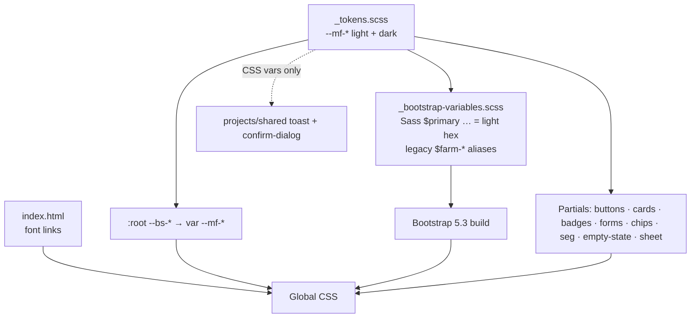

# Design

## Context

- **Global styles live in `projects/home/src/styles/`:**
  - `_bootstrap-variables.scss`: Sass overrides with the "premium" palette (`$farm-green-primary: #2e7d32` …) and the Outfit font
  - `_bootstrap-config.scss`: a slim stack that component SCSS imports
  - `_bootstrap.scss`: the full Bootstrap 5.3.8 build
  - `_design-system.scss`: `@import`s Outfit from Google Fonts and the component partials (`buttons`, `cards`, `badges`, `forms`, `layout`, `animations`; 820 lines in all)
- **Component styles:**
  - 32 component SCSS files. 11 import `bootstrap-config` and use legacy Sass variables, `$farm-green-primary` alone 27 times.
  - Hard-coded colours: 169 hex codes in component SCSS and 118 in templates and TS (weather panels, workflow cards, map layers, activity display).
  - 14 files name `Outfit` directly.
- **Shared library (`projects/shared`):** `lib-toast` (BEM classes, its own styles), `confirm-dialog` (a custom backdrop plus a `card`), `combobox` and `loader`.
- **Prototype tokens** (from `design/prototype/myfarm-prototype.html` `:root`):
  - Light: `--bg #eef1ec`, `--surface #fff`, `--surface2 #f4f6f2`, `--line #dde3d8`, `--fg #18231a`, `--muted #5d6b5f`; leaf `#2f7a3f`, soft `#dcefdf`, ink `#1d5a2b`; sun `#c98a14`, soft `#faefd2`; sky `#2b74b8`, soft `#dcebf8`; rose `#b83d3d`, soft `#f8dfdf`.
  - Dark: a matching set under `[data-theme="dark"]`.
  - Spacing: 4, 8, 12, 16, 24 and 32 px. Radius: 8, 10, 12, 14, 18 px and pill.
  - Fonts: Bricolage Grotesque (display), Figtree (body), Mukta (Devanagari).

## Goals / Non-Goals

**Goals**
- One source of truth for tokens, consumed by Bootstrap and by custom SCSS.
- Every route visibly adopts the prototype palette, type and component look in one PR, with no template rewrites.
- Dark token values are ready, so task 1.2 only has to switch them on and fix screens.

- No colour literal is left outside the token layer, so task 1.2 can switch themes without screen-by-screen colour hunting.

**Non-Goals**
- Theme switching, layout or shell changes, and per-screen redesigns. See the proposal's Non-goals.

## Decisions

1. **Tokens are CSS custom properties with an `--mf-` prefix in a new `_tokens.scss`.**
   - The prefix avoids clashing with Bootstrap's `--bs-*`.
   - Light values sit on `:root`. Dark values sit on `[data-bs-theme="dark"]`, which nothing sets yet.
   - Using Bootstrap's own attribute now means task 1.2 needs no renaming.
   - Alternative: Sass-only variables. Rejected because they are compile-time and can't switch theme at runtime.
2. **Bootstrap gets the tokens two ways.**
   - Sass `$primary`, `$body-bg` and the rest take the light hex values. Bootstrap needs real colours at compile time for `tint`/`shade` and for contrast.
   - `:root` then re-points the matching `--bs-*` properties (`--bs-body-bg`, `--bs-body-color`, `--bs-border-color`, `--bs-primary`, `--bs-primary-rgb`, `--bs-link-color` …) to `var(--mf-*)`.
   - This makes Bootstrap's runtime properties follow the tokens.
   - This block lives in its own `_bootstrap-bridge.scss`, imported right after Bootstrap in `styles.scss`: it has the same specificity as Bootstrap's own `:root` output, so it must come later to win.
   - Component-level properties that Bootstrap bakes from Sass (`.btn-primary`'s `--bs-btn-bg`) are re-pointed in our component partials. That way the dark mode in task 1.2 works without a second Bootstrap build.
3. **Fonts load from `index.html`, not a Sass `@import`.**
   - `<link rel="preconnect">` to fonts.googleapis.com and fonts.gstatic.com, plus one stylesheet link for the families in use: Bricolage Grotesque 500/700, Figtree 400–700, Mukta 400–700, with `display=swap`.
   - Font stacks: `--mf-font-display: 'Bricolage Grotesque', 'Mukta', system-ui, sans-serif` and `--mf-font-body: 'Figtree', 'Mukta', system-ui, sans-serif`.
   - The Mukta fallback renders Devanagari, which the Latin fonts lack.
   - The PWA service worker gets a lazy `fonts` asset group for `fonts.googleapis.com` and `fonts.gstatic.com`, so the fonts work offline after the first visit.
   - Alternative: self-host the fonts. Deferred to the PWA polish task.
4. **The base font size is 14 px (`$font-size-base: .875rem`)** to match the prototype.
   - Headings follow the prototype scale: page title 24 px, card title 16 px, KPI number 24 px. The `$h1`–`$h6` sizes are reduced to match.
   - Form controls stay at 16 px on phone widths so iOS does not zoom on focus.
5. **The radius map:**
   - `$border-radius: 8px`, `$border-radius-sm: 6px`, `$border-radius-lg: 12px`, `$border-radius-xl: 14px` and `$border-radius-pill`.
   - Cards use `lg` (12 px), dialogs use `xl` (14 px), and sheets use 18 px top corners.
   - **Spacing:** Bootstrap's `$spacers` stay the same, so `p-3` keeps its current value and existing layouts don't shift. `--mf-s-1`…`--mf-s-6` are for custom CSS.
6. **Component partials are rewritten, not layered on.**
   - `_buttons.scss`, `_cards.scss`, `_badges.scss` and `_forms.scss` are rewritten to the design system: no gradients, no glass, no hover lift.
   - New partials: `_chips.scss` (`.chip[aria-pressed]`), `_segmented.scss` (`.seg` over `btn-group` semantics), `_empty-state.scss` (`.empty-state` with `__icon`, `__title`, `__text` and `__action`) and `_sheet.scss` (bottom-sheet modifier).
   - Badge tones are added as `.badge-soft-{success|warning|info|danger|muted}`, using Bootstrap's `*-bg-subtle` and `*-text-emphasis` properties mapped to the soft and ink tokens.
7. **Legacy Sass colour variables are aliases in PR 1 and deleted in PR 2.**
   - In PR 1 they point at the new palette so the 11 importing components keep compiling.
   - PR 2 replaces every use with `var(--mf-*)` and deletes them, including `$temp-*`, `$farm-humidity` and `$farm-wind`. Sass colours are fixed at build time, so they can never follow the theme.
8. **Shared library components consume tokens.**
   - `lib-toast` styles switch to `var(--mf-*)` with success, warning, error and info tints.
   - `confirm-dialog`: the card gets 14 px corners and a token surface. Below 576 px it becomes a bottom sheet: anchored to the bottom, full width, 18 px top corners, sliding up over `--mf-dur-base`.
   - The shared library can't import the app's SCSS, so it reads only the CSS custom properties. It has no literal fallbacks: the home app is its only consumer and always defines the tokens, and fallbacks would break the no-literal rule.
9. **Outfit is removed everywhere.**
   - All 14 files that name `Outfit` switch to `var(--mf-font-body)` or `var(--mf-font-display)`, or simply inherit.
   - The `@import` of Outfit is deleted.
   - A lint-style check (a `grep` in the tasks) confirms zero references remain.

10. **Hard-coded colours are removed by kind (PR 2).**
   - **Styles:** each literal maps to its nearest token. Shadows and scrims use `--mf-shadow-*` and `--mf-scrim`. Tints like `rgba(var(--mf-leaf-rgb), .08)` use the `-rgb` channel tokens added for leaf, sun, sky, rose and fg.
   - **Inline template colours:** `style="color:#…"` and `[style.color]` bindings become tone classes (`.tone-leaf|sun|sky|rose|muted`, setting `--tone`, `--tone-soft` and `--tone-ink`) or `[class]` bindings.
   - **TypeScript colour maps:** `activity-display.ts`, the profile crop options, the weather alert and advisory severities, the chat and workflow cards and the loader return a tone key (`'leaf' | 'sun' | …`) or a token name (`'--mf-type-spray'`), and templates turn that into a class. The lookup tables stay where they are.
   - **New data tokens:** `--mf-type-*` for the 12 activity types (from the prototype), `--mf-temp-cold|cool|warm|hot`, `--mf-chart-1…6`, and `--mf-map-draw`, `--mf-map-done` and `--mf-map-select`. Each has a light and a dark value.
   - **Leaflet layers:** Leaflet writes colours as SVG presentation attributes, and browsers do resolve `var()` there. Path options use `var(--mf-map-draw)`, `var(--mf-map-done)` and `var(--mf-map-fill)` directly; a headless check confirmed the stroke and fill resolve and follow a token change live.
   - **Canvas charts:** Chart.js draws on a canvas, which cannot read `var()`. A small `cssColor(token)` / `cssColorAlpha(token, alpha)` helper (`core/theme/css-token.ts`) resolves a token to an `rgb()` value when the chart is built.
   - **The weather sun path:** the inline SVG uses `var(--mf-…)` in presentation attributes and `fill-opacity` instead of an rgba string.
   - **Bootstrap fixed-colour utilities:** `bg-white`, `bg-light`, `bg-dark`, `bg-secondary`, `text-dark`, `text-secondary`, `border-light*` and the navbar colours are fixed in Bootstrap and ignore any theme. `_bootstrap-bridge.scss` maps them onto the tokens once, instead of editing about 100 template usages.
   - **Bootstrap Sass colour variables** (`$light`, `$border-color`, `$text-muted`) used in component SCSS are replaced with tokens too.
   - **False positives:** `#123` issue references in comments and the generated `openapi-schema.ts` are excluded by the guard.
11. **The colour guard: `scripts/check-colors.mjs`.**
   - It scans `projects/**/*.{scss,css,html,ts}`, skipping specs, `generated/` and `node_modules`.
   - It reports hex codes (`#rgb`, `#rrggbb`, `#rrggbbaa`) that are not inside a comment, `rgb(`/`rgba(`/`hsl(` with literal numbers, and named colours in style contexts.
   - It also flags `rgba(var(--mf-leaf), …)`, which is invalid CSS because `rgba()` needs a channel token (`--mf-leaf-rgb`).
   - Allow-list: `_tokens.scss`, `_bootstrap-variables.scss` (Sass needs real colours for Bootstrap's maths), the `index.html` `theme-color` meta and `manifest.webmanifest`.
   - It is wired as `npm run lint:colors` and chained into `npm run lint`, so CI blocks regressions.
   - Alternative: Stylelint with `color-no-hex`. Rejected because it does not cover TS or templates, and the repo has no Stylelint today.

## Risks / Trade-offs

- **Global visual shift in a single PR.** Every route changes at once, and some feature components with hard-coded colours may clash, such as a green gradient on a now-flat card.
  - Mitigation: the tasks include a pass over every route at desktop and phone width.
  - Clashes fix only obvious breakage: unreadable text, invisible borders, or overlap.
  - The rest is left for that screen's own change.
- **Going from 16 px to 14 px affects density.** Some tables and cards that were tuned for 16 px may wrap differently.
  - Mitigation: the route pass checks for overflow and clipped text.
- **`--bs-*` overrides depend on Bootstrap's internals.** A future Bootstrap minor version could rename properties.
  - Mitigation: Bootstrap is pinned to `^5.3.8`, and the overrides live in one block in `_tokens.scss`.
- **Fonts loading from Google adds a third-party request on first load.** `display=swap` keeps it non-blocking, and the new service worker `fonts` group caches it for offline use.
- **Colour removal touches about 60 files at once.** A wrong mapping can make an element blend into its background.
  - Mitigation: PR 2 is separate from the token PR, so its diff is only colour substitutions.
  - The route pass is repeated after PR 2.
- **Leaflet styling through classes depends on Leaflet keeping `className` on paths.** It is supported in Leaflet 1.x, and the map draw tests cover it.
- **The guard can be noisy.** Comments and issue references are excluded, and the allow-list is kept short and explicit in the script.

## Open Questions

- None blocking. The 14 px base size follows the prototype. If field testing with farmers shows it's too small, a single `$font-size-base` change raises it everywhere.
