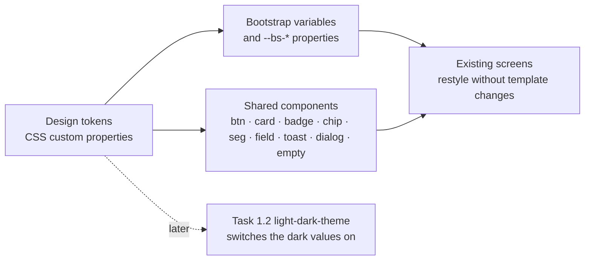

# Proposal

## Why

The app still uses the old "premium" theme: the Outfit font, glass cards that lift on hover, gradient buttons, and Material greens and oranges. The prototype's look replaces it: a warm field palette (leaf, sun, sky, rose on soft green-grey), Bricolage Grotesque and Figtree with Mukta for Marathi and Hindi, flat cards with hairline borders, and soft pill badges. This change is task 1.1 of `prototype-adoption-roadmap`. Every later screen change and the light/dark theme (task 1.2) build on these tokens, so they come first.

Prototype references:
- Design system → Foundations (colour, type, spacing, radius, shadow) and Components (buttons, cards, badges, chips, segmented control, fields, toast, dialog/sheet, empty state): `design/prototype/myfarm-design-system.html`
- Prototype → any screen, for the tokens in use: `design/prototype/myfarm-prototype.html`

## What Changes

- **Tokens:** add one global token layer as CSS custom properties.
  - Colours: bg, surface, surface2, line, fg, muted, and leaf, sun, sky and rose, each with its soft and ink variants.
  - Spacing (4–32 px), radius (8–18 px and pill), shadows, layers and motion duration.
  - The prototype's light values are active. Its dark values are defined but not switched on until task 1.2.
- **Bootstrap mapping:** primary, success, warning, info, danger, body colour and background, border colour, border radius, fonts and base font size now come from the tokens. Bootstrap utilities and components (`btn`, `card`, `badge`, `form-control`, `alert`) pick up the new look without template changes.
- **Typography:**
  - Outfit is removed everywhere (the global styles plus 14 component files).
  - Headings and numbers use Bricolage Grotesque, body text uses Figtree, and Mukta is the Devanagari fallback for Marathi and Hindi text.
  - Fonts load from `index.html` with preconnect, not through a Sass `@import`.
  - The base size is 14 px, as in the prototype.
- **Shared components restyled to the design system:**
  - buttons (default, primary, warning, danger, link)
  - cards: flat with a hairline border, no glass or hover lift
  - soft pill badges in five tones
  - chips with a pressed state
  - segmented control
  - form fields (label, control, hint, error)
  - shared toast (`projects/shared` toast)
  - shared confirm dialog: a centred dialog on desktop, a bottom sheet on phones
  - a reusable empty-state block
- **Every hard-coded colour is removed:** about 250 hex codes, 184 `rgb()`/`rgba()` literals and 21 `white`/`black`, across about 60 files in `projects/home` and `projects/shared`. A colour that stays fixed while the rest of the app switches theme is what breaks dark mode, so this has to happen before task 1.2.
  - Component SCSS and the global partials use `var(--mf-*)`.
  - Inline colour bindings in templates (16 `style=` and 8 `[style.*]`/`[ngStyle]`) become tone classes.
  - TypeScript colour maps (activity types, crop icons, weather severity and advisories, chat cards, workflow cards, loader) return a tone or token name instead of a hex code.
  - Map drawing layers and the weather history chart use token-driven CSS classes.
  - New tokens cover data colours: activity-type tones, a temperature scale, chart series, and map drawing and selection.
- **The legacy Sass colour variables are deleted** (`$farm-*`, `$soil-*`, `$light-mint`, `$border-mint`, `$body-dark-slate`, `$temp-*`, `$farm-humidity`, `$farm-wind`) once nothing uses them, because Sass colours are fixed at build time and cannot follow the theme.
- **A colour guard:** a new `npm run lint:colors` script, run as part of `npm run lint` and CI, fails when a colour literal appears outside the token files.
- **Ships as two PRs:** PR 1 is the tokens, typography and shared components; PR 2 is the colour removal and the guard.

## Capabilities

### New Capabilities

- `design-system`: the shared visual language of the app. It covers the design tokens, typography with Devanagari support, and the look and states of the shared UI components that every screen uses.

### Modified Capabilities

(none)

## Non-goals

- **The theme switch and dark mode on screen.** The dark values are defined here, but switching to them, the Theme setting, and auditing screens in dark are task 1.2 (`light-dark-theme`).
- **Rebuilding any screen's layout or content** (Home, Lands, Crops and the rest). These are Phase 2 and 3 changes.
- **Shell and navigation:** the sidebar, bottom tabs and header are task 1.4.
- **The logo, favicon and PWA icons:** task 1.3.
- **The Warli login art and its Baloo 2 font:** task 2.1.
- **Changing Bootstrap's spacing scale.** The utilities (`p-3`, `gap-2`) keep their current values, and the prototype spacing is available as tokens for custom CSS.

## Impact

- **Styles:**
  - `projects/home/src/styles/_bootstrap-variables.scss` and `_design-system.scss`
  - `projects/home/src/styles/components/*` (buttons, cards, badges, forms, layout, animations)
  - new `_tokens.scss`
  - `projects/home/src/index.html` (font links)
- **Shared library:** the `projects/shared` toast and confirm-dialog styles.
- **Components:** about 60 component, template and TS files lose their colour literals, including the 14 that name Outfit directly.
- **Tooling:** new `scripts/check-colors.mjs` and a `lint:colors` script, chained into `npm run lint`.
- **Visual:** every route changes appearance: font, colour, card style, and the base size going from 16 to 14 px. No routes, data or APIs change.
- **Tests:** unit tests are unaffected. The Playwright golden path asserts text and roles, not pixels, so it should pass unchanged.
