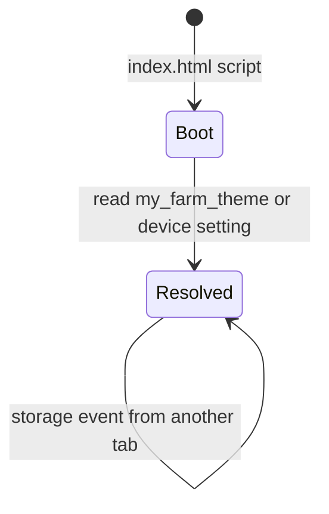

# Design

## Context

- **Tokens are ready.** `_tokens.scss` defines the light palette on `:root` / `[data-bs-theme='light']` and the dark palette on `[data-bs-theme='dark']`. `_bootstrap-bridge.scss` points Bootstrap's `--bs-*` properties at the tokens and maps its fixed-colour utilities (`bg-white`, `text-dark`, …) too. A forced `data-bs-theme="dark"` on `<html>` already renders login, home, crops, activities, weather, profile, reports, map and 404 with no bright patches (verified headless in `design-tokens-foundation`). So the switch is one attribute.
- **No theme code exists.** `index.html` has no theme meta tags. Nothing reads `prefers-color-scheme`.
- **Language is the closest pattern.** `LanguageService` is root-provided, started by `provideLanguageInitializer()` in `app.config.ts`, and uses one gated effect. Language is stored on the account; theme is not.
- **Profile** is a card page with an Account Information card (`profile.component.html`, label/value rows, the language row among them) and an edit dialog. The prototype redesign of Profile is a later task (2.2), so this change adds a row to the existing card.
- **Parts that do not read CSS variables on their own:**
  - the Chart.js weather chart (`history-trend`) resolves tokens once when it is built, through `core/theme/css-token.ts`
  - Leaflet's own stylesheet gives zoom buttons, attribution and popups white backgrounds
  - the browser's own UI: address bar, scrollbars and built-in controls
- **Storage rule.** ROADMAP and CLAUDE say features do not use `localStorage` (domain data goes through the API). Only `AuthService`, `WorkflowStateService` and a cleanup helper touch it today.

## Goals / Non-Goals

**Goals**
- A three-way choice that applies immediately and survives reloads and sign-out.
- No flash of the wrong theme on load.
- Everything that draws colour follows the theme, including the chart, map controls and browser UI.

**Non-Goals**
- Cross-device sync, a header or login toggle, map tile theming, more palettes, and the Profile redesign. See the proposal.

## Decisions

1. **The preference is stored on the device in `localStorage` under `my_farm_theme`.** Values: `system` (also the meaning of a missing key), `light`, `dark`.
   - It has to be readable before the app boots, before any API call, and on the login page, so the account and backend are the wrong place. A farmer may also want a dark phone and a light tablet.
   - This is a deliberate exception to "features do not use `localStorage`": that rule is about domain data. Theme is a device display preference, and the key is documented in `ThemeService`.
   - Alternative: a backend `preferred_theme` field. Rejected for now because it adds an API change and cannot work before sign-in. It can be added later and would simply seed the device value.
2. **`data-bs-theme` on `<html>` is the single switch.**
   - Bootstrap 5.3 already uses this attribute for its own colour modes, and `_tokens.scss` is keyed on it, so no renaming is needed.
   - The attribute always holds the resolved value, `light` or `dark`, never `system`. Same as phone is resolved in code.
3. **A tiny inline script in `index.html` applies the theme before first paint.**
   - It reads `my_farm_theme` in a `try/catch`, falls back to `matchMedia('(prefers-color-scheme: dark)')`, and sets `document.documentElement.dataset.bsTheme`. It also sets the `theme-color` meta.
   - It runs in `<head>`, before the stylesheet, so there is no flash. It contains no colour literals except the two `theme-color` values it picks; those live in the allow-listed `index.html` meta, not in the script.
   - No Content-Security-Policy is set in `index.html` or `render.yaml` today, so an inline script is allowed. If a CSP is added later it needs a hash for this script.
   - Alternative: set the theme only from Angular. Rejected because Angular boots after the first paint, which would flash light on a dark device.
4. **`ThemeService` (root-provided, `core/theme/theme.service.ts`) owns the state after boot.**
   - Signals: `preference` (`'system' | 'light' | 'dark'`), `systemDark` (from `matchMedia`), and `resolved = computed(...)` (`'light' | 'dark'`).
   - `setPreference(value)` writes the signal and `localStorage` (in `try/catch`).
   - **One** effect, with no API calls, writes `data-bs-theme` and the `theme-color` meta from `resolved()`. This matches the repo's rule about effects.
   - A `matchMedia` `change` listener updates `systemDark`; a `storage` event listener updates `preference` so other tabs follow.
   - Started by `provideThemeInitializer()` next to the language initializer, so it runs on every route including login.
   - `theme-color` is set to the resolved `--mf-bg` colour via `cssColor('--mf-bg')`, so it follows the tokens.
5. **The Profile row uses the shared `.seg` segmented control.**
   - A radio-group style control with three buttons (`aria-pressed`), placed in the Account Information card under Language. It applies on click; there is no dialog.
   - Labels are translated: `profile.theme`, `theme.system`, `theme.light`, `theme.dark` in `en`, `hi` and `mr`.
   - Alternative: a select in the existing edit dialog, as in the prototype. Rejected here because the dialog saves to the server, while this setting is local and instant. The Profile redesign (task 2.2) can restyle the row to match the prototype.
6. **The browser is told the theme two ways.**
   - Static `<meta name="color-scheme" content="light dark">` in `index.html`, so default form controls and scrollbars are right before CSS loads.
   - Tokens already set `color-scheme: dark` on the dark block; the light block gets `color-scheme: light`, so a chosen theme that differs from the phone's still styles native controls correctly.
7. **The weather chart redraws on theme change.** Its existing `effect` also reads `themeService.resolved()`, so Chart.js rebuilds with freshly resolved token colours. This adds a dependency to an effect that already exists; no new effect or API call.
8. **Leaflet controls get token overrides in the global styles.**
   - A new `styles/components/_leaflet.scss` sets `.leaflet-bar a`, `.leaflet-bar a:hover`, `.leaflet-control-attribution`, `.leaflet-popup-content-wrapper`, `.leaflet-popup-tip` and `.leaflet-control-layers` to the surface, line and text tokens.
   - Map tiles stay as they are; a dark map style is out of scope.
9. **The legacy storage cleanup must keep the key.** `main.ts` runs `cleanupLegacyLocalStorage()` on every start, which deletes every `my_farm_*` key that is not a session or per-farmer key. Without a change it would erase the saved theme on every load (found by the headless reload check). `my_farm_theme` is added to its kept keys, with a spec.
10. **Tests.** Unit specs: `ThemeService` (default, saved value, system follow, storage failure, cross-tab), Profile row (renders three options, sets preference, reflects selection), `css-token`. A headless run over every listed route in both themes at desktop and phone widths checks no bright patches in dark and no unreadable text, as in the previous change. The guard script already prevents new literal colours.



```mermaid
sequenceDiagram
  participant H as index.html script
  participant D as html[data-bs-theme]
  participant T as ThemeService
  participant P as Profile row
  participant C as Chart / map
  H->>D: set resolved theme (before first paint)
  T->>D: effect keeps attribute and theme-color in sync
  P->>T: setPreference('dark')
  T->>T: save to localStorage
  T->>D: attribute = dark
  D-->>C: tokens change; chart effect re-runs and redraws
```

## Risks / Trade-offs

- **Flash if the inline script is blocked or removed.** Mitigation: `ThemeService` applies the same logic on boot and a spec covers it; a future CSP must allow the script by hash.
- **The choice is per device, not per account.** A farmer using two devices sets it twice. Accepted and noted in the proposal; a later backend field could seed it.
- **Some feature screens may still look off in dark in ways the automated scan cannot see** (for example a coloured gradient that is fine on a light card but harsh on a dark one). Mitigation: the route pass includes screenshots that are looked at, not only scanned, and fixes are limited to unreadable or broken parts.
- **Duplicated resolve logic** between the inline script and `ThemeService`. Accepted: the script must stay tiny and run before the app. Both read the same key and the same media query.
- **Chart redraw cost** when the theme changes: one chart rebuild, only when the weather page is open.

## Open Questions

- None blocking. If farmers ask for it, a header toggle (and a backend field to sync the choice across devices) can be added as a separate change.
