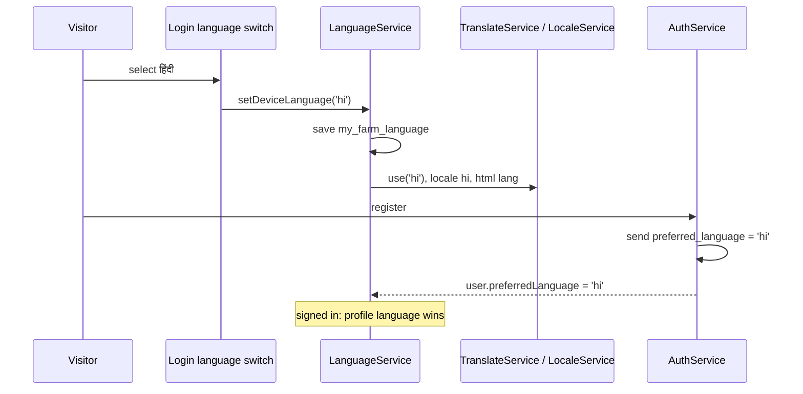

# Design

## Context

- **The plumbing exists.** `@ngx-translate` loads `public/i18n/{en,hi,mr}.json` over HTTP (`provideTranslateService`, `lang: 'en'`, `fallbackLang: 'en'`). All three files already hold the same 497 keys. `SUPPORTED_LANGUAGES` marks `en`, `hi` and `mr` as supported (six more are "coming soon").
- **`LanguageService`** (root-provided, started by `provideLanguageInitializer`) has one effect: when the signed-in farmer has a `preferredLanguage`, call `translate.use(it)`. When nobody is signed in the language stays English. The toolbar dropdown and the profile edit dialog both write `preferredLanguage` through `AuthService.updateProfile`.
- **Where English is fixed:**
  - Templates and components with raw text: `profile-edit-dialog` (37), `reports.component.ts` (28), `weather.component.html` (24), `login` (18), `home` (18), and a handful of others. Roughly 140 strings, found by an audit of text nodes and `placeholder`, `title`, `aria-label` and `alt` attributes. Strings written inside TypeScript (toasts, chart labels, error mapping) are additional and found as part of the work.
  - The registration default: `session-auth.service.ts` sends `preferred_language: req.preferredLanguage ?? 'en'` and maps `f.preferred_language ?? 'en'`; the backend default is `en`.
- **No locale handling.** There is no `LOCALE_ID`, no `registerLocaleData`, and `index.html` has a fixed `lang="en"`. `DatePipe` and `DecimalPipe` therefore always format as English, so a Marathi screen shows "01 Oct 2026". The app uses `date: 'dd MMM yyyy'`, `date: 'dd MMM yyyy HH:mm'`, `date: 'shortDate'`, `number`, `number: '1.4-4'` and `number: '1.0-0'` in about 20 places.
- **Reference data names** (crops, activity types, expense categories, stages, seasons, statuses) are translated through `<category>.<slug>` keys in the same files (`resolveReferenceName`), with a fallback to the stored name for farmer-added entries.
- **Vocabulary drift.** Comparing the 163 prototype terms with the app: 57 overlap, 40 match, 17 differ. The app uses literal or formal words where the prototype uses farmer vocabulary (listed in the glossary below).
- **Fonts:** Mukta is already loaded for Devanagari (tokens change). The e2e tests find controls by English labels and register through the login page.
- **Lesson from the theme change:** the legacy storage cleanup in `main.ts` deletes every unknown `my_farm_*` key on start, so a new device key must be added to its kept list.

## Goals / Non-Goals

**Goals**
- Marathi-first from the first screen, switchable before and after sign-in.
- No English left on a Marathi or Hindi screen (except proper nouns and farmer-entered data).
- Farmer vocabulary, and dates, numbers and money that read naturally.
- A guard that keeps the three files in step.

**Non-Goals**
- More languages, the Warli login layout, translating farmer-entered data, Devanagari digits, assistant replies, backend default changes. See the proposal.

## Decisions

1. **Language precedence: signed-in farmer, then device, then Marathi.** `LanguageService` computes the active language as `currentUser()?.preferredLanguage ?? deviceLanguage ?? 'mr'`. A new device key `my_farm_language` stores the device choice (same approach and reasoning as `my_farm_theme`: it must work before sign-in and before the app boots).
   - Choosing a language in Profile saves the profile (as today) **and** writes the device key, so the login page after sign-out shows the same language.
   - Choosing on the login page writes only the device key (no profile exists yet); registration then sends it as `preferred_language`.
   - Unknown or unsupported stored values fall back to Marathi.
2. **Marathi default in the app, not the backend.** `session-auth.service.ts` sends the active language when registering and falls back to `mr` instead of `en` when mapping a profile with no language. The backend default stays `en`, so API clients and tests are unaffected. Existing farmers keep their saved language.
3. **`app-language-switch`** (a small standalone component, `layout/language-switch/`): a segmented control (`.seg`) of three buttons, `मराठी`, `हिंदी` and `English`, `aria-pressed` for the selected one, each button labelled in its own language. It is placed on the login card now; the Warli login (task 2.1) will place it in the new layout. It calls `LanguageService.setDeviceLanguage()`.
4. **`LocaleService` for formats.** Angular's pipes read the locale from `LOCALE_ID`, which is fixed at start. To change it live without a reload, the app provides `LOCALE_ID` through a factory backed by a signal-based `LocaleService`, and the date and number formatting goes through `LocalizedDatePipe` and `LocalizedNumberPipe` that read the active language (impure-by-signal pipes, `pure: false` with signals). Alternative: reload the page on a language change. Rejected: it is jarring, loses form state, and the spec requires an instant switch.
   - Locales registered: `registerLocaleData` for `mr` and `hi` (from `@angular/common/locales`), and `en-IN` for English so that English also gets Indian grouping (₹1,24,500).
   - Digits stay Western (`0`–`9`): Angular's number formatting uses Latin digits for these locales; a spec locks that in so a CLDR change cannot flip it silently.
   - Existing `| date` and `| number` uses are switched to the localized pipes (about 20 places) with the same format strings.
5. **Hard-coded text moves into the files by key.** A script-assisted pass lists every raw string; each gets a key in the right group (`login.*`, `home.*`, `weather.*`, `reports.*`, `profile.edit.*`, `common.*`) in all three files. Strings in TypeScript use `translate.instant` or the `translate` pipe; chart labels are built from translated keys and rebuilt on language change (like the theme change does for colours).
6. **Glossary.** The prototype's `TR.mr` and `TR.hi` tables are the source of truth for the common words. Where the existing files disagree, the glossary wins. Seed list (Marathi):

   | English | Prototype (use) | Was in the app |
   |---|---|---|
   | Activity / Activities | कामे | क्रियाकलाप, कृती |
   | Log activity | काम नोंदवा | क्रियाकलाप नोंदवा |
   | Harvest | काढणी | कापणी |
   | Rice | भात | तांदूळ |
   | Fertilizer Application | खत देणे | खत वापर |
   | Labour Activity | मजुरीचे काम | मजूर काम |
   | Plot | प्लॉट | भूखंड |
   | Pincode | पिन कोड | पिनकोड |
   | Date performed | केल्याची तारीख | केलेली तारीख |
   | Category | वर्ग | श्रेणी |
   | Notes | नोंदी | टिपा |

   The Hindi equivalents come from the prototype's Hindi table in the same way. Wording changes are listed in the PR for a native-speaker review.
7. **`<html lang>`** is set by `LanguageService` (`document.documentElement.lang`) in the same effect that calls `translate.use`, and `index.html` starts as `lang="mr"`.
8. **Fallback.** `fallbackLang: 'en'` stays. A `MissingTranslationHandler` is not added; the existing `resolveReferenceName` already handles farmer-added names, and the completeness check prevents missing keys.
9. **Completeness check: `scripts/check-translations.mjs`** (`npm run i18n:check`, in `npm run lint`). It flattens the three files and fails on: a key missing in any file; an empty value; a different set of `{{placeholders}}` between languages. It also reports any text node in a template that is not a binding (the same detector used for the audit), as a warning list that must be empty, so new hard-coded text cannot creep back in. Same style as the colour guard.
10. **Keep the device key.** `my_farm_language` is added to the kept keys in `legacy-storage-cleanup.ts`, with a spec.
11. **E2E tests pin English.** Both Playwright specs add an init script that sets `my_farm_language` to `en` before each test, so labels and the registration flow behave as they do today.

## Risks / Trade-offs

- **Translation quality.** I can write natural Marathi and Hindi, but wording for farming terms is a judgment call. Mitigation: the glossary starts from the prototype's reviewed words, and every changed or new term is listed in the PR so you can correct it (a native Marathi speaker should review it). Corrections are one-line edits in the JSON.
- **Large mechanical diff.** About 140 strings across 12 files plus about 20 pipe swaps. Mitigation: the completeness and raw-text checks, and a route-by-route look at Marathi and English screenshots.
- **Text length.** Marathi labels are longer: tab bar labels, buttons and table headers can overflow. Mitigation: a phone-width check in Marathi on every route; fix clipping with wrapping or shorter keys.
- **Locale pipes and zoneless change detection.** Impure pipes must react to the language signal. Mitigation: they read the signal inside `transform`, and a spec switches the language and asserts the output changes.
- **New farmers become Marathi by default.** Anyone testing against the real backend as a new farmer now gets Marathi unless they pick English first. Mitigation: documented; e2e pins English.
- **Chart labels** are created at build time by Chart.js: they need the same rebuild-on-change handling as colours. Covered by reading the language signal in the chart effect.

## Open Questions

- Native-speaker review of the Marathi and Hindi wording (you, as a Marathi speaker, are the best reviewer). The PR lists every changed term.
