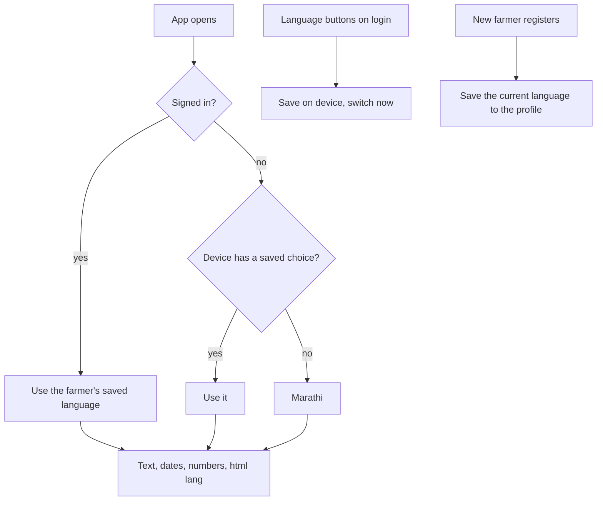

# Proposal

## Why

The app already has Marathi and Hindi translation files, and a farmer can pick a language, but it does not yet work as a Marathi-first app. An audit found:

- about 140 pieces of English text written straight into templates and components (login, Home, Weather, Reports, the profile dialog and more), which stay English when the language is Marathi;
- no locale handling, so dates show English month names, and `<html lang>` always says English;
- the login page has no language choice, and new farmers are registered as English;
- 17 of the 57 terms the prototype and the app share use a bookish Marathi word where the prototype uses what farmers actually say (for example "क्रियाकलाप" for activity where farmers say "कामे", "तांदूळ" (the grain) for the rice crop where they say "भात", "कापणी" for harvest where they say "काढणी").

This change is task 1.5 of `prototype-adoption-roadmap`. It makes the language choice real from the first screen, and makes the text, dates and numbers read naturally to a Marathi-speaking farmer.

Prototype references:
- Prototype → login language buttons (मराठी / हिंदी / English), Profile → Language, and every screen in Marathi and Hindi: `design/prototype/myfarm-prototype.html` (the `TR` tables hold the agreed wording)
- Design system → Language: `design/prototype/myfarm-design-system.html`

## What Changes

- **Marathi is the default** for new farmers and for a device that has not chosen a language. English and Hindi remain available.
- **Choose a language before signing in.** The login page gets a three-button language switch (मराठी / हिंदी / English). The choice is remembered on the device, applied before sign-in, and saved to the farmer's profile when they register. After sign-in the farmer's saved language wins.
- **All visible text is translated.** The roughly 140 hard-coded English strings, plus toasts, chart labels and error messages written in code, move into the translation files in Marathi, Hindi and English.
- **Farmer vocabulary.** The existing Marathi and Hindi wording is aligned with the prototype's glossary where they differ (the 17 terms above and any others the audit finds).
- **Dates, numbers and money follow the language:** Marathi and Hindi month and day names, Indian digit grouping (₹1,24,500), Western digits (0–9) throughout.
- **`<html lang>` follows the language,** so browsers pick the right font shaping, hyphenation and screen-reader voice.
- **Reference data names** (crops, activity types, expense categories, seasons, crop stages) are checked for Marathi and Hindi names, and gaps are filled.
- **An automated translation check** (`npm run i18n:check`, part of `npm run lint`) fails when the three files differ in keys or placeholders, or a value is empty.

## Capabilities

### New Capabilities

- `localization`: supported languages and the Marathi default, how the choice is made, saved and applied (before and after sign-in), full text coverage, farmer vocabulary, locale-aware dates, numbers and money, the document language, and the translation completeness check.

### Modified Capabilities

(none)

## Non-goals

- **Adding more languages** (Punjabi, Telugu, Tamil and the others listed as "coming soon").
- **The Warli login layout** (task 2.1). Only a language switch is added to the existing login card; 2.1 will move it into the new design.
- **Translating farmer-entered data** (their notes, names, farm and land names) or backend error text beyond the messages the app already maps.
- **Devanagari digits.** Digits stay 0–9 in every language, as in the prototype.
- **Voice input and the assistant's replies in Marathi** (separate assistant tasks).
- **Changing the backend's default language** (`preferred_language` stays `en` there; the app sends the chosen language when registering).

## Impact

- **Frontend:**
  - new `LocaleService` and locale registration for `mr`, `hi` and `en-IN`; `LanguageService` extended with the device-saved choice, the Marathi default, `<html lang>` and the locale; a new `app-language-switch` component on the login card.
  - about 12 templates and components lose hard-coded text (`profile-edit-dialog`, `reports`, `weather`, `login`, `home`, `not-found` and more).
  - `public/i18n/en.json`, `hi.json`, `mr.json` grow and some Marathi and Hindi terms change.
  - the legacy storage cleanup keeps the new device language key (it deletes unknown `my_farm_*` keys).
- **Tooling:** `scripts/check-translations.mjs`, `npm run i18n:check`, chained into `npm run lint`.
- **Backend and API:** none.
- **Tests:** specs for the language service, locale formatting, the switch and the check script. The Playwright tests (`golden-path`, `profile-persistence`) find controls by their English labels and register a new farmer through the login page, which would now default to Marathi. They are updated to pin English on the device (`my_farm_language`) before each test, so they keep testing the same flows.
