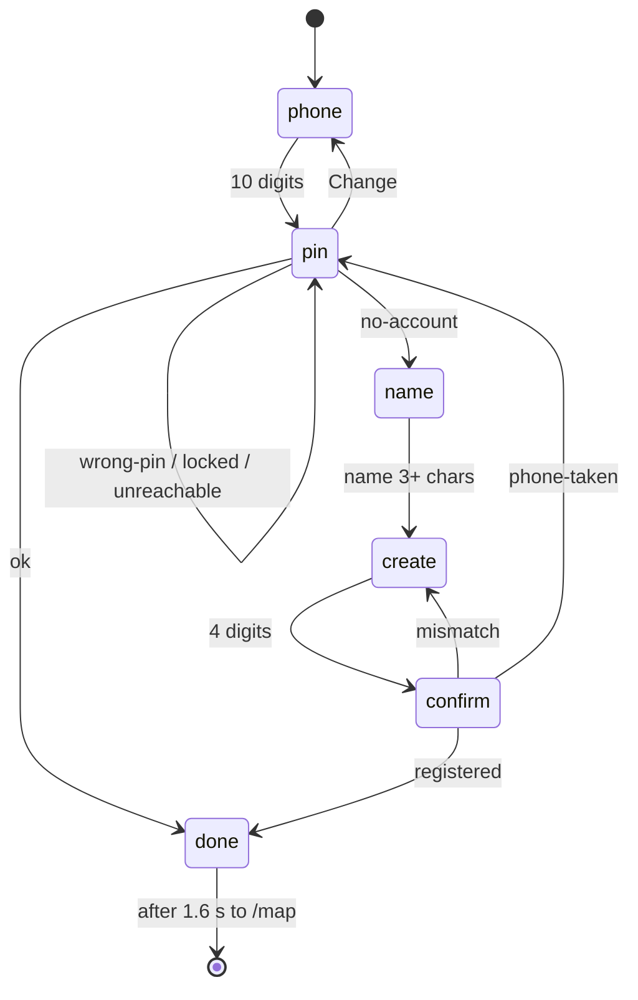

# Design

## Context

- **Prototype:** `login` in `design/prototype/myfarm-prototype.html`, variant B (the Warli one): `loginHtml`, `lgScene`, the `.lg-*` styles and the `LG_T` text for mr, hi and en. Variant A and the prototype's demo hint ("number ending in 0 is new") are not built.
- **Today:** `features/auth/login.component.*` is a glass card with three steps (`phone`, `pin`, `register`) using plain inputs. `SessionAuthService.createSession(phone, pin)` returns `ok | no-account | wrong-pin | locked | unreachable`; `register({phone, fullName, pin, preferredLanguage})` returns `ok | phone-taken | unreachable`. The backend accepts 4 to 6 digit PINs and names of 3 or more characters.
- The flow already matches the prototype's order (number, PIN, then name and new PIN only when the server says `no-account`), so no service or backend change is needed.

## Goals / Non-Goals

**Goals:** match the prototype's look and step flow; keep every behaviour of today's login (online-only, lockout, taken number); reach the keyboard and screen-reader bar in the spec.

**Non-Goals:** see the proposal.

## Decisions

1. **Same state machine, new steps.** `LoginStep` becomes `phone | pin | name | create | confirm | done`. `isNew` is set when `createSession` returns `no-account`; the typed PIN is discarded, as in the prototype. Alternative: ask the server whether the number exists before the PIN. Rejected: it needs a new endpoint and would leak which numbers are registered.
2. **Four small components, one screen.**
   - `LoginComponent`: state and service calls only (signals; `OnPush`).
   - `WarliSceneComponent`: the SVG village. A static template, with `currentColor` and CSS variables so it follows the theme; `aria-hidden`.
   - `NumberPadComponent`: the 12 keys. Inputs: `busy`, `showDevanagari`; output: `key` (`'0'-'9' | 'del' | 'ok'`). Logic for keyboard events stays in `LoginComponent` via one `keydown` listener on the screen.
   - `PinBoxesComponent` and the phone slots are plain template blocks inside `LoginComponent` (they have no logic of their own).
3. **PIN length.** New PINs are exactly 4 digits (prototype). Sign-in accepts 4 to 6, because existing accounts may have longer PINs; the boxes show 4 and add up to 2 more as digits are typed. The old 4 to 6 rule for new PINs is dropped on purpose; the backend is unchanged.
4. **Show-then-mask.** The last digit is revealed for 900 ms using a `setTimeout` held in the component and cleared on destroy and on the next key. Show PIN keeps all digits visible.
5. **Bootstrap first.** Layout uses `row`/`d-flex`/utilities, the primary button is `btn btn-success`, the error is an `alert alert-danger`, the hint an `alert alert-warning`, language switch is the existing `app-language-switch`. Custom CSS in `login.component.scss` is limited to the Warli hero (mud background texture, rice trim, scene animation), the digit slots and the pad key style (the "pressable" 3 px shadow). All colours come from tokens: the mud and rice colours become two new tokens in the dark and light palettes (`--mf-warli-mud`, `--mf-warli-rice`) so the colour lint stays clean.
6. **Typography.** The prototype uses Baloo 2 for this screen only. We use the design-system fonts (Bricolage Grotesque for headings and digits, Mukta for Devanagari) and do not add a font, to keep the page light on rural connections.
7. **Motion.** Step titles rise in, the wrong input shakes once, the done tick pops. All three are disabled under `prefers-reduced-motion`. The hero sun and walkers stay static (no looping animation) to keep CPU use low on cheap phones.
8. **Language.** The language switch component and rules are untouched. New keys go under `login.*` in all three files; `npm run i18n:check` enforces parity. The prototype's Marathi and Hindi wording is used as written.
9. **Redirect.** Welcome screen shows for 1.6 s, then navigates to `/map` as today. A signed-in visitor is still redirected away from `/login` at once.

## Risks / Trade-offs

- The scene is a large inline SVG (about 4 KB of markup). Kept in its own lazily loaded route chunk with the login page, so it does not affect other screens.
- Dropping the 6-digit option for new PINs makes new PINs slightly weaker. Accepted because the prototype specifies 4 and the number pad is 4 boxes; lockout on the server limits guessing.
- Playwright specs type into inputs today. They will click pad keys instead; a stable `data-testid` per key (`key-1` … `key-ok`) keeps them readable.
