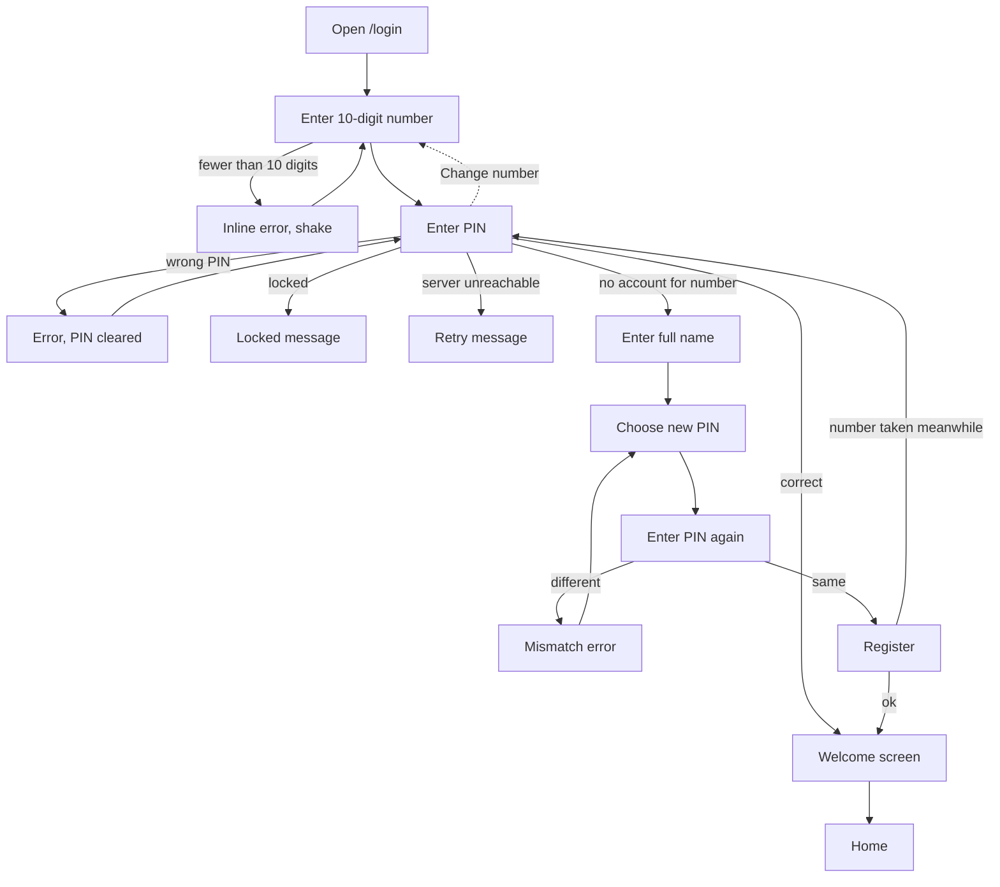

# Proposal: Warli login and registration

## Why

The sign-in screen is the first thing a farmer sees. Today it is a generic card on a gradient with a house icon, and registration is a plain three-field form. The approved prototype greets the farmer in their own language over a Warli village scene and walks them through one small step at a time on a big number pad. This is Phase 1 task 2.1 of `prototype-adoption-roadmap`.

## What Changes

- Replace the login screen with the prototype's two-part layout: a Warli mud-red hero (greeting "राम राम मंडळी 🙏", tagline, feature chips on desktop, village scene) beside the sign-in card. On a phone the hero shrinks to a short band above the card.
- Sign-in becomes a stepper with an on-screen number pad: phone number, then PIN. A number the backend does not know continues to name, new PIN and confirm PIN, then registers.
- Show the number as 10 digit slots (`+91`, grouped 5 + 5), the PIN as 4 boxes with a Show/Hide PIN toggle, a progress indicator, inline errors with a shake, a busy spinner on the confirm key, and a short "Welcome, <first name>!" screen before Home.
- Keep the physical keyboard working: digits, Backspace and Enter drive the same steps.
- Keep the language switch (already built in `marathi-language-switching`) in the hero bar on a phone and the panel top on desktop.
- All new text is translated in `mr`, `hi` and `en` with the prototype's wording.
- Remove the old "back to landing" house button and the glass-card background blobs.
- No backend change: the existing session and register calls are reused unchanged.

Prototype screen: `login` in `design/prototype/myfarm-prototype.html` (variant B, the Warli one; `lgScene`, `LG_T`, `loginHtml`). Design-system components used: segmented control (language), buttons, fields, banners (error and hint), step dots.

## Capabilities

### New Capabilities
- `farmer-sign-in`: how a farmer signs in or creates an account with a phone number and PIN: the steps, number pad, validation, errors, welcome screen and the Warli presentation.

### Modified Capabilities
<!-- None. The language switch rules stay in `localization`; the backend contract does not change. -->

## Non-goals

- Backend or API changes: PIN rules, lockout, sessions and registration endpoints stay as they are.
- OTP, password reset or "forgot PIN".
- Collecting farm details at registration (profile, land and crop setup belong to `profile-settings` and later tasks).
- A second Warli variant (the prototype's variant A) or the prototype's demo hints.
- The public landing page; the login screen no longer links back to it.
- Changing the language rules or the language switch component itself.

## Impact

- `projects/home/src/app/features/auth/login.component.{ts,html,scss}`: rewritten; new small presentational components for the Warli scene and the number pad.
- `projects/home/public/i18n/{mr,hi,en}.json`: `login.*` keys replaced and extended.
- `e2e/golden-path.spec.ts`, `e2e/profile-persistence.spec.ts` and the login unit specs: sign-in steps now use the number pad.
- No new dependencies. No data or API changes.
