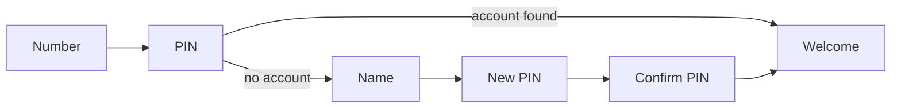

# Spec Delta

## Purpose

A farmer signs in, or creates an account, with a mobile number and a PIN on one friendly screen: a Warli village scene greets them in their language, and a big number pad walks them through one small step at a time.

## ADDED Requirements

### Requirement: The sign-in screen shows the Warli welcome
The sign-in screen SHALL show a Warli village hero with the app name and the greeting "राम राम मंडळी 🙏" (Hindi "राम राम जी 🙏", English "Namaste, friends 🙏") with a one-line tagline, beside the sign-in card. On a wide screen the hero SHALL also list four feature chips (field map, work diary, expenses, weather) and the language switch SHALL sit above the card. On a phone the hero SHALL be a short band above the card with the language switch in its top bar. The hero art SHALL follow the light and dark themes and SHALL be hidden from screen readers.

#### Scenario: First visit on a phone
- **WHEN** someone opens the app for the first time on a phone
- **THEN** they see the Warli band with "राम राम मंडळी 🙏" and the number step with the number pad visible without scrolling

#### Scenario: Wide screen
- **WHEN** the screen is 992 px wide or more
- **THEN** the hero fills the left side with the feature chips and the card is on the right

#### Scenario: Dark theme
- **WHEN** the theme is Dark
- **THEN** the hero uses the darker mud and rice colours and all text stays readable

### Requirement: Sign-in runs in small steps
Signing in SHALL be a sequence of steps, each with one title, one hint and one input: mobile number, then PIN. A number the server does not know SHALL continue with full name, a new PIN and a repeat of the new PIN, and then create the account. A progress indicator SHALL show the position in the sequence. A "Change" link on the PIN step SHALL return to the number step and clear the PIN.

#### Scenario: Existing farmer
- **WHEN** a farmer enters a registered number and the correct PIN
- **THEN** they see "स्वागत आहे, <first name>!" for about a second and a half and then arrive on the map home

#### Scenario: New farmer
- **WHEN** a farmer enters a number the server does not know and any valid PIN
- **THEN** the screen asks for their full name, then for a new PIN, then for the PIN again, and creates the account in the language currently chosen

#### Scenario: Changing the number
- **WHEN** a farmer taps "Change" on the PIN step
- **THEN** the number step opens with the number kept and the PIN cleared

#### Scenario: Number taken while registering
- **WHEN** the server reports the number is already registered at the final step
- **THEN** the PIN step is shown again with a message that the number already has an account

### Requirement: Numbers and PINs are entered on a number pad
The number and PIN steps SHALL show a 3 by 4 pad (1 to 9, delete, 0, next). The pad SHALL also work with the keyboard: digits type, Backspace deletes and Enter goes next. The mobile number SHALL be shown as 10 digit slots after "+91", grouped 5 and 5. Only digits SHALL be accepted, up to 10 for the number and 4 for a new PIN; for signing in, the PIN SHALL accept 4 to 6 digits so existing accounts keep working. PIN digits SHALL be masked, the last typed digit SHALL show for a moment, and a Show PIN / Hide PIN toggle SHALL reveal them. In Marathi and Hindi each key SHALL also show its Devanagari numeral beneath the digit.

#### Scenario: Typing a number
- **WHEN** a farmer taps 9, 8, 2, 2 on the pad
- **THEN** four slots fill and the next empty slot shows the cursor

#### Scenario: Keyboard
- **WHEN** a farmer on a laptop types 10 digits and presses Enter
- **THEN** the screen moves to the PIN step as if Next had been tapped

#### Scenario: Masked PIN
- **WHEN** a farmer types a PIN digit
- **THEN** the digit shows for about a second and then becomes a dot, unless Show PIN is on

#### Scenario: Older longer PIN
- **WHEN** a farmer whose PIN has 6 digits signs in
- **THEN** the PIN boxes grow to 6 as they type and sign-in succeeds

#### Scenario: Non-digit input
- **WHEN** a farmer pastes "98-22 abc"
- **THEN** only the digits are kept

### Requirement: Mistakes are explained next to the input
Each step SHALL validate before going on and SHALL show a short translated message in an alert banner, with the offending input shaking once: a number with fewer than 10 digits, a PIN shorter than 4, a name shorter than 3 characters, and new PINs that do not match. A wrong PIN SHALL clear the PIN and say so. A locked account and an unreachable server SHALL each show their own message. Typing again SHALL clear the message. A new farmer SHALL never be created while the server cannot be reached.

#### Scenario: Short number
- **WHEN** a farmer taps Next with 7 digits entered
- **THEN** "कृपया 10 अंकी नंबर टाका" appears in the alert banner and the number slots shake

#### Scenario: Wrong PIN
- **WHEN** a farmer enters a wrong PIN
- **THEN** the PIN is cleared, "चुकीचा PIN. पुन्हा प्रयत्न करा." is shown, and they can try again

#### Scenario: PINs do not match
- **WHEN** the repeated PIN differs from the new PIN
- **THEN** both are cleared, the screen returns to "Choose a new PIN" and a mismatch message is shown

#### Scenario: Server unreachable
- **WHEN** the server cannot be reached at the PIN or final step
- **THEN** a retry message is shown and no account is created or signed in

### Requirement: The screen is accessible and reassuring
Every step SHALL be usable by keyboard and screen reader: the step title is a heading, the number and PIN fields announce their label and how many digits are entered, keys have accessible names ("Delete", "Next"), errors are announced, and focus moves to the name field on the name step. While a request is running the pad SHALL be disabled and the Next key SHALL show a spinner. A line "तुमची माहिती सुरक्षित आहे" ("Your information is safe with us") SHALL appear under the card.

#### Scenario: Screen reader announcement
- **WHEN** a wrong PIN is rejected
- **THEN** the error banner is announced without moving focus away from the PIN

#### Scenario: Busy
- **WHEN** a farmer taps Next and the server is still answering
- **THEN** the number pad is disabled and Next shows a spinner until the answer arrives

#### Scenario: Name step focus
- **WHEN** the name step opens
- **THEN** the full name field has focus
