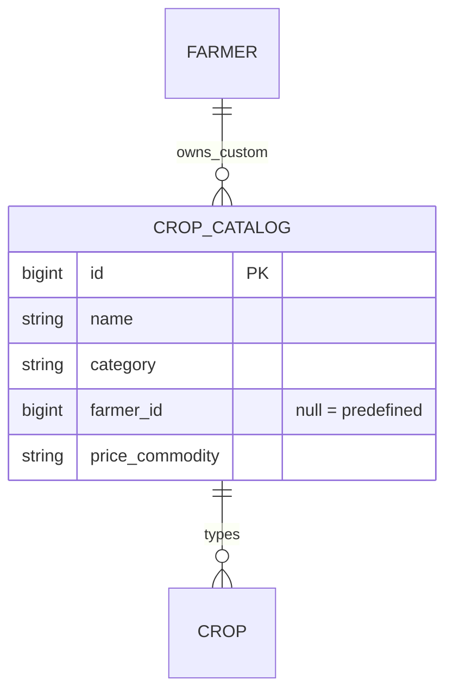

# Design

## Context

`crop_catalog` is a global table with a unique `name`, seeded by an admin endpoint with nine broad crops (Soybeans, Wheat, Rice, Corn, Cotton, Sugarcane, Mustard, Vegetables, Fruits). `POST /api/v1/reference/crops` creates or returns a row by name for anyone, so a typed name becomes a shared catalog entry. In Add crop, the Crop name box (`lib-combobox`) is fed from the farmer's own crops, never from the catalog. Crops reference the catalog by id (`crop.crop_catalog_id`, `farm_crop`), and names are translated through `crop.<slug>` keys with a raw-name fallback (`resolveReferenceName`). See proposal.md for scope.

## Goals / Non-Goals

**Goals:**
- A complete common-crop list on day one, grouped and in three languages.
- Custom crops that stay private to their farmer.
- No change to ids that existing crops point at.

**Non-Goals:**
- Management of custom crops, promotion of popular ones, varieties, icons.

## Decisions

1. **One table, with an owner and a group.** Add `category` (cereal, pulse, oilseed, cash, vegetable, fruit, other) and a nullable `farmer_id` to `crop_catalog`. `farmer_id` null means predefined. Alternative: a separate `custom_crop` table; rejected because crops, `farm_crop` and the price mapping already point at `crop_catalog.id`, and one table keeps every foreign key as it is.
2. **Uniqueness moves to partial indexes.** The global unique `name` constraint is dropped and replaced by a unique index on `lower(name)` where `farmer_id` is null, and a unique index on `(farmer_id, lower(name))` where `farmer_id` is not null. Two farmers can then each have "Dragon fruit". The create endpoint checks the predefined list first (any case), then the farmer's own, then inserts.
3. **The list endpoint becomes per farmer.** `GET /api/v1/reference/crops` returns the predefined crops plus the signed-in farmer's custom ones, each with `id`, `name`, `category` and `custom`. Without a token it returns the predefined ones only, so nothing that loads reference data early breaks. `POST` creates or returns as in the spec, owned by the caller. Names are trimmed and limited to 100 characters.
4. **One seed list, applied by migration.** Migration `0010` inserts the predefined crops (idempotent, by name), sets their category and feed commodity, renames Corn to Maize and Soybeans to Soybean, and tidies earlier typed names. The same list lives in a backend module that the admin reference-seed endpoint also uses, so a fresh database and a migrated one agree. Alembic migrations do not import app code, so the migration carries its own copy of the list.
5. **Tidying earlier typed names** (in the migration): a catalog row outside the predefined list that crops of exactly one farmer use becomes that farmer's custom crop; a row used by crops of several farmers stays shared (listed for everyone) so no crop changes meaning; a row that nothing uses is deleted. The shared case is rare and listed in Risks.
6. **Predefined list** (English names; the group is the `category`):

   | Group | Crops |
   |---|---|
   | Cereals | Wheat, Rice, Maize, Jowar, Bajra |
   | Pulses | Tur, Gram, Moong, Urad |
   | Oilseeds | Soybean, Groundnut, Sunflower, Mustard, Sesame |
   | Cash crops | Cotton, Sugarcane, Turmeric |
   | Vegetables | Onion, Tomato, Potato, Brinjal, Cabbage, Cauliflower, Okra, Green chilli, Garlic, Ginger, Capsicum |
   | Fruits | Grapes, Pomegranate, Banana, Mango, Orange, Sweet lime, Papaya, Guava, Watermelon |
   | Other | Vegetables, Fruits (the two broad entries kept for existing crops) |

   Feed commodity names (`price_commodity`) are set where the crop has a mandi price. Agmarknet spells many of them with brackets (for example "Bajra(Pearl Millet/Cumbu)"), so they are set from the feed's own names when first confirmed; a wrong spelling only means "No price", and the ingest already reports commodities that matched no rows.
7. **Names in three languages.** `crop.<slug>` keys for every predefined crop are added to `en`, `hi` and `mr`. Marathi and Hindi names use the everyday farmer words (for example कांदा, डाळिंब, तूर). The user reviews the translations before the PR is merged.
8. **The picker is a new presentational component** (`CropPickerComponent`, in `features/crop-timeline/add-crop/`): an input with a dropdown list grouped by category, filtered as the farmer types, matching the displayed name and the English name. The last row is "Add new crop <text>" when the text matches nothing exactly. It follows the ARIA combobox and listbox pattern: arrow keys, Enter, Escape, `aria-activedescendant`, and an announced result count. It takes its groups as an input and reports a chosen name or a new name as outputs; it injects no service. Add crop keeps its form control holding the crop name, so crops, mappers and the rest of the app are unchanged.
9. **Resolving the id.** `ReferenceDataService.cropCatalogIdForName` looks the name up (case-insensitive) in the farmer's list and falls back to `POST`, as today; since the list is now the farmer's own, the lookup finds predefined and custom crops. Bootstrap utilities style the picker; custom CSS is limited to the dropdown's positioning.

## Risks / Trade-offs

- **A destructive tidy.** Deleting unused earlier names and moving single-user names is irreversible. The migration only deletes rows with no references, and the downgrade does not bring them back. Take a Neon snapshot before deploying.
- **Shared earlier names stay shared** when several farmers use one. Accepted; they behave as before.
- **Renaming Corn and Soybeans** changes what existing users see. It is intended (Maize and Soybean are what farmers say) and keeps ids, so nothing else changes.
- **Translations by me, not a native review.** The Marathi and Hindi names are reviewed by the user before merge.
- **A long dropdown on a phone.** Groups with a search box keep it short; the picker is checked at 360 px.
