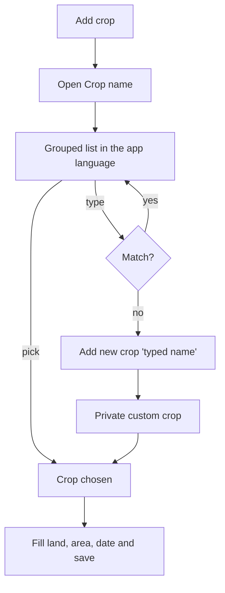

## Why

A new farmer opens Add crop and the Crop name box is empty. It only suggests names of crops the farmer already has, and the nine broad crops in the catalog are never shown. A name the farmer types is saved into one catalog shared by every farmer, so one person's typo or odd spelling appears for all. Farmers should pick from a ready list of the crops most grown in Maharashtra, in their own language, and add their own crop only when it is missing. The Prices screens (`market-prices`) also need real crops such as Onion and Tomato to link to mandi prices.

## What Changes

- **A predefined crop list** of about 45 common crops, in groups: Cereals, Pulses, Oilseeds, Cash crops, Vegetables, Fruits and Other. Names show in Marathi, Hindi or English to match the app language.
- **Add crop picks from the list.** The Crop name field becomes a grouped, searchable list. Search matches the name in the farmer's language and in English. When nothing matches, the list ends with "Add new crop" and the typed name.
- **Custom crops are private.** A crop a farmer adds is visible only to that farmer, so typos and odd names never reach other farmers' lists. A name that matches a predefined crop (any case) selects that crop instead of creating a copy.
- **Existing catalog tidied.** Corn becomes Maize and Soybeans becomes Soybean, so there are no duplicates with the new list; ids are kept, so existing crops keep working. Crops other farmers typed in earlier are made private to the one farmer who uses them, or removed when unused.
- **Price commodity** is set for the predefined crops that have a mandi price, so Prices can show them.

Prototype screens: `addcrop` (Crop name) in `design/prototype/myfarm-prototype.html`.

## Capabilities

### New Capabilities
- `crop-catalog`: the predefined crop list, private custom crops, and how crop names are listed and matched.

### Modified Capabilities
- `crops-screen`: the Crop name field of Add or edit a crop picks from the list.

## Impact

- Backend: `crop_catalog` gains a group and an owner; migration `0010` (seed, tidy, ownership); `GET` and `POST /api/v1/reference/crops` become per-farmer; the reference seed uses the same list; tests, `openapi.json`.
- Frontend: a grouped, searchable crop picker used by Add crop, the reference-data service, about 45 crop names in mr, hi and en, specs.
- Fits with `market-price-data` (price commodities) and unblocks `market-prices`.

## Non-goals

- Crop varieties, crop images or icons per crop, or crop growing guides.
- Letting farmers rename or delete their custom crops in a management screen; they can pick or add only.
- Reviewing or promoting custom crops into the predefined list.
- Changing how a farmer's own crops (plantings) are listed, edited or deleted.

## User journey

