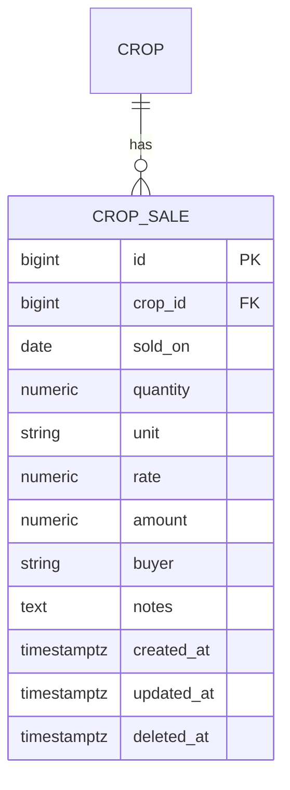

# Design

## Context

Expenses hang off an `activity`; there is no income concept. The prototype stores sales as `{cropId, date, qty, unit, rate, amount, buyer, notes}` and computes profit on the crop page as sales minus the crop's `cost`. The backend is tenant-scoped through `TenantScopedBase`, with RLS unavailable on Neon, so isolation relies on the base repository and a per-endpoint cross-tenant 404 test. Frontend writes are online-only through `IStorageService`. See proposal.md for why.

## Goals / Non-Goals

**Goals:**
- One `crop_sale` record per sale, owned through the crop.
- Profit figures computed in one pure helper, reused later by reports.

**Non-Goals:**
- Aggregate endpoints or reports (4.6), harvest records, inventory.

## Decisions

1. **New table, not an activity of type Sale.** The prototype's activity types include `Sale`, but an activity carries status, cost lines and history that a sale does not need, and mixing income into activities would distort the season expense totals. A flat `crop_sale` table keeps expenses and income apart. Alternative: reuse Activity with a Sale type and an amount; rejected for the reasons above.

2. **Tenant scope through the crop.** `crop_sale` stores `crop_id` only. Endpoints are `GET/POST /crops/{crop_id}/sales` and `PATCH/DELETE /crops/{crop_id}/sales/{id}`; each resolves the crop through the tenant-scoped repository first, so a foreign crop returns 404. Soft delete with `deleted_at`, as `activity_expense` does.
3. **Amounts are stored, not derived.** `amount` is saved as entered (the farmer may override quantity x rate), matching the form and the expense model.
4. **Profit is computed on the client** from the crop's sales and its expense total, in a pure function (`sales-summary.ts`), so reports can reuse it. Profit per acre uses the crop's area and is hidden when there is none.
5. **Form and storage.** A routed page like the expense form, reachable from the crop page. A `CropSalesService` (list, add, update, remove) over the HTTP service, with types generated from the new OpenAPI schema. The app no longer has an `IStorageService`; each feature calls the backend through its own service.
6. **Reuse.** The amount auto-calculation and quantity/unit input follow the expense form's pattern; reuse its helper if it can be extracted, and the shared confirm dialog for delete.

## Risks / Trade-offs

- Adds a migration and API surface in the same PR as the UI. If the PR grows too large it can split into backend then frontend, with the roadmap task ticked after the second.
- Without a Harvest link, a sale and a harvest of the same crop are unrelated records; accepted until a later change needs the link.
- Profit uses all-time crop expenses; a crop is single-season, which matches the prototype.
