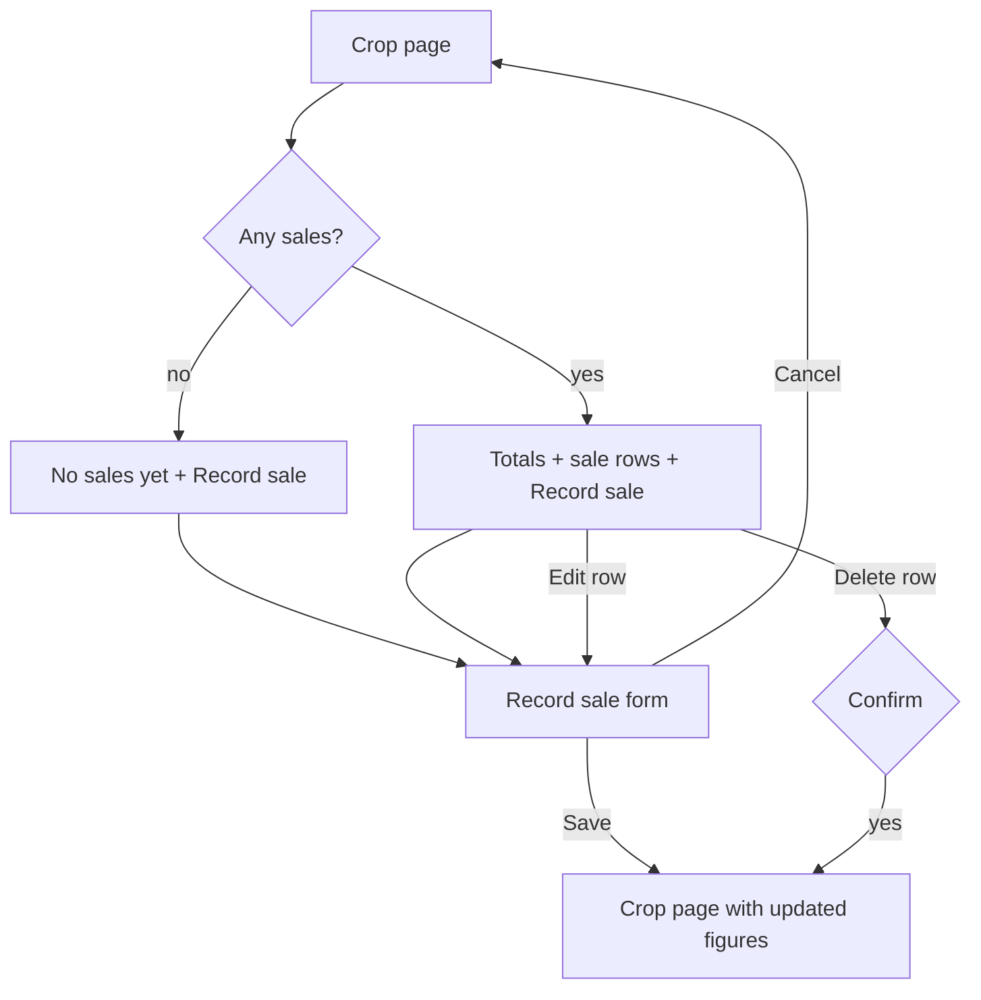

## Why

A farmer can log what a crop cost but not what it earned, so MyFarm cannot say whether a crop made money. The prototype closes this with "Record sale" and a Sales card on the crop page that shows total sales, profit and profit per acre. Roadmap task 4.1.

## What Changes

- **Record sale form** (route from the crop page): Crop (shown, locked), Date sold, Quantity with a Unit, Rate per unit, Amount, Buyer and Notes. Date, Quantity, Unit, Rate and Amount are required. Amount is worked out from quantity and rate and can be typed over. Units suggested: crates, kg, quintal, bags, tonnes.
- **Sales card on the crop page:** with no sales, an empty state "No sales yet" and a "Record sale" button. With sales, three figures (Total sales, Profit, Profit per acre) and one row per sale (date chip, "12 crates at ₹1,250", buyer, amount), newest first, and a "+ Record sale" button. Profit is sales minus the crop's expenses; profit per acre divides by the crop's area. Profit shows green when positive and red when negative.
- **Edit and delete a sale** from its row (delete asks to confirm).
- **Harvest stays an activity.** The existing Harvest activity type already records the harvest; this change adds no separate harvest record.
- **Backend:** a new `crop_sale` table, tenant-scoped CRUD endpoints under a crop, and the OpenAPI contract regenerated.

Prototype screens: `addsale` and `cropdetail` (Sales card) in `design/prototype/myfarm-prototype.html`.

## Capabilities

### New Capabilities
- `crop-sales`: recording, listing, editing and deleting sales of a crop, and the profit figures on the crop page.

### Modified Capabilities
- none

## Impact

- Backend: new model and Alembic migration `0008`, schema, repository, router `crops/{id}/sales`, tenant-isolation tests, `openapi.json`.
- Frontend: storage seam (`IStorageService` and `ApiStorageService`), a sale form page and route, the Sales card in the crop detail, i18n keys (mr, hi, en), specs.
- No change to the Harvest activity type or to expenses.

## Non-goals

- Income roll-ups across crops, season comparison and CSV export belong to `reports-redesign` (4.6), which will read the sales added here.
- Linking a sale to a Harvest activity, stock or inventory tracking, payment status.
- Price suggestions from mandi data (`market-prices`, 4.2).

## User journey

