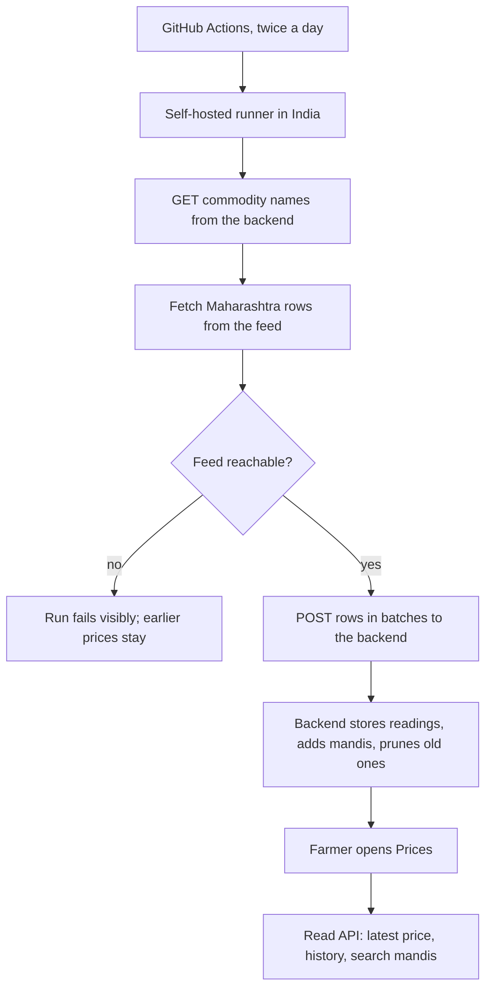

## Why

The Prices screens (roadmap 4.2) need real mandi prices and a history to chart, and nothing in MyFarm holds either. Mandi prices are published once a day, so a history exists only if we store each day's reading ourselves. This change builds that data layer first, so history is already building while the screens (`market-prices`) are made. History starts from the first day the job runs; nothing is backfilled.

## What Changes

- **Price source:** a daily pull of mandi prices (minimum, maximum and modal, in rupees per quintal, per market, commodity, variety and grade) from the government open-data mandi feed, limited to Maharashtra and to the commodities MyFarm's crops map to. The feed's contract is recorded in the design. **The feed refuses connections from outside India** (Render in Singapore and GitHub's US runners are both refused; India works), so the fetch runs from an Indian IP and the backend only stores what it is sent.
- **Tables:** `mandi` (state, district, name), `price_reading` (one row per mandi, commodity, variety, grade and day, with min, max and modal), `farmer_mandi` (the mandis a farmer follows), and a `price_commodity` name on `crop_catalog` so a crop maps to a feed commodity.
- **Mandis come from the feed.** There is no hand-seeded list: a mandi is added when the feed first reports it, and the farmer finds theirs by searching name or district.
- **Price intake:** an admin-protected endpoint accepts batches of price rows and stores them. It ignores other states and unmapped commodities, skips bad rows, is safe to send twice, and prunes readings older than 400 days. A second admin endpoint lists the commodity names to fetch.
- **A small fetcher that runs in India** (a Node script) reads those names, pages through the feed with the free key, and posts the rows to the backend. The backend no longer calls the feed.
- **Trigger:** a scheduled GitHub Actions workflow, twice a day, on a **self-hosted runner in India** (to start, your own PC; later, a small server in India). It is idempotent, so a repeat or a late run is harmless. The runner is for scheduled and manual runs only, never pull requests.
- **Read API** (signed-in farmers): search mandis, read and set the farmer's chosen mandis (one to five), the latest price for the farmer's crops at those mandis, and a price history for one commodity at one mandi over 7, 30 or 365 days.
- **Default mandis:** a farmer with none chosen sees up to three mandis in their district that trade their crops. With no district saved, none are chosen until they pick.
- **No distance.** The feed has no coordinates, so there are no "km away" figures; mandis show their district instead.

Prototype screens this feeds: `prices`, `pricedetail`, `apmcs` in `design/prototype/myfarm-prototype.html`. No UI is added here.

## Capabilities

### New Capabilities
- `market-price-data`: mandis, daily price readings, price history and the farmer's chosen mandis, served through the API.

### Modified Capabilities
- none

## Impact

- Backend: models and migration `0009`, a seed of commodity names on `crop_catalog`, repositories, an ingest service, an admin endpoint, farmer endpoints, tests, `openapi.json`.
- CI: `.github/workflows/price-ingest.yml` runs on a self-hosted runner labelled `india`; it needs the secrets `PRICE_INGEST_ADMIN_TOKEN` and `MANDI_API_KEY`.
- Config: the data-feed key becomes a GitHub secret (`MANDI_API_KEY`) used by the fetcher, and is no longer needed on Render.
- Frontend: only the regenerated API types.
- Cost: inside the free tiers. About a thousand rows a day is roughly 40 to 80 MB a year with indexes in Neon (0.5 GB free), capped by the 400-day retention.

## Non-goals

- Any screen, banner or chart (`market-prices`).
- Price alerts and watchlists (4.3).
- Backfilling history, intraday prices, or prices outside Maharashtra.
- Distance to a mandi.
- A paid price API or an always-on server in India; both are possible later without changing the backend, since only the fetcher moves.

## Data flow

