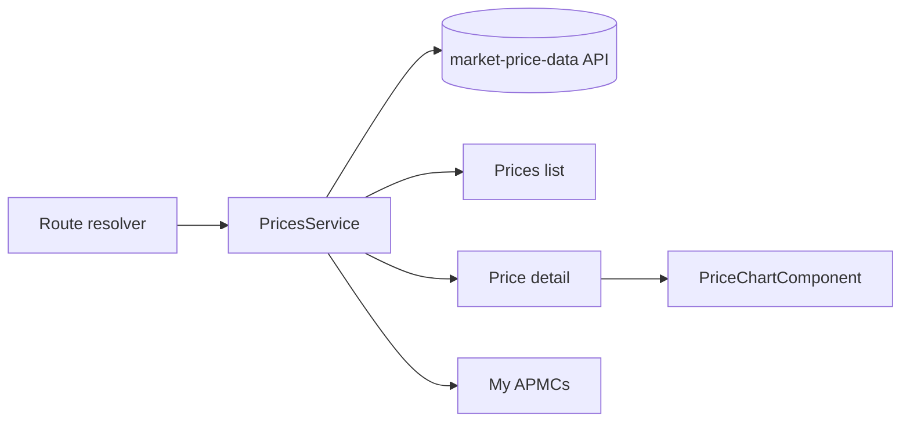

# Design

## Context

This change builds the screens on top of the read API from `market-price-data` (district list, mandi finder, the farmer's chosen mandis, latest prices, price history). Frontend writes and reads are online-only through the HTTP service; there is no `IStorageService` any more, so each feature has its own service. The weather page already draws a themed Chart.js line chart (`history-trend`), and the shell takes its sections from `NAV_ITEMS` and `data.section` on routes. See proposal.md for scope.

## Goals / Non-Goals

**Goals:**
- Three pages (Prices, Price detail, My APMCs) in the prototype's look, in all three languages.
- One chart component that handles one to four lines in both themes.
- Real data only: no sample prices in the app.

**Non-Goals:**
- Alerts, watchlists (4.3), intraday data, distance.

## Decisions

1. **Routes under one lazy `prices` section.** `/prices` (list), `/prices/mandis` (My APMCs, parent `/prices`), `/prices/:cropId` (detail, parent `/prices`, with `?mandi=<id>` and `?period=7|30|365`). Each sets `data.section: 'prices'` so the sidebar and tab stay highlighted, and a `title` key. Page data arrives from functional resolvers that call the prices service, as the repo's data-loading rule asks, not from `ngOnInit`.
2. **Nav change.** Add `{ key: 'prices', icon: 'bi-currency-rupee', link: '/prices', phoneTab: true }` to `NAV_ITEMS` after Reports, before Weather. The phone bar goes from five to six tabs, as in the prototype; the tab bar's width is checked at 360 px with Marathi labels, and the label may need a shorter key.
3. **One `PricesService`** (`providedIn: 'root'`, over `HttpService`) with `latest()`, `history(mandiId, commodity, days)`, `chosenMandis()`, `saveMandis(ids)`, `districts()` and `findMandis(filters)`. Types come from the generated contracts. Signals hold the loaded lists for the page; no `effect()` fires requests.
4. **One row per crop type.** The read API returns one entry per planting (`crop_id`), so two onion plantings arrive as two identical entries. The Prices page groups them by `crop_catalog_id` before drawing. Crop names use the existing `crop.<slug>` names, so rows read in the app's language.
5. **District names come from the finder.** The default mandis use the farm's saved district as text, which may not match the feed's spelling. My APMCs therefore fills its District filter from `GET /mandis/districts` (the feed's own names), so a farmer whose default list is empty can still pick the right district in two taps.
6. **Derived values are pure functions** in `prices.utils.ts`: best price among mandis, percentage change, the average-badge rule (more than 3% under or over the 30-day average), and the period figures. They are unit-tested without the DOM.
7. **Chart.** A `PriceChartComponent` reuses the `history-trend` approach (Chart.js, `cssColor` tokens, rebuilds on theme change). Inputs are the series (name, points, colour index) and the period. The main line is solid; comparison lines are dashed and use colour tokens that also differ in lightness. It sets an accessible label with the first and last prices, and a visually hidden table of the points is the text alternative.
8. **Few days of history.** The chart draws only real readings on a date axis, so a 4-day history is 4 points and not a flat line; a note says how many days exist. No interpolation.
9. **Rows use Bootstrap first.** List rows, chips, the badge states and the expand control use Bootstrap utilities and the existing badge and button styles; custom CSS is limited to what the chart needs.
10. **Empty and error states** reuse the existing empty-state pattern and the toast service. The "Nothing chosen" case redirects with a message to My APMCs.
11. **Strings.** All new keys go into `en`, `hi` and `mr` and pass `scripts/check-translations.mjs`. Crop and commodity names reuse the existing reference-name pipe where a crop is shown; district and mandi names are shown as the feed spells them.

## Risks / Trade-offs

- **Real data is only days deep.** Prices have been stored since 17 Oct 2026, so most mandis show one to a few points. The change since the previous reading may be from several days ago; the row says "since last reading", not "today".
- **No fetch button in the app.** Prices are fetched by the runner in India (twice a day). The pages only read stored data and show "Updated <date>".

- **Six phone tabs** are tighter than five. Mitigation: check at 360 px; if labels wrap, shorten the Prices label in the three languages.
- **Little history at first.** Charts will look sparse for weeks. The note says why, and the price card does not depend on history.
- **Depends on the data layer** being merged and run at least once; before that every crop shows "No price". The tasks start only after `market-price-data` is merged.
- **Stale or missing mandis**: some mandis post irregularly, which the "Updated <date>" and "Not traded" states cover.
