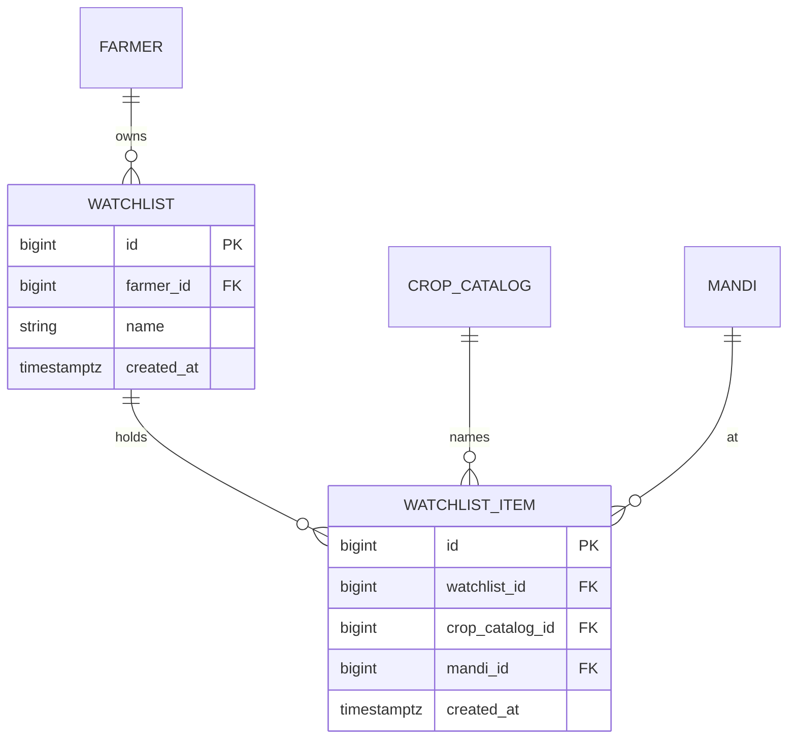

# Design

## Context

The Prices screens (`market-prices`) read stored mandi prices through `GET /prices/latest` (the farmer's crops at their followed mandis), `GET /prices/history` and `GET /me/mandis`. Prices are fetched daily by the runner in India and stored per mandi, commodity, variety, grade and day (`market-price-data`). The crop list marks which crops map to a feed commodity (`crop_catalog.price_commodity`). The detail page today loads its mandi list from the farmer's own crops, so it cannot open a crop the farmer does not grow. See proposal.md for scope.

## Goals / Non-Goals

**Goals:**
- Lists of "crop at one market" items, per farmer, with live prices.
- One place that works out "latest price and change" so the Prices page, lists and detail agree.
- The detail page works for any priced crop.

**Non-Goals:**
- Alerts, notifications, sharing, reordering, renaming.

## Decisions

1. **Two tables.**

   `watchlist` is unique on (`farmer_id`, `lower(name)`); `watchlist_item` is unique on (`watchlist_id`, `crop_catalog_id`, `mandi_id`) and its list reference deletes with the list. The limits (10 lists, 20 items, 30-character names) are checked in the API, not in the schema, so they can change without a migration.
2. **Tenancy through the list.** Items have no farmer column. Every item route first loads the list through a farmer-scoped query, so a list or item of another farmer answers 404. Each route has a cross-tenant test, as the rest of the API does.
3. **Endpoints** (farmer-authenticated):
   - `GET /api/v1/watchlists` returns the farmer's lists with their items and each item's latest price, previous price, change and date.
   - `POST /api/v1/watchlists` (name) returns 201, 409 for a repeated or reserved name, 422 for a bad name, 409 with a clear code for the limit.
   - `DELETE /api/v1/watchlists/{id}` returns 204.
   - `POST /api/v1/watchlists/{id}/items` (`crop_catalog_id`, `mandi_id`) returns 201; 422 when the crop has no price commodity; 404 for an unknown mandi; 409 for a duplicate or a full list.
   - `DELETE /api/v1/watchlists/{id}/items/{item_id}` returns 204.
   - `GET /api/v1/prices/crops/{crop_catalog_id}/markets?limit=` returns the markets that have a price for the crop, best first, each with district, price and date (default 20, at most 50). It serves the Add item market list and the detail page's market chips.
   - `has_price` is added to the crop list entries so the Add item crop list can show only crops with a price.
4. **One price function.** The "latest price, previous price, change" logic now lives in `routers/prices.py`. It moves to a shared helper (`core/price_lookup.py`) that takes a set of (mandi, commodity) pairs and returns the latest and previous daily median for each, in one query. `GET /prices/latest`, the watchlists route and the markets route all call it, so a number can never differ between screens.
5. **Detail for any crop.** `loadPriceDetail` takes its priced mandis from `GET /prices/crops/{id}/markets` (the opened market is always included, even if it falls outside the top 20) instead of from the farmer's own crop rows. This also lets a grown crop compare against any market with a price, not only followed ones; that is a deliberate widening, noted in the PR. The `?mandi=` link keeps working.
6. **Tabs and routes on the frontend.** `/prices` gains a `list` query parameter (absent or `farm` is "My farm"; otherwise a list id). New routes: `/prices/lists/new` (New list, parent `/prices`) and `/prices/lists/:id/add` (Add item, parent `/prices?list=:id`). They sit before `/prices/:crop` so they are not read as a crop id. The Prices page resolver also loads the watchlists. A `WatchlistsService` wraps the endpoints.
7. **Delete asks first.** The prototype's "tap again to delete" is replaced by the shared confirm dialog already used for deleting crops, which is clearer on a phone and in three languages.
8. **Adding.** The Add item form uses two selects (Crop, then Market) with the same validation messages as the prototype. The crop select lists crops with a price, named in the app language and grouped like the crop picker. Choosing a crop loads its markets; the market select shows "<market> · <district> · ₹<price>", best first.
9. **Reuse.** The row markup of the "My farm" tab (price, change, "Updated") is extracted into one small presentational component so lists and the farm tab look and behave alike. Bootstrap utilities first.

## Risks / Trade-offs

- **Prices exist only for crops in the predefined list that have a feed name,** so the Add item crop list is that subset; crops without a price are not offered. Sugarcane, Vegetables and Fruits will not appear.
- **A watched market may stop reporting.** The item then shows "Not traded"; it stays in the list so a returning price shows again.
- **Widening the detail page** (decision 5) changes what "compare" offers for grown crops. It is a better default, and the existing detail tests are updated.
- **Hard limits in the API only.** Someone can create a list in two requests at the same moment and exceed 10; accepted for a one-farmer-at-a-time app.
- **History is short at first;** the watched charts will be sparse like the rest of Prices.
