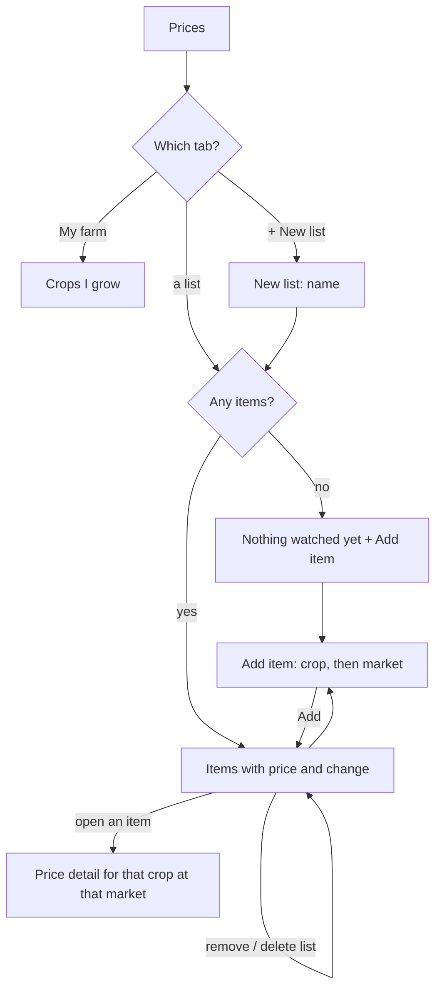

## Why

The Prices page only shows crops the farmer grows. A farmer also wants to follow prices of crops they do not grow (a neighbour's onion, a crop they are thinking of planting) at the markets they care about, and to keep these in lists of their own, such as "Onion markets". The prototype does this with watchlists. This is the watchlist half of roadmap task 4.3; price alerts stay for a later change.

## What Changes

- **Watchlists:** a farmer creates named lists (up to 10, names up to 30 characters, no repeats). Each list holds items; one item is a **crop at one market**, for example Onion at Lasalgaon. The same crop can be added at several markets to compare them.
- **Tabs on the Prices page:** a row of tabs above the prices: "My farm" (what is there today), then one tab per list, then "+ New list". The chosen tab shows in the link, so a list can be opened directly.
- **A list's view:** each item shows the crop, the market and its district, the latest price per quintal and the change since the previous reading, "Updated <date>" when old, or "Not traded" when the market has no price for it. An item opens the price detail of that crop at that market (chart, periods, compare). Each item can be removed; a list can be deleted after a confirmation.
- **Add to a list:** pick a crop from the crops that have a mandi price (any crop, not only ones the farmer grows), then a market, shown best price first with its price and district. A crop already in the list at that market cannot be added twice.
- **Backend:** tables `watchlist` and `watchlist_item`, endpoints to list, create and delete lists and to add and remove items, and one endpoint listing the markets that have a price for a crop, best first. The crop list tells which crops have a price.
- **Price detail for any crop:** the detail page also works for a crop the farmer does not grow, using the markets that have a price for that crop.

Prototype screens: `prices` (watchlist tabs, `wlView`), `newwl`, `addwi` in `design/prototype/myfarm-prototype.html`.

## Capabilities

### New Capabilities
- `price-watchlists`: named watchlists of crop-at-market items, their tabs on the Prices page, and the pages to create a list and add an item.

### Modified Capabilities
- none

## Impact

- Backend: migration `0011` (two tables), models, schemas, a `watchlists` router and a markets-for-a-crop endpoint, `has_price` on the crop list, tests including that one farmer cannot see or change another's lists, `openapi.json`.
- Frontend: a watchlists service, tabs and a list view on the Prices page, New list and Add item pages, the detail loader for crops not grown, i18n keys (mr, hi, en), specs.
- Builds on the Prices screens (`market-prices`) and the stored prices (`market-price-data`). Applying starts after `market-prices` is merged.

## Non-goals

- Price alerts and banners (`price-alerts`, the other half of roadmap 4.3).
- Renaming or reordering lists, moving items between lists, or sharing a list with another farmer.
- Following crops that have no mandi price, or markets outside Maharashtra.
- Notifications of any kind.

## User journey

