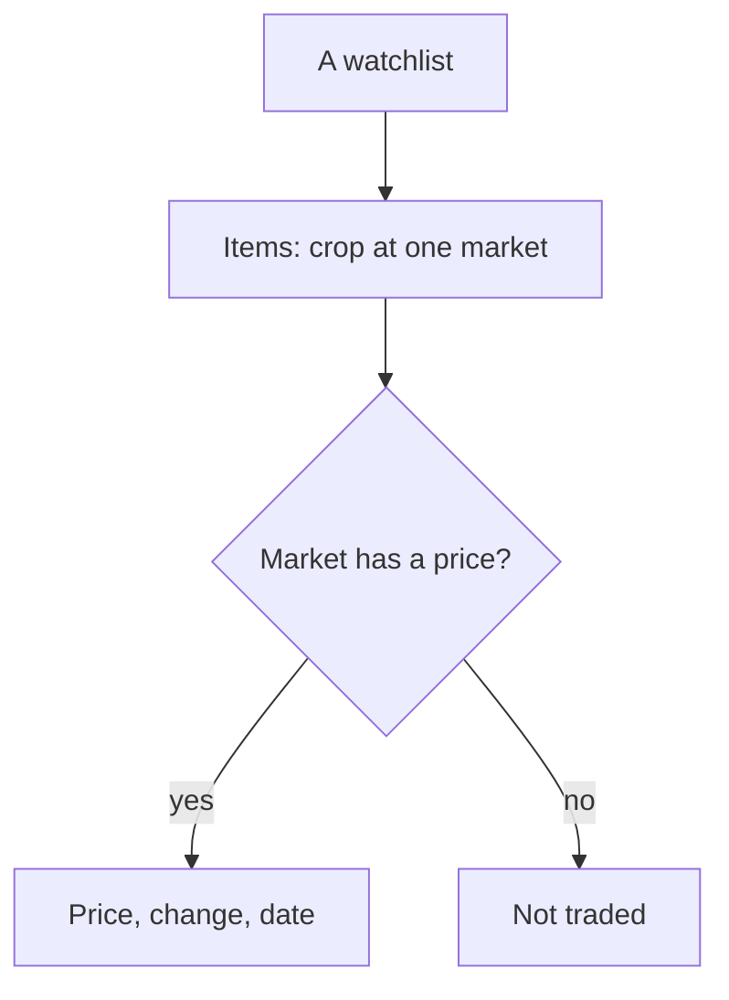

# price-watchlists Specification

## Purpose
A farmer follows the prices of any crop at the markets they choose, in named lists of their own, next to the prices of the crops they grow.

## ADDED Requirements

### Requirement: Create and delete watchlists
A farmer SHALL be able to create a watchlist by giving it a name. The name SHALL be trimmed, SHALL be 1 to 30 characters, SHALL NOT repeat another of the farmer's lists in any case, and SHALL NOT be "My farm" in any case. A farmer SHALL have at most 10 lists. A farmer SHALL be able to delete a list after a confirmation, which removes its items. A list belongs to one farmer and SHALL NOT be visible to or changeable by another.

#### Scenario: Create
- **WHEN** the farmer creates a list named "Onion markets"
- **THEN** the list exists, is empty, and opens in its own tab

#### Scenario: Name rejected
- **WHEN** the farmer submits a blank name, a name already used in another case, "my farm", or a name over 30 characters
- **THEN** nothing is created and the form says what is wrong ("Give the list a name.", "You already have a list with this name.", or the length limit)

#### Scenario: Too many lists
- **WHEN** the farmer already has 10 lists and tries to create another
- **THEN** it is refused with a message that the limit is reached

#### Scenario: Delete
- **WHEN** the farmer deletes a list and confirms
- **THEN** the list and its items are gone and the "My farm" tab opens

#### Scenario: Another farmer's list
- **WHEN** a farmer asks for or changes a list that belongs to someone else
- **THEN** the answer is "not found"

### Requirement: Tabs on the Prices page
The Prices page SHALL show a row of tabs: "My farm" first and selected by default, then one tab per list in the order created, each with its item count, then "+ New list". Choosing a tab SHALL show it; the chosen list SHALL be in the page link so it can be opened directly.

#### Scenario: Default tab
- **WHEN** the farmer opens Prices
- **THEN** "My farm" is selected and shows the crops they grow, as before

#### Scenario: Open a list
- **WHEN** the farmer selects the tab "Onion markets · 3"
- **THEN** the page shows that list's three items

#### Scenario: Open from a link
- **WHEN** the farmer opens a link to a list
- **THEN** that list's tab is selected

### Requirement: A watchlist's items
Each item SHALL show the crop name, the market and its district, and the latest price per quintal with the change since the previous reading. A price from an earlier day than today SHALL show "Updated <date>". An item whose market has no price for the crop SHALL show "Not traded". An empty list SHALL show "Nothing watched yet" and an Add item button. Selecting an item SHALL open the price detail of that crop at that market. Each item SHALL have a remove button, and removing it SHALL not ask for confirmation.

#### Scenario: Priced item
- **WHEN** a list holds Onion at Lasalgaon, priced 2150 after 2020
- **THEN** the item shows ₹2,150 and +6.4%

#### Scenario: Not traded
- **WHEN** a market has never had a price for the crop
- **THEN** the item shows "Not traded" and has no link to a chart

#### Scenario: Remove an item
- **WHEN** the farmer removes an item
- **THEN** it disappears and the tab's count drops by one

### Requirement: Add an item
The Add item page SHALL ask for a Crop, chosen from the crops that have a mandi price (not only crops the farmer grows), then a Market, listing the markets that have a price for that crop, best price first, each with its district and price. Market SHALL stay disabled until a crop is chosen. A list SHALL hold at most 20 items. A crop at a market SHALL NOT be added to the same list twice.

#### Scenario: Add
- **WHEN** the farmer chooses Onion, then Lasalgaon, and selects "Add to list"
- **THEN** the item is added and the list shows it

#### Scenario: Markets best first
- **WHEN** the farmer chooses Onion
- **THEN** the markets are listed from the highest price down, each with its district and price

#### Scenario: Missing choice
- **WHEN** the farmer selects "Add to list" without a crop or without a market
- **THEN** the form says "Pick a crop." or "Pick a market." and nothing is added

#### Scenario: Already in the list
- **WHEN** the farmer picks Onion at Lasalgaon, which the list already holds
- **THEN** the form says "Already in this list." and nothing is added

#### Scenario: List full
- **WHEN** the list holds 20 items
- **THEN** adding another is refused with a message that the limit is reached

### Requirement: Price detail for a crop the farmer does not grow
The price detail of a watched item SHALL work for any crop that has a price, with the same chart, periods, average badge and comparison as for a crop the farmer grows. The markets offered to switch to and to compare SHALL be the markets that have a price for that crop, best first, and SHALL include the market that was opened.

#### Scenario: Open a watched crop
- **WHEN** the farmer opens Banana at Pune from a list and does not grow bananas
- **THEN** the detail shows the price and chart for Banana at Pune, with other markets that price Banana to compare
