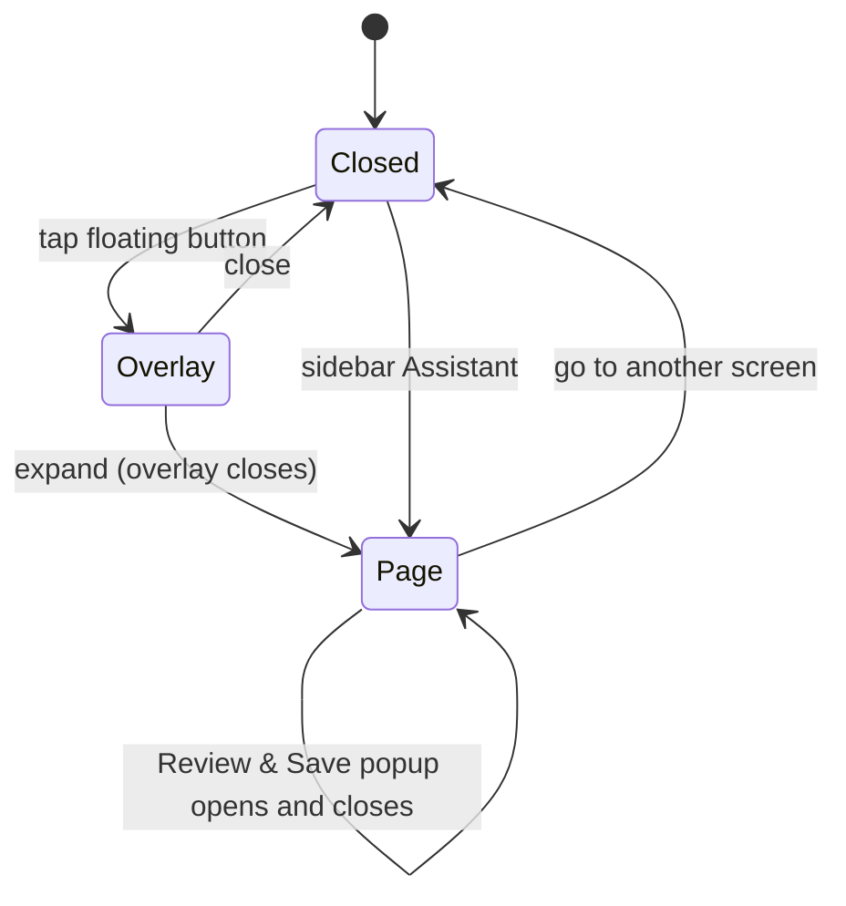

## Context

The chat is a floating button plus an overlay (`ChatBotContainerComponent`) that hosts `ChatPanelComponent`, the `ReviewPopupComponent`, and a `ChatOrchestratorService` provided at the container, so its state lives and dies with the signed-in layout. History, the daily brief, routing and answers are built and stay as they are (specs `assistant-chat-history`, `assistant-daily-brief`, `assistant-data-answers`, `assistant-intent-routing`). See proposal.md for the reasons and the three decisions taken with the user: keep the overlay, no answer cards now, no side column.

## Goals / Non-Goals

**Goals:** a `/chat` page that is a second view of the same conversation; one look for page and overlay; no backend change.

**Non-goals:** anything in the proposal's Non-goals; changing what is stored or sent to the assistant.

## Decisions

1. **Share the conversation by moving the provider up, not by copying state.** `ChatOrchestratorService` is provided on the app layout component instead of the container. Routed pages are created under the layout's outlet, so both the container and the `/chat` page inject the same instance, and it is destroyed with the layout when the farmer signs out (so "cleared on logout" needs no extra code). Alternative: `providedIn: 'root'` plus a manual reset on logout. Rejected: easy to forget the reset, and the current comment in the container explains why state should not be a bare singleton.

2. **The Review & Save popup stays mounted in the container; its "open" flag moves into the orchestrator.** The container keeps rendering the popup on every page, including `/chat`. The panel asks for a review through `orchestrator.requestReview()`, and the container shows the popup from that signal. This is why the page needs no popup of its own and the pending entry carries over from overlay to page.

3. **One `ChatPanelComponent` for both views.** It gets a `layout` input (`overlay` | `page`). The overlay header keeps close and gains an expand button; the page header has no close. Everything inside (thread, chips, composer, clear-confirm) is shared, so a fix applies to both. Alternative: a separate page component. Rejected: two threads to keep in step.

4. **Restyle the panel with the shared tokens and Bootstrap utilities**, not new global CSS: leaf avatar on assistant bubbles, bubble colours from the theme tokens, a send icon button, chips in the prototype's pill style, a three-dot thinking indicator driven by the existing `busy()`. Dark theme comes from the tokens. Custom CSS only for the bubble shapes.

5. **Suggested questions become a standing row above the composer** (the same three the replies already use: spending, pending work, weather), instead of only chips attached to a reply. Chips attached to a reply for missing details stay inline. Restored old chips stay plain text, as the history spec says.

6. **Times under messages.** New messages get a client `createdAt` when appended; restored ones already carry it. Shown as a short local time.

7. **Route and navigation.** Lazy route `chat` with `data: { section: 'assistant', title: 'shell.title.assistant' }` and a nav item `assistant` with `phoneTab: false`, so it appears in the sidebar only. On a phone the way in is the floating button, then expand; the six tabs stay as they are. The page fills the content area with no extra padding and no footer; the composer sits above the phone tab bar.

8. **Hiding the floating button on `/chat`.** The container reads the current URL from router events and renders the button only when it is not `/chat`. If the overlay is open when the farmer navigates to `/chat` (expand), it closes.

```mermaid
flowchart TD
  L[App layout - provides orchestrator] --> C[Chat container - button, overlay, review popup]
  L --> R[Router outlet]
  R --> P[/chat page]
  C --> PN1[Chat panel - overlay]
  P --> PN2[Chat panel - page]
  PN1 & PN2 --> O[Orchestrator: thread, busy, draft, review flag]
  O --> API[(Assistant + history APIs)]
```



## Risks / Trade-offs

- **Moving the provider could miss a consumer** that relied on the container's injector → search for every injection of the orchestrator and cover the container, panel and page with specs.
- **Two panels alive at once?** Expand closes the overlay first, and the button is hidden on the page, so only one thread is on screen → a spec checks it.
- **Full-height layout on a phone** (address bar, keyboard, tab bar) can push the composer off screen → use the shell's existing content height and check on a phone-sized e2e.
- **Standing suggestion row takes room on a phone** → one scrolling line.

## Migration Plan

Frontend only; ship in one PR. Rollback is a revert. #301 closes with this change's PR.

## Open Questions

None that change the specs or tasks.
