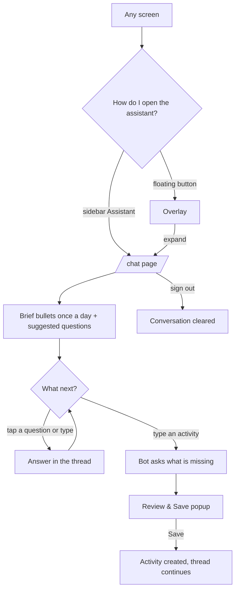

## Why

The assistant today lives only in a small floating overlay. The prototype gives it a full page: a header with the leaf avatar, speech bubbles, the daily brief as bullets, suggested questions and a send button. On a phone the overlay is cramped, and on a desktop it hides most of the screen's room. This is roadmap task 4.4 (issue #387) and also delivers #301, the dedicated `/chat` page.

## What Changes

- **A `/chat` page** (signed-in only), full height inside the app shell, in the prototype's style: a header with the leaf avatar, "Farm assistant" and "Knows your lands, crops and expenses"; bubbles with a leaf avatar on the assistant's side and a time under each message; a "thinking" indicator; a row of suggested questions; a composer with a send icon.
- **One conversation everywhere.** The page and the existing floating overlay show the same thread, the same pending entry and the same Review & Save popup. The conversation is cleared when the farmer signs out.
- **Entry points:** an "Assistant" item in the sidebar (active on `/chat`); an expand button in the overlay that opens the page; the floating button is hidden while on `/chat`. On a phone the floating button stays the way in, then expand.
- **Same behaviour as today:** history (last 50, "Load older"), the once-a-day brief shown as bullets, answers to questions, adding an activity by typing it and tapping Review & Save, and "Clear chat" with its confirmation.
- **New style for the chat itself:** the overlay and the page share one look (bubbles, chips, composer), in light and dark, with Marathi, Hindi and English texts.

Prototype screen: `chat` in `design/prototype/myfarm-prototype.html`. Mockup: `design/assistant-full-page/assistant-full-page-mockup.html`.

## Capabilities

### New Capabilities
- `assistant-full-page`: the `/chat` page, its entry points and the single shared conversation between the page and the overlay.

### Modified Capabilities
- none (history, brief, routing and answers keep their current requirements)

## Impact

- Frontend only: a chat page and route, a sidebar item, an expand button and hiding rule in the container, moving the conversation state so the page and overlay share it, a restyle of the chat panel, i18n keys (mr, hi, en), specs and an e2e step. No backend change, no API change, no migration.
- Builds on the app shell (`app-shell-navigation`) and the design tokens.

## Non-goals

- Answer cards under replies (tasks, spend, rain, harvest). They need structured answers and become their own change.
- "New chat" and a "Recent" list: there is one continuous conversation per farmer.
- The "daily brief is ready" nudge on Home (comes with `banners-and-notifications`, 5.1).
- The chat follow-ups of #269 (required fields, quantity, full transcript, loader, comboboxes) and voice input.
- Any change to how the assistant understands or answers messages.

## User journey

