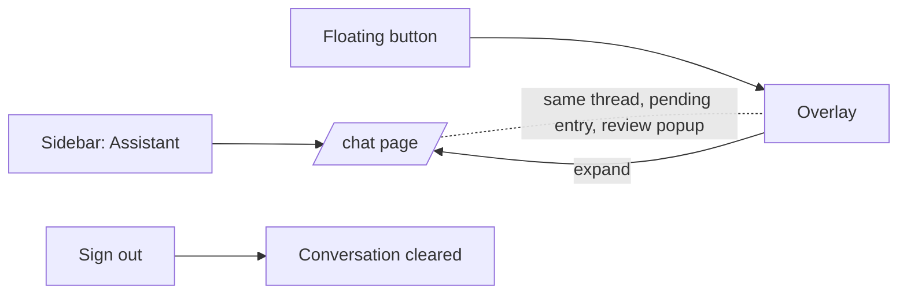

## Purpose
The assistant has its own full-height page, and the page and the floating overlay are two views of one conversation.

## ADDED Requirements

### Requirement: Assistant page
The system SHALL provide a signed-in page at `/chat` that shows the assistant conversation across the full height of the content area, with a header naming the assistant, the thread, suggested questions and a message composer.

#### Scenario: Open the page
- **WHEN** a signed-in farmer opens `/chat`
- **THEN** the header, the saved conversation (newest at the bottom), the suggested questions and the composer are shown

#### Scenario: Signed out
- **WHEN** a farmer who is not signed in opens `/chat`
- **THEN** they are sent to sign-in

### Requirement: Entry points
The sidebar SHALL list "Assistant" and mark it active on `/chat`. The floating chat button SHALL NOT be shown on `/chat`, and SHALL stay on every other signed-in page. The overlay SHALL have a control that opens `/chat`.

#### Scenario: Sidebar
- **WHEN** the farmer taps "Assistant" in the sidebar
- **THEN** `/chat` opens and the item is shown as current

#### Scenario: Expand from the overlay
- **WHEN** the farmer taps the expand control in the overlay
- **THEN** `/chat` opens, the overlay closes and the same conversation is shown

#### Scenario: Floating button on the page
- **WHEN** the farmer is on `/chat`
- **THEN** no floating chat button is shown

### Requirement: One shared conversation
The page and the overlay SHALL show one conversation: the same messages, the same pending activity entry and the same Review & Save popup. A message sent in one SHALL appear in the other. Signing out SHALL clear it.

#### Scenario: Continue on the page
- **WHEN** the farmer sends a message in the overlay and then opens the page
- **THEN** the message and the reply are in the page's thread

#### Scenario: Pending entry carries over
- **WHEN** the bot has an activity ready to review in the overlay and the farmer opens the page
- **THEN** Review & Save is still offered and saves the same entry

#### Scenario: Sign out
- **WHEN** the farmer signs out and another farmer signs in
- **THEN** the second farmer sees none of the first farmer's thread or pending entry

### Requirement: Thread appearance
Assistant messages SHALL show a leaf avatar and the farmer's messages SHALL be on the opposite side; each message SHALL show its time. The daily brief SHALL be shown as separate bullet lines. While an answer is loading, a thinking indicator SHALL be shown and sending SHALL be disabled.

#### Scenario: Daily brief
- **WHEN** the day's first brief is shown
- **THEN** each point is on its own line under the assistant's avatar, with the suggested questions below

#### Scenario: Waiting for an answer
- **WHEN** the farmer sends a question
- **THEN** their message appears at once, a thinking indicator follows, and the composer is disabled until the answer arrives

### Requirement: Suggested questions
The page SHALL offer suggested questions as chips. Tapping a chip SHALL send that question as a new message.

#### Scenario: Tap a suggestion
- **WHEN** the farmer taps "Will it rain this week?"
- **THEN** it is sent as their message and the assistant answers

### Requirement: Existing behaviour is kept
On the page, history (the last 50 messages, older on request), Review & Save, the manual-form fallback and "Clear chat" with its confirmation SHALL work as in the overlay.

#### Scenario: Add an activity by typing
- **WHEN** the farmer types an activity, answers any questions, and taps Review & Save
- **THEN** the review popup opens above the page and saving creates the activity

#### Scenario: Clear chat
- **WHEN** the farmer confirms "Clear chat" on the page
- **THEN** the thread is emptied

### Requirement: Themes and languages
The page and the overlay SHALL be readable in the light and dark themes, and every text SHALL exist in Marathi, Hindi and English.

#### Scenario: Dark theme
- **WHEN** the dark theme is on
- **THEN** bubbles, chips and the composer use the dark palette with readable contrast

#### Scenario: Marathi
- **WHEN** the language is Marathi
- **THEN** the header, chips, placeholder and buttons are in Marathi
