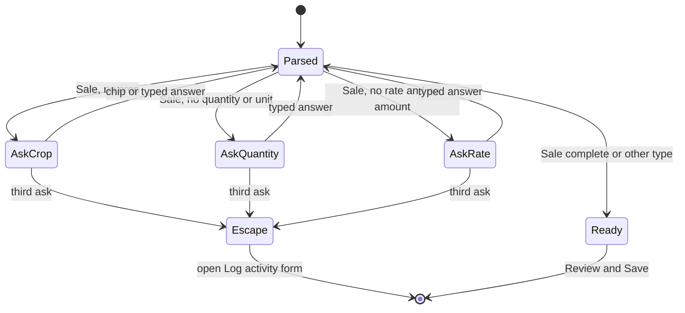
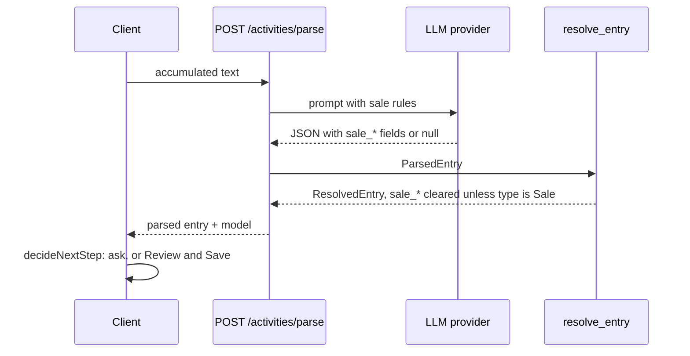

# Design

## Context

- `POST /activities/parse` builds a prompt from the reference tables (`core/chat_entry.py`), asks the LLM provider for JSON, validates it as `ParsedEntry`, and resolves names to ids with `entry_resolver.resolve_entry`, returning `ResolvedEntry` (ids plus names, `dropped` list). Shape errors are 503s; an unusable activity type is a 422.
- The client keeps an accumulated text and re-parses all of it after every answer. `decideNextStep` (pure, in `chat-decision.ts`) picks the next question from the latest parse: land, crop, expense category, date. Answers from chips are appended as `correctionSentence(field, label)`; typed answers while a field is open are appended as typed (`chat-orchestrator.service.ts`). Two rounds on a field end in the escape hatch, which navigates to `/activities/create` with `type`, `date`, `cropId`, `fieldId`, `notes`.
- Review & Save (`ReviewPopupComponent`) edits type, date, land, crop and expense lines, then `ChatEntryService.create` posts a Completed activity with provenance in `activity_meta`.
- A Completed Sale must carry quantity, unit, rate and amount, a crop (API rule from `sales-as-activities`); the activity model has `sale?: ActivitySale`.

## Decisions

**1. Five optional sale fields on the parse schema.** `ParsedEntry` and `ResolvedEntry` gain `sale_quantity`, `sale_unit`, `sale_rate`, `sale_amount`, `sale_buyer` (all default null), named like the activity columns. Optional with defaults means a provider response without them still validates and older clients ignore them: no API break. The resolver passes them through, but a non-positive number becomes null, a blank string becomes null, and every sale field is cleared when the resolved type is not Sale. Missing sale figures are not a `dropped` entry: absence is not an error.

**2. The prompt extracts, the client calculates.** The prompt adds the five fields to the JSON shape and rules: take a number only if the text states it; a per-unit price goes to `sale_rate`, a stated total ("for", "total") goes to `sale_amount`; never multiply or divide; buyer only when someone is named as the buyer; all null for non-sales. Keeping arithmetic out of the model avoids silent wrong totals ("never guess" is already the module's rule). The client fills the amount (quantity × rate) or the rate (amount ÷ quantity) from what was said, in one small pure helper used by both the decision and the popup.

**3. New questions in `decideNextStep`.** `ClarifyField` gains `saleQuantity` and `saleRate`. For a Sale entry the order is crop, `saleQuantity`, `saleRate`, date; land is not asked (the crop fixes it).
- `crop` is missing for a Sale when `crop_id` is null, even if nothing was `dropped`: a sale without a crop cannot be saved, unlike other types.
- `saleQuantity` is missing when quantity or unit is null; `saleRate` when both rate and amount are null.
- Crop uses crop chips; the two sale questions have no chips and take typed text. The typed answer is appended through `correctionSentence` ("Sale quantity: 5 crates.", "Sale rate or total: 1000.") so the next parse reads it as an answer, not new narrative.
- Rounds and the escape rule are unchanged: the third ask of the same field escapes. The existing escape navigation already carries `type=Sale`, `cropId`, `date` and `notes`, so no change is needed there.
- Non-Sale entries never reach the new branches.

**4. Review & Save grows a Sale block, not a second popup.** The form gets `saleQuantity`, `saleUnit`, `saleRate`, `saleAmount`, `saleBuyer` controls shown while the selected type is Sale, with the amount-follows-product behaviour and the same error keys (`saleForm.*`) as the activity form. The crop becomes required and the date may not be after today, only for Sale. Validation runs before `create`; the API rules remain the backstop. Changing the type away from Sale hides the block and `create` omits `sale`.

**5. Create and provenance.** `ChatEntryService.create` adds `sale` (quantity, unit, rate, amount, buyer) to the draft when the type name is Sale; status stays Completed. `buildProvenance.parsed` records the parsed sale figures as strings so a later edit shows the correction.

**6. Backend sequence.**

## Risks and trade-offs

- **Model quality.** A model may read "1250" as a total or put a crate count in the wrong field. Mitigations: the prompt rules, the popup showing every figure before saving, and provenance recording what the model proposed. Prompt examples are covered by unit tests on the prompt text only; live extraction accuracy is not asserted in CI.
- **Multi-language text.** The prompt already handles Hindi and Marathi input; sale words ("बेचा", "विकले") are listed as hints. Accuracy for them is unmeasured.
- **A sale with two crops of the same name** resolves as ambiguous and falls to the crop question, as today.
- **More questions in chat.** A Sale can take up to three questions; the two-round limit keeps the worst case short and ends in the form.

## Migration

None: new optional fields, no data change. Rollback is reverting the release; older clients ignore the new response fields.

## Open questions

None blocking. Assumed: the buyer is never asked in chat; a future-dated sale is logged in the form, not chat.
