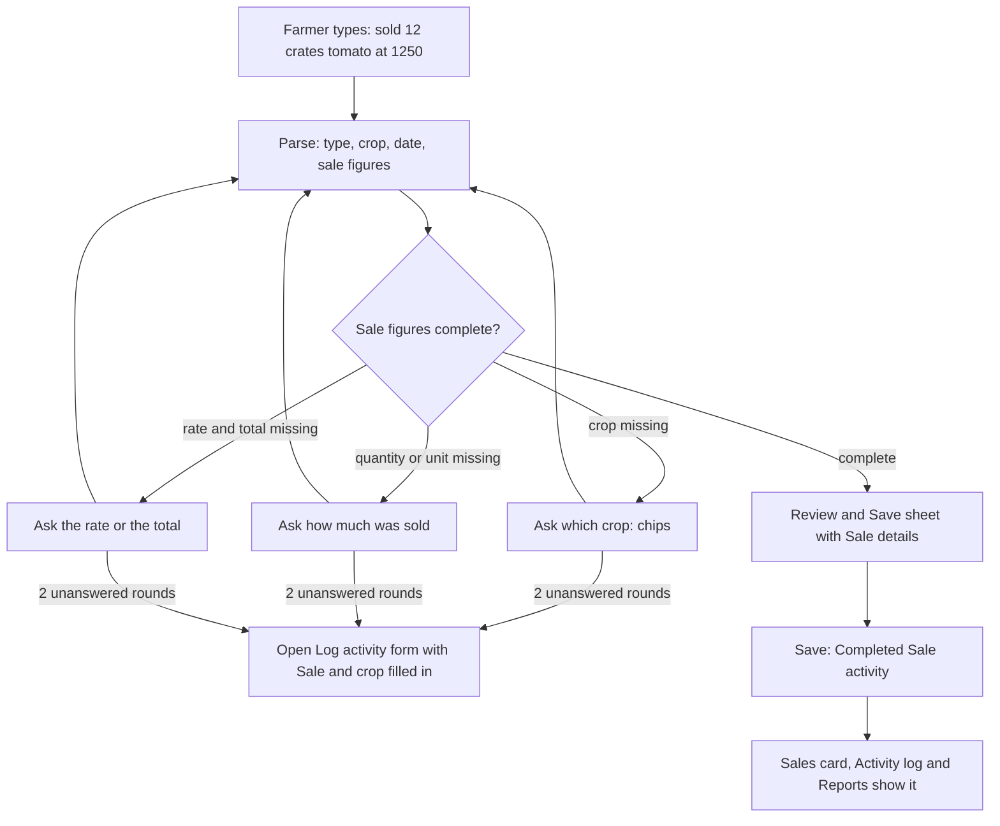

# Proposal

## Why

Since `sales-as-activities`, a sale is an activity whose quantity, unit, rate and amount are required once it is Completed. The assistant still parses entries without any sale figures and saves them as Completed, so "sold 12 crates of tomato at 1250" fails at save with an error and nothing is recorded. This change teaches the assistant to read the figures from the farmer's words, ask for what is missing, and show them in Review & Save, so selling by chat works end to end.

## What Changes

- The parse step extracts sale quantity, unit, rate, total amount and buyer from the text, only when the farmer actually said them; it never multiplies or guesses.
- A Sale entry with something missing is not offered for review yet. The bot asks, one thing at a time, in this order: the crop, the quantity and unit, the rate or the total, then the date. The farmer answers by tapping a crop chip or typing.
- After two unanswered rounds on one question, the bot offers the manual form, opened on Log activity with Sale, the crop, the date and the notes filled in (the existing escape hatch).
- Review & Save shows a Sale details block (quantity and unit, rate, amount, buyer) when the type is Sale. Amount is quantity × rate until the farmer types their own total. Crop is required and the date cannot be in the future.
- Save creates a Completed Sale activity with its figures. The parsed figures are kept in the entry's provenance so corrections can be compared later.
- Other entry types behave exactly as today.

Prototype: `design/prototype/myfarm-prototype.html`, screen `chat` (Sale chips, follow-up questions, "Review & Save" button, the Review & Save sheet, "Open the form"). Approved on 2026-11-01 and committed on this branch.

## Capabilities

### New Capabilities
- `assistant-sale-entry`: reading sale figures from the farmer's words, asking for missing sale details in chat, the Sale details in Review & Save, and saving a Completed Sale.

### Modified Capabilities
<!-- none: sale recording rules stay in `crop-sales`; the generic parse, clarify and review flow is unchanged for other types. -->

## Impact

- **Backend:** `ParsedEntry` and `ResolvedEntry` schemas, the extraction prompt in `core/chat_entry.py`, `entry_resolver.py`, their tests; regenerate `openapi.json` and contracts.
- **Frontend:** `ResolvedEntry` type, `chat-decision` (new questions), `chat-orchestrator` (typed answers to sale questions), `ReviewPopupComponent`, `ChatEntryService.create` and provenance, en/hi/mr strings and specs.
- **API:** `POST /activities/parse` response gains optional sale fields; no new endpoint and nothing breaks for older clients.
- **Data:** none; sales are saved through the existing activity endpoints.
- **Roadmap:** adds `assistant-sale-entry` after 4.4 and ticks it.

## Non-goals

- Voice entry, or logging sales in languages beyond what the existing parser handles.
- Asking for the buyer in chat (it is taken only when the farmer names one).
- Planned or future sales from chat (they are logged in the form).
- Changing how other activity types or expenses are parsed or asked about.
- Editing or deleting sales from the chat.
