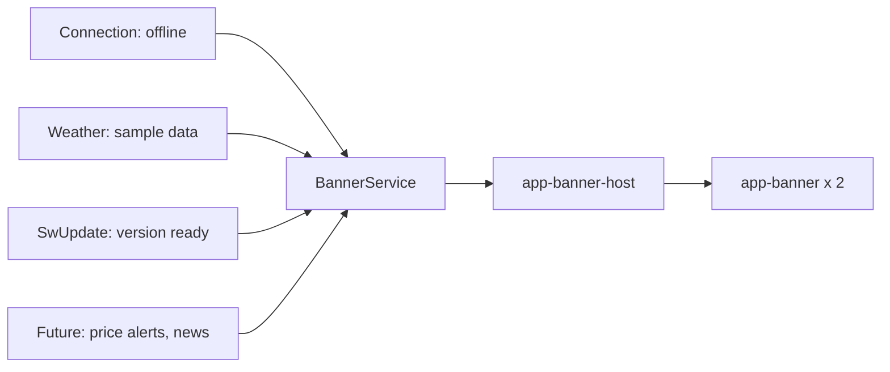

# Design

## Context

- `app-offline-banner` (from `system-states`) is hand-built Bootstrap in `layout/offline-banner/`, placed in `app-main` (signed in) and above the router outlet (signed out). It reads `ConnectionService.online`. Its text and rules stay; only its markup moves.
- Weather shows a plain `alert alert-warning` when `weatherService.source() === 'demo'` (`weather.component.html`).
- The app registers a service worker (`provideServiceWorker`, `ngsw-config.json`) but nothing listens for new versions.
- Per-farmer flags already live in `localStorage` under a key plus the user id (`workflow-state.service.ts`), wrapped in try/catch.
- Price alerts are not in the app (4.3b is on hold), so no banner for them here.

## Decisions

**1. A `BannerService` owns the list; notices register themselves.**

- A banner is `{ id, kind, titleKey, textKey, params?, labelKey?, action?, screens }`. It carries translation keys, not translated text, so the service has no translate dependency and switching language is not a content change (decision 3).
- A source is a function that returns its banner or `null`, read inside a computed, so it follows its own signals (no `effect()`). `addSource(fn)` returns a remover that the owner calls on destroy. `active` is a computed: read every source, filter by the current screen, drop dismissed ones, sort by kind order then insertion order.
- Sources: an `AppBanners` root service (created by `app-layout`) registers the offline notice from `ConnectionService.online` and the update notice from `SwUpdate.versionUpdates` (ready events), with "Update now" calling `activateUpdate()` then reloading through a `RELOAD_PAGE` token (so tests can replace it); Weather adds its sample notice from its own state and removes it on destroy. `SwUpdate` is injected optionally and is a no-op when the service worker is disabled (dev), so nothing shows there.

**2. Screen scope, not routes.** A banner lists `screens` as a list of route-area names (`'home'`, `'weather'`, …) or `'*'` for every screen. The host reads the current top-level route segment from the router; `'*'` covers the signed-out screens too (the host is also placed above the signed-out router outlet, as the offline banner is today).

**3. Dismissal key is `id + titleKey + textKey + params`.** Dismissals are stored per farmer as a set of keys in `localStorage` under `mf.banners.<userId>`. Because the words (keys and values) are part of the key, "dismissed until its content changes" needs no version counter, and changing the app language does not bring a dismissed banner back. A New banner uses the same record, so "shown once" is the same as "dismissed". Problem banners ignore the record. Read and write are wrapped in try/catch; on failure an in-memory set keeps the session correct. Signed-out screens use no user id, so only the offline Problem shows there and nothing is stored.

**4. Stacking in the host, expansion in the host.** `app-banner-host` shows `active().slice(0, 2)` and the "N more notifications" row; a local `expanded` signal switches to all banners and back, and resets on navigation. No new screen. The "N more" copy has singular and plural forms in all three languages.

**5. One presentational `app-banner` component**, built with Bootstrap utilities in the same way as the current offline banner (surface, 1px border, radius, chip, label, title, line, link button, dismiss button). A small `banner.scss` is added only if the chip tints for kinds cannot be expressed with utilities; the design tokens are used. The Problem kind adds the rose border and `role="alert"`; others use `role="status"`.

**6. The offline banner component is removed**; its spec cases move to the banner, `AppBanners` and the `app-layout` spec (shows offline, no dismiss, disappears online, present in both signed-in and signed-out branches).

**7. Strings.** `banners.*` keys (kind labels, "N more notifications" with plural forms, "View all", "Show less", "Dismiss: {{title}}", update and weather notice text) in en, hi and mr; the existing `states.offline.*` keys are reused. The translation check must pass.

## Risks and trade-offs

- **`SwUpdate` is hard to try locally.** It only works in a production build with the service worker on. The spec mocks `versionUpdates`; the PR notes a manual check on the deployed build.
- **Banner height shifts content** when it appears, as the offline banner already does; accepted.
- **Three notices only.** The host can look over-built until price alerts and news arrive; accepted, since the roadmap needs the shared pattern now and 4.3b should only add `register()` calls.
- **`localStorage` is per browser**, so a farmer on a second device sees dismissed banners again; accepted (non-goal).

## Migration

None. Rollback is reverting the frontend.

## Open questions

None blocking.
