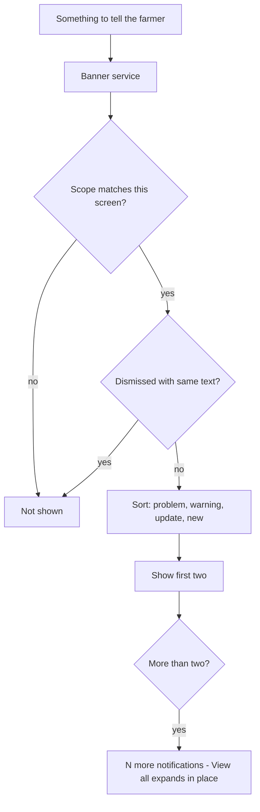

# Proposal

## Why

The app already tells the farmer things in several ways: a hand-built red offline box, a yellow Bootstrap `alert` on Weather when the forecast is sample data, toasts, and, once price alerts return, banners for them. None share a look, an order or a rule for dismissing. The design system defines one banner for everything the app tells the farmer. This change builds it and moves the existing notices onto it. It is roadmap item 5.1.

## What Changes

- **One shared banner** with four kinds: Problem (rose border, cannot be dismissed), Warning, Update and New. Each is a white card with an icon chip, a small kind label, a bold title, one muted line and an optional link action.
- **A banner host at the top of every signed-in screen** (in the shell, above the page). It shows at most two banners, problem first, then warning, update, new. The rest fold into a dashed "N more notifications" row; "View all" opens the full list in place and "Show less" folds it back.
- **Scope per banner:** a banner names the screens it belongs to (Home and the screen it is about). A problem such as offline shows on every screen.
- **Dismissal:** a dismissed banner stays gone for that farmer until its text changes. A New banner is shown once.
- **Moved onto it now:**
  - the offline notice (from `system-states`): the Problem kind, text and rules unchanged;
  - the Weather "sample data" notice: the Update kind, on the Weather screen only;
  - "New version available": the Update kind, on Home, shown when the service worker has a new version, with "Update now" reloading the app.
- **Built, not shipped:** the New kind and its once-only rule exist and are tested, but no New message ships yet.
- Hindi and Marathi text for all labels and messages.

Prototype: `design/prototype/myfarm-prototype.html` (Home, and the Banners card on "System states") and the Banners section of `design/prototype/myfarm-design-system.html`. Approved on 2026-11-01 and committed on this branch.

## Capabilities

### New Capabilities
- `banners`: the shared banner, its four kinds, the host and stacking, per-screen scope, dismissal memory, and the first notices that use it.

### Modified Capabilities
<!-- none: the offline notice's wording and rules in system-states are unchanged; only how it is drawn changes. -->

## Impact

- **Frontend only:** a banner service, a shared banner component and a host in `app-main` (replacing the offline banner component's own markup); the offline notice, the Weather sample notice and a service-worker update notice register through the service; per-user dismissal in `localStorage`; en, hi and mr strings; specs.
- **Backend / API:** none.
- **Roadmap:** ticks 5.1.

## Non-goals

- Price-alert banners: they arrive with 4.3b (on hold) and will register through the same service.
- Rain-coming and activity-overdue warnings, and any server-sent or stored notifications.
- A notifications page: "View all" only expands in place.
- A "Later" snooze for Update banners: they have a dismiss button only.
- Shipping a New message.
- Syncing dismissals across devices.
- Changing toasts and form validation messages.
