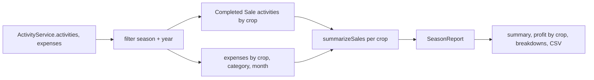

# Design

## Context

- `ReportsComponent` has a Season select, a Year select and a Generate button; `ReportService.generateSeasonReport(season, year)` filters activities by `season` and the year of `date ?? createdAt`, and returns `byCategory`, `byCrop` (expense totals) and `byMonth`. `reportToCSV` and `downloadCSV` export that.
- A sale is a Sale activity with `sale.amount` (`sales-as-activities`). `salesFromActivities`, `summarizeSales` and `isCompletedSale` in `crop-timeline/crop-sales/sales-summary.ts` already define what counts: Completed only, Cancelled hidden, profit minus expenses, per acre over the crop area.
- Crops (`CropEntity`) carry `name`, `area`, `areaUnit`, `season`, `sowingDate`, `status`. `CropTimelineService.costForCrop(id)` gives a crop's expenses.
- No backend change: activities, expenses and crops are already loaded client-side.

## Decisions

**1. Live filter with signals, no Generate.** `selectedSeason` and `selectedYear` stay signals; `report` becomes a `computed` of them, `ActivityService.activities()` and `expenses()`. The "report" workflow phase used to be marked on Generate; it is now marked once when the page first renders a report with data (called from `ngOnInit`, no `effect()`).

**2. One report model, extended.** `SeasonReport` gains `totalSales`, `cropsSold`, `cropCount` and a `crops: CropProfit[]` list; `byCrop` (expense-only) is replaced by it. Per crop: `cropId`, `name`, `areaAcres`, `sales`, `expenses`, `profitPerAcre | null`, `soldCount`.
- Sales in the selection: Completed Sale activities whose `season` and year match, grouped by `cropId`.
- Expenses per crop: the existing expense-to-activity aggregation grouped by the activity's crop.
- Reuse `summarizeSales` for profit per acre so Reports and the Sales card cannot disagree; do not re-derive the maths.
- Net so far = `totalSales - totalExpense` (all expenses of the selection, including activities with no crop).

**3. Compare seasons lives beside, not inside, the report.** A `compareRows(cropName)` method builds rows from `CropTimelineService.crops()` grouped by catalog name: label from `season` and the year of `sowingDate`, area, `salesFromActivities` for that crop, `costForCrop`, profit per acre via `summarizeSales`; "In progress" when `status === 'Active'`. It takes no season or year, which is why it is unfiltered.

**4. Presentation split.** The routed `ReportsComponent` owns the signals and the page; the filter chips, the summary, the crop rows, the breakdown bars and the compare card become small presentation components with `input()`/`output()`, no service injection, following the Angular rules. Bootstrap utilities first (chips as `btn-check` + label like the activity form, progress bars as `.progress`), no custom CSS unless unavoidable. Colours come from existing tokens (`text-success`, `text-danger`).

**5. CSV.** `reportToCSV` writes the summary, profit by crop (name, sales, expenses, profit per acre), category and month sections. Values are escaped as today. File name stays `<season>-<year>-report.csv`. The button is hidden when the selection has no data.

**6. Empty state.** Shown when the selection has no activities (`crops.length === 0 && totalExpense === 0 && totalSales === 0`), replacing summary and breakdowns but keeping chips and Compare seasons.

## Risks and trade-offs

- **Year semantics.** A sale's season and year come from its activity's `season` and `date`, matching how expenses are filtered today. A crop sown in one season and sold in another therefore splits across two selections; Compare seasons (per crop, all time) is where the whole-crop view lives. Documented in the hint text.
- **Large activity lists.** Aggregation runs over the already-loaded list in a `computed`; no extra network calls. Acceptable at current volumes; no pagination assumed.
- **Replacing `byCrop`.** The old "Expenses by Crop" table disappears; Profit by crop shows the same expenses plus sales. Existing specs for `ReportService` change accordingly.

## Migration

None: no data or API change. Rollback is reverting the frontend.

## Open questions

None blocking. Assumed: the Year chips are the current year and the two before it (as today); the "report" phase is marked on first render with data.
