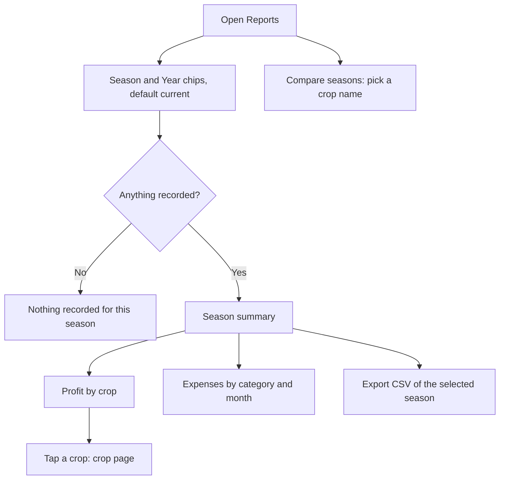

# Proposal

## Why

Reports today only count expenses behind a Season/Year picker and a Generate button. Now that a sale is an activity (`sales-as-activities`), the app can show what a farmer actually cares about: what each crop earned against what it cost. This change redesigns Reports to the approved prototype and keeps the category and month tables so nothing is lost. It is roadmap item 4.6 and builds directly on the Sale activities.

## What Changes

- Season (Kharif, Rabi, Zaid) and Year chips replace the pickers and the Generate button; the page loads and updates live.
- A **Season summary**: Total sales, Total expenses, Net so far, and Crops sold "N of M". Only Completed sales count. A hint explains that Net so far includes crops with no sales yet.
- **Profit by crop**: one row per crop in the selected season, with sales, expenses and profit per acre ("–" and "No sales yet" when none). A row opens the crop page.
- **Expenses by category** and **Expenses by month** stay, restyled, and follow the filter.
- **Compare seasons**: pick a crop name and see one row per sowing of that crop (area, sales, expenses, profit per acre). It ignores the filter and is labelled "Not filtered".
- A season with nothing recorded shows "Nothing recorded for this season".
- **Export CSV** exports the selected season including sales and profit.
- Old "Expenses by Crop" table is replaced by Profit by crop. No backend change.

Prototype: `design/prototype/myfarm-prototype.html`, screen `reports`. Approved on 2026-11-01 and committed on this branch.

## Capabilities

### New Capabilities
- `reports`: the Reports screen: season filter, season summary, profit by crop, expense breakdowns, compare seasons, empty state and CSV export. No `reports` spec exists today.

### Modified Capabilities
<!-- none: crop-sales already defines how a sale and profit are counted; Reports reuses it. -->

## Impact

- **Frontend only:** `features/reports` (component, `ReportService`, specs), reuse of `salesFromActivities` and `summarizeSales` from the crop Sales card, en/hi/mr strings. `ActivityService` and `CropTimelineService` data is read, not changed.
- **Backend / API:** none.
- **Workflow state:** the "report" phase is marked complete when Reports first shows a report (it was on Generate).
- **Roadmap:** ticks 4.6.

## Non-goals

- Backend report endpoints or server-side aggregation.
- Charts beyond the existing bars, PDF export, or sharing.
- Changing how sales, profit or expenses are recorded or counted.
- Filtering Compare seasons, or comparing across different crops.
- Fixing the assistant's Sale entry regression (separate follow-up).
