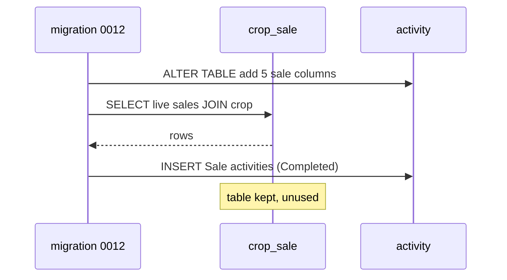
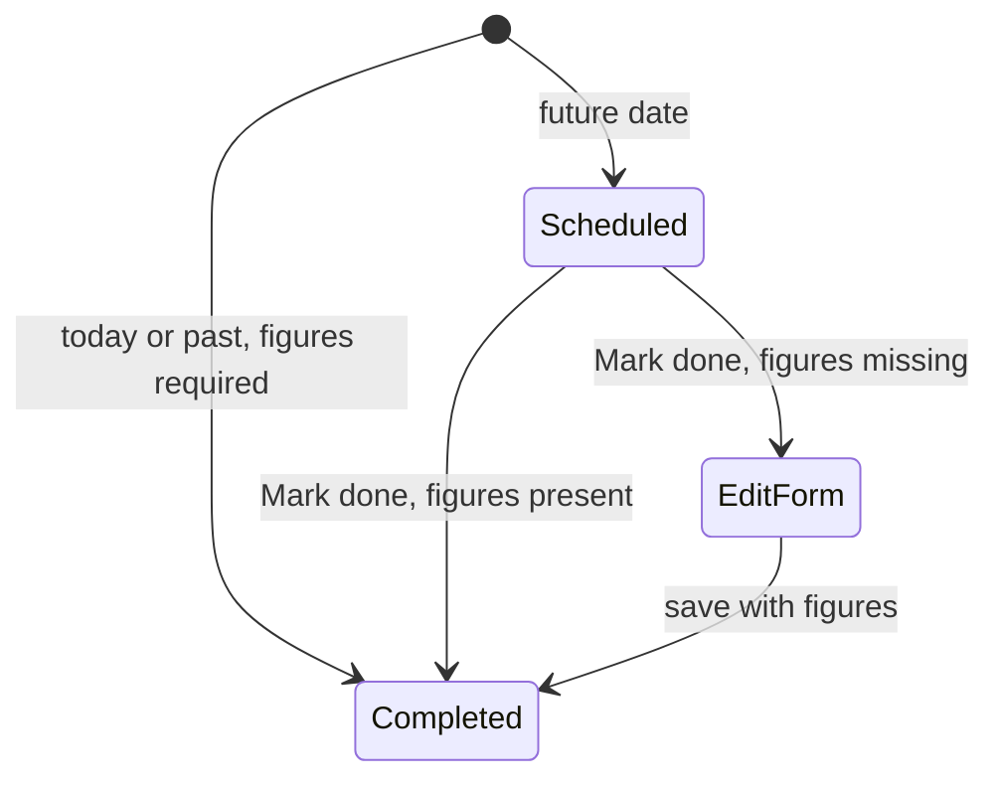

# Design

## Context

- `activity` already has `crop_id`, `land_id`, `date`, `season`, `status`, `notes`, and child `activity_expense` rows. "Sale" already exists as an activity type (seeded in migration 0003 and `admin.py`), but carries no money.
- Sales live in `crop_sale` (migration 0008), served by `/crops/{id}/sales` in `routers/crops.py`, and used by the frontend `crop-sales` folder (service, form, card, summary) and two routes (`sales/new`, `sales/:saleId/edit`).
- Profit on the Sales card is computed in the frontend (`sales-summary.ts`) from sales and the crop's expenses.
- Latest migration is `0011_watchlists`. Activity create and update go through `routers/activities.py`; tenancy is `farmer_id` on the activity.

## Decisions

**1. Real columns on `activity`.** Add nullable `sale_quantity numeric(10,2)`, `sale_unit varchar(50)`, `sale_rate numeric(10,2)`, `sale_amount numeric(12,2)`, `sale_buyer varchar(255)`. Chosen over `activity_meta` because Reports sums `sale_amount` and a typed column validates and indexes cleanly. Sparse columns on one table are acceptable here: five fields, one type. Notes reuse the existing `notes` column.

**2. Validation lives in the API, keyed on the Sale type.** On create and update, resolve the activity's type name (reference table lookup by `activity_type_id`):
- Sale figures on a non-Sale activity: 422.
- Sale with status `Completed`: quantity > 0, unit non-empty, rate > 0, amount > 0, crop required; else 422 with field messages matching the form.
- Sale in any other status: figures optional, but if given each must be valid (positive numbers, non-empty unit).
- Changing the type away from Sale clears the five columns.
The form repeats the same rules for immediate messages; the API is the source of truth.

**3. One migration `0012_sale_activity_columns`:** add columns, then `INSERT ... SELECT` every non-deleted `crop_sale` joined to `crop`: `farmer_id`, `crop_id`, `land_id` (the crop's land), `activity_type_id` (Sale), `date = sold_on`, `season` from the month using the same rule as the frontend `seasonForDate`, `status = 'Completed'`, `notes`, figures, `created_at`. Soft-deleted sales are not copied. Downgrade deletes the copied activities and drops the columns. The `crop_sale` table is not dropped here: it stays as a rollback copy and is dropped by a follow-up change once the new path is verified in production.

**4. API surface.** Sale figures travel on the existing activity create, update and read schemas (new optional fields). Remove the sales routes, `CropSale` model usage in routes, `schemas/crop_sale.py` and its tests; keep the `CropSale` ORM model only for the migration's sake if needed, otherwise remove it. `GET /activities` already filters by `crop_id` and `activity_type_id`, so the crop page needs no new endpoint. Regenerate `openapi.json` and contracts.

**5. Frontend reads one list.** The crop Sales card derives its rows and the profit from `ActivityService` (activities where type is Sale and `crop_id` matches) and the crop's expenses, replacing `CropSalesService`. `sales-summary.ts` keeps its maths but takes Completed sales only. The activity form gets a Sale details block driven by the selected type and status; the activity page gets a Sale card; the list row gets the amount. Delete `crop-sales.service.ts`, `sale-form.component.*`, their routes and the `shell.title.recordSale/editSale` strings; "Record sale" links to the activity form with `type=Sale&cropId=…` query params and a return-to-crop target.

**6. Mark done on a Sale without figures** opens the edit form with Completed preselected (client rule; the API's Completed validation is the backstop). This follows the prototype commit on this branch.

## Risks and trade-offs

- **Data copy is the one irreversible-looking step.** Mitigated by keeping `crop_sale` untouched, a downgrade that removes only copied rows, and a migration test with live and soft-deleted sales. Verify counts and sums before and after on a database copy.
- **Activity list grows** by one row per sale; the activity list is already paginated (`paginate-activities-and-expenses`), so no new load concern.
- **Status semantics.** A Cancelled sale does not count and is hidden on the Sales card; Draft and In Progress sales show as planned.
- **Sparse columns** on `activity`: accepted over a child table to keep one list query and no join for Reports.
- **Old clients** calling `/crops/{id}/sales` get 404 after deploy; the only client is this app, deployed together.

## Migration plan

1. Deploy backend with migration 0012 and the new validation; the removed routes go in the same release as the frontend.
2. Verify on production: row counts and total amount equal between `crop_sale` (live) and Sale activities.
3. Follow-up change drops `crop_sale`.
Rollback: revert the release, run downgrade `0012`; `crop_sale` still holds the original data.

## Open questions

None blocking. Assumed: season for migrated sales follows the app's existing month rule; migrated sales are Completed.
