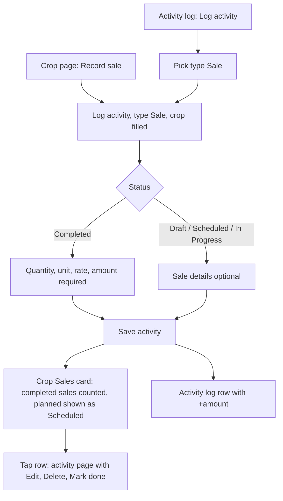

# Proposal

## Why

"Sale" is already one of the 12 activity types, yet a sale is recorded on a separate Record sale page and stored in its own `crop_sale` table. The two never meet: logging a "Sale" activity records no money, and a recorded sale never shows in the Activity log. Making a sale a real activity gives the farmer one place to record work and money, and gives Reports (roadmap 4.6) a single list to read sales from. It lands before `reports-redesign` so that change is not built on the old table.

## What Changes

- Choosing the **Sale** type on Log activity reveals "Sale details": quantity and unit, rate, amount (calculated, overridable) and buyer. The crop becomes required.
- Sale details are **required once the sale is Completed** and optional while it is Draft, Scheduled or In Progress, so a planned sale can be logged without figures.
- The five sale fields become real nullable columns on `activity` (not `activity_meta`).
- The Record sale page, its routes, and the `/crops/{id}/sales` endpoints are removed. "Record sale" buttons open Log activity with type Sale and the crop filled in.
- The crop page Sales card reads the crop's Sale activities. Total sales, Profit and Profit per acre count only Completed sales; planned sales show as Scheduled rows. Rows open the activity page, where Edit and Delete now live.
- Activity log rows and the activity page show the sale amount and figures.
- A migration copies every existing `crop_sale` row into an activity (type Sale, status Completed). The `crop_sale` table is left unused for one release and dropped in a later change.
- **BREAKING (API):** `GET/POST/PATCH/DELETE /crops/{id}/sales...` are removed. The only client is this app.

Prototype: `design/prototype/myfarm-prototype.html`, screens `addact` (Sale details), `cropdetail` (Sales card), `actdetail` and `log` (Sale rows). Approved on 2026-11-01 and committed on this branch.

## Capabilities

### New Capabilities
<!-- none -->

### Modified Capabilities
- `crop-sales`: a sale is recorded, edited and deleted as an activity; the Sales card reads Sale activities; planned sales do not count towards totals.
- `activity-log-and-detail`: the Sale type shows Sale details, validates them by status, and the log row and activity page show the sale figures.

## Impact

- **Backend:** new migration (columns, data copy); `Activity` model, `ActivityCreate/Update/Read` schemas and the activities router (validation); remove sales routes, `schemas/crop_sale.py`, `tests/test_endpoints_crop_sales.py`; regenerate `openapi.json`.
- **Frontend:** activity form, activity page, activity list row, activity mapper and models; crop Sales card re-pointed to `ActivityService`; remove `crop-sales.service`, `sale-form.component`, their routes, contracts and translation keys; en/mr strings for Sale details.
- **Data:** existing sales migrated, none lost. Rollback: the `crop_sale` table is kept until the follow-up drop.
- **Roadmap:** adds this change before 4.6; 4.6 reads sales from activities.

## Non-goals

- Reports redesign (roadmap 4.6) and any Reports change.
- Logging a sale through the assistant chat.
- Multi-crop or multi-buyer sales, payments received, or stock tracking.
- Dropping the `crop_sale` table (follow-up change).
- Changing how expenses attach to activities.
