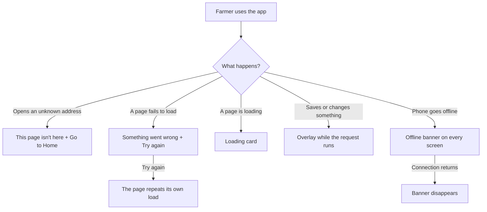

# Proposal

## Why

When something goes wrong, the app looks different on every screen. The 404 page has its own layout and old wording, one page shows a red "could not load" card while others rely on a toast, the loading overlay says "Loading..." in English only, and a farmer whose phone is offline gets no hint why saving fails. This change gives the four states one look and one set of words, matching the approved prototype and design system, so a failure always reads the same. It is roadmap item 5.2.

## What Changes

- **Page not found:** the unknown-address page becomes the empty-state card: "This page isn't here", "The link may be old or mistyped.", and a primary "Go to Home". It keeps the app shell around it.
- **Could not load:** one shared "Something went wrong" card with "Try again", which repeats the page's own load. The activity page uses it in place of its own error box.
- **Loading a page:** one shared loading card (spinner, "Loading…", one short line, announced as a status). The pages that show a full-page spinner today use it.
- **Loading after an action:** the global overlay keeps working as now, but its text is translated and its card is styled with the design tokens.
- **Offline:** while the device is offline, a "You are offline" banner sits at the top of every screen: "Saved screens still open, but changes need a connection." It cannot be dismissed and disappears when the connection returns.
- Hindi and Marathi text for all of it.

Prototype: `design/prototype/myfarm-prototype.html`, screen "System states", and the new States section of `design/prototype/myfarm-design-system.html`. Approved on 2026-11-01 and committed on this branch.

## Capabilities

### New Capabilities
- `system-states`: how the app looks and reads when a page is missing, fails to load, is loading, or the device is offline.

### Modified Capabilities
<!-- none: the app shell and localization requirements are unchanged; the new states are described in system-states. -->

## Impact

- **Frontend only:** a connection service and an offline banner in the shell; shared loading and load-error components; the 404 page; the loader overlay in the shared library (a translated label and token styling); the full-page spinners and the activity page's error box switch to the shared components; en, hi and mr strings and specs.
- **Backend / API:** none.
- **Roadmap:** ticks 5.2.

## Non-goals

- Skeleton screens, or changing which requests show the global overlay.
- An offline queue or offline writes: the app stays online-only.
- The shared banner component with stacking and dismiss rules (roadmap 5.1); the offline banner is moved onto it when that lands.
- Retry policies or automatic retries for failed requests.
- Changing toasts, form errors or the sign-in screen's own errors.
