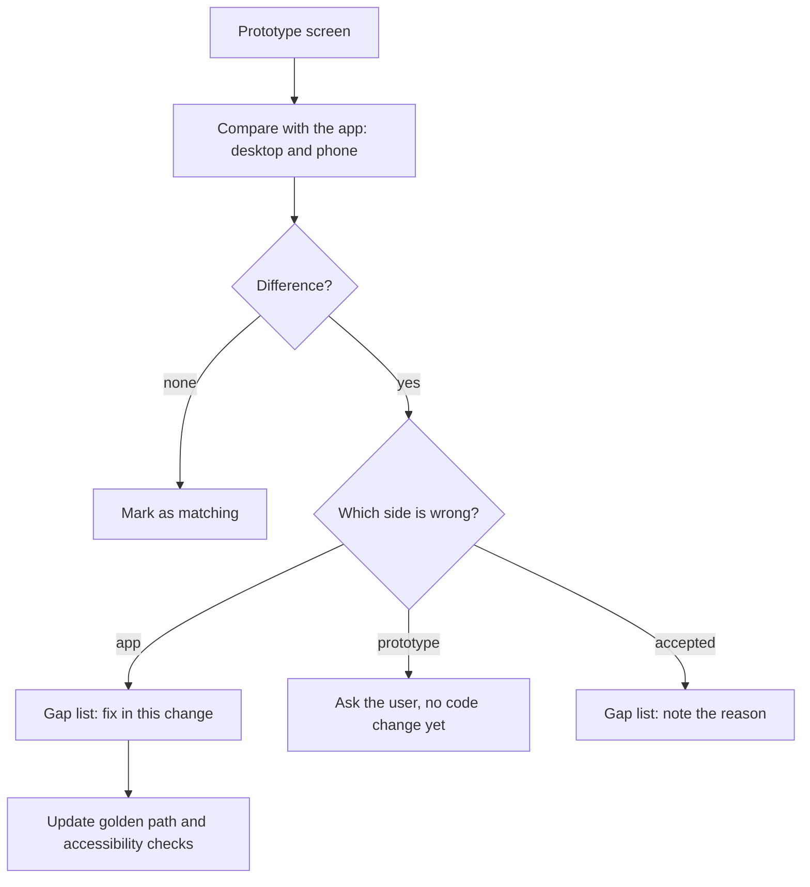

# Proposal

## Why

Every screen of the roadmap has been rebuilt from the prototype one change at a time. No one has yet put the finished app next to the prototype to see what still differs, on desktop and on a phone, and the Playwright golden path and accessibility have not been checked against the new screens as a whole. This change closes Phase 4 of the roadmap (item 5.3): it finds the remaining gaps, fixes them, and leaves the end-to-end test and accessibility in a known good state.

## What Changes

- **Parity review.** Each prototype screen (and its sub-screens) is compared with the running app on desktop and on a phone. Every difference is written into a gap list in `design.md`, each marked as an app gap, a prototype gap or an accepted difference.
- **Fix the app gaps.** Gaps marked as app gaps are fixed in this change. A gap that turns out to be a prototype error is not fixed in code: it is shown to the user first, and only the user decides whether the app or the prototype changes.
- **Golden path.** `e2e/golden-path.spec.ts` is updated to the current flow and wording (the roadmap changed screens, labels and routes since it was written) and keeps running on both Playwright projects, Desktop Chrome and Mobile Chrome.
- **Accessibility pass.** Each screen is checked for keyboard use, focus order, names for controls and images, contrast in both themes, and reduced motion; failures are fixed or listed.
- Hindi and Marathi text stays in step with any copy that changes.

Prototype: no change to `design/prototype/` is planned. If the review shows the prototype itself needs to change, that edit goes through the usual approval first and is added to this change as a separate step.

## Capabilities

### New Capabilities
<!-- none: this change reviews, fixes and tests existing behaviour; it adds no new capability. -->

### Modified Capabilities
<!-- none planned. If a fix changes what a screen must do (not only how it looks), add a delta spec to this change at that point and remove `skip_specs`. -->

## Impact

- **Frontend:** whatever the gap list names (templates, styles, strings, specs); no new screens.
- **E2E:** `e2e/golden-path.spec.ts` and, if needed, `e2e/login-pad.ts`; the CI `e2e` job runs it unchanged.
- **Backend / API:** none.
- **Roadmap:** ticks 5.3. Item 5.4 (update `ROADMAP.md`, archive the roadmap) follows.

## Non-goals

- Weather (4.5) and price alerts (4.3b): both are on hold. They are listed in the gap list as known gaps and not reviewed in depth.
- New features, new screens, or redesigns. The review only aligns the app with the approved prototype.
- Changing the prototype or the design system without the user's decision.
- A visual regression tool or screenshot baselines.
- Performance work and the bundle budget warning.
