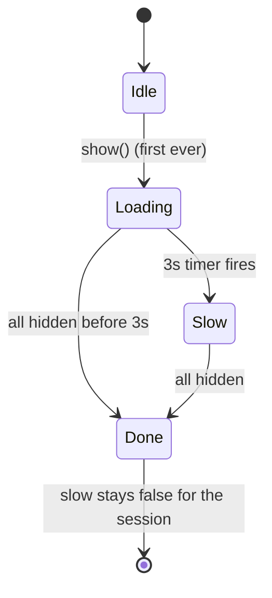

# Design

## Context

- `HttpService` wraps every call in `withLoader`, which calls `LoaderService.show()`/`hide()`; `<lib-loader-outlet>` in `app-layout.html` shows the overlay while `isLoading()` is true. The outlet already takes a translated `label` (added by `system-states`). The shared library has no translation dependency, so the app passes text in.
- On a cold start the first request is session restore (`AuthService.loadSession`), and `app-layout` renders nothing until it finishes, so the overlay is what the farmer sees.
- Prototype: screen "System states", the "Slow start" card.

## Decisions

**1. The timing lives in `LoaderService`.** It already knows when loading starts and stops, so it exposes a readonly `slow` signal: true when a load has been running for 3 seconds and no load has finished yet in this session.

- When `isLoading` turns true for the first time, start a 3-second timer; when it fires and loading is still on, set `slow` true.
- When `isLoading` turns false for the first time, clear the timer, set `slow` false, and mark the first load done; the timer never starts again.
- The timer is a plain `setTimeout` started from `show()` and cleared from `hide()`; no `effect()`. The delay is a constant (`SLOW_START_MS = 3000`) in the service, with the service's constructor unchanged so existing specs and consumers keep working.

**2. The outlet shows the note.** `LoaderOutletComponent` gains an optional `slowNote` input (default empty). When `loaderService.slow()` is true and the note is not empty it renders `` under the label inside the same `role="status"` card, so it is announced with the label. `app-layout` passes the translated `states.loading.slow`.

**3. Why not the page-level card.** The page-level `app-page-loading` appears after the shell is up, which is after the cold start; the overlay is the only thing on screen during it.

**4. Strings.** One new key, `states.loading.slow`, in en, hi and mr. The translation check must pass.

**5. Testing.** Specs use Jasmine's fake clock: `slow` is false before 3 seconds, true after, false once loading ends; a fast load never sets it; a second load after the first never sets it; overlapping requests keep one timer. The outlet spec checks the note renders only when `slow` is true and a note is given.
