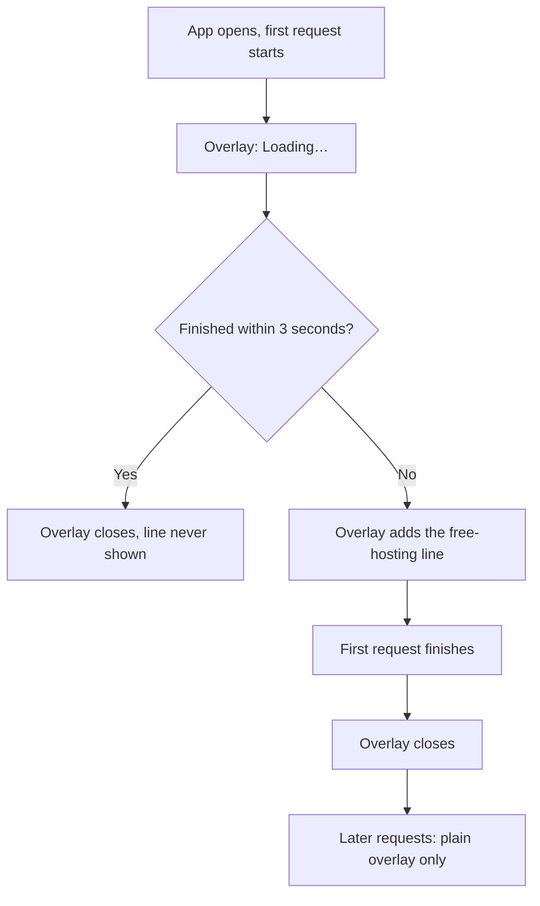

# Proposal

## Why

The app is hosted on free plans (Render for the API, Neon for the database). After a quiet spell both go to sleep, so the first request of a session can take up to a minute. Today the farmer sees only the plain "Loading…" overlay for that whole time and cannot tell a slow start from a broken app. This change adds one friendly line to the loader when the first load runs long. It resolves GitHub issue #404.

## What Changes

- **Slow start line:** if the first load of a session is still running after 3 seconds, the loading overlay shows a second, muted line under "Loading…": "The app runs on free hosting, so the first load can take up to a minute. Thanks for waiting."
- A fast start never shows the line. After the first load has finished once, later requests never show it, so it is never wrong about "first load".
- The line is translated into Hindi and Marathi.
- The loading card for a page (`app-page-loading`) is unchanged; only the overlay, which is what covers the cold start, gets the line.

Prototype: `design/prototype/myfarm-prototype.html`, screen "System states", the "Slow start" card, and the States section of `design/prototype/myfarm-design-system.html`. Approved on 2026-11-03 and committed on this branch.

## Capabilities

### New Capabilities
<!-- none -->

### Modified Capabilities
- `system-states`: adds the slow-start line to the loading-after-an-action overlay.

## Impact

- **Frontend only:** `LoaderService` and `LoaderOutletComponent` in the shared library (a `slow` signal and an optional note), `app-layout` passes the translated note, en, hi and mr strings, specs.
- **Backend / API:** none. The cold start itself is not changed.
- **Roadmap:** no roadmap item; this is issue #404.

## Non-goals

- Making the cold start faster (keep-alive pings, a paid plan, a warm-up job).
- A progress bar, a countdown, or a "retry" button during the wait.
- Showing the line on later slow requests or on the page-level loading card.
- Changing which requests show the overlay.
