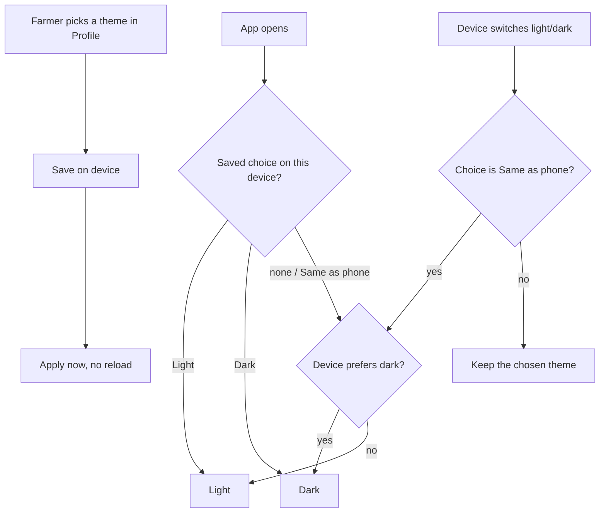

# Proposal

## Why

The design tokens now carry a full dark palette, and a forced `data-bs-theme="dark"` already renders every route correctly, but nothing lets a farmer choose it. Today the app is always light, even on a phone set to dark mode, and a farmer working at night or in bright sun has no way to change it. This change is task 1.2 of `prototype-adoption-roadmap`. The prototype already shows the behaviour: Profile → App → Theme with Same as phone, Light and Dark.

Prototype references:
- Prototype → Profile → App → Theme row and its edit dialog: `design/prototype/myfarm-prototype.html`
- Design system → Foundations (theme toggle, light and dark palettes): `design/prototype/myfarm-design-system.html`

## What Changes

- **A Theme setting with three choices:** Same as phone (the default), Light and Dark. It sits in Profile, next to Language, and applies immediately with no save button and no reload.
- **Same as phone follows the device live:** if the phone switches to dark at sunset, the app follows without a reload.
- **The choice is remembered on this device.** It is applied before the first screen draws, so there is no flash of the wrong theme on load, on the login page or after a refresh.
- **The browser UI follows the theme:** the address-bar colour (`theme-color`), scrollbars, date pickers and other built-in controls switch with the app.
- **Parts that cannot follow CSS alone are handled:**
  - the weather history chart redraws with the new colours
  - the Leaflet map controls (zoom buttons, attribution, popups) use the tokens, since Leaflet ships white controls
- **Every route is checked in both themes** on desktop and phone widths.

## Capabilities

### New Capabilities

- `app-theme`: the Light / Dark / Same as phone choice, how it is stored and applied, and what must follow it (browser UI, charts, map controls).

### Modified Capabilities

- `design-system`: the scenario "Dark values exist but are inactive" no longer holds. The dark palette is now used when the theme resolves to dark, and every colour must stay readable in both.

## Non-goals

- **Syncing the choice across devices or to the account.** It is stored on the device only (see design). A backend field can be added later if farmers ask for it.
- **A theme toggle in the header or on the login page.** The prototype only has it in Profile.
- **Retheming map tiles or satellite imagery.** Only the map's controls and popups change.
- **New screens or layout changes**, and the Profile redesign (task 2.2). The Theme row is added to the existing Profile page and moved with it later.
- **More than two palettes** (high-contrast, sepia and so on).

## Impact

- **Frontend:**
  - new `core/theme/theme.service.ts` and an app initializer
  - a small inline script and meta tags in `projects/home/src/index.html`
  - a Theme row on the Profile page and its i18n strings (`en`, `hi`, `mr`)
  - `history-trend` chart redraw on theme change
  - Leaflet control overrides in the global styles
- **Storage:** one new `localStorage` key for the device preference. This is a deliberate exception to "features do not use `localStorage`" (see design).
- **Backend and API:** none.
- **Tests:** a unit spec for the service, a Profile spec for the row, and a headless route check in both themes. The Playwright golden path should pass unchanged.
