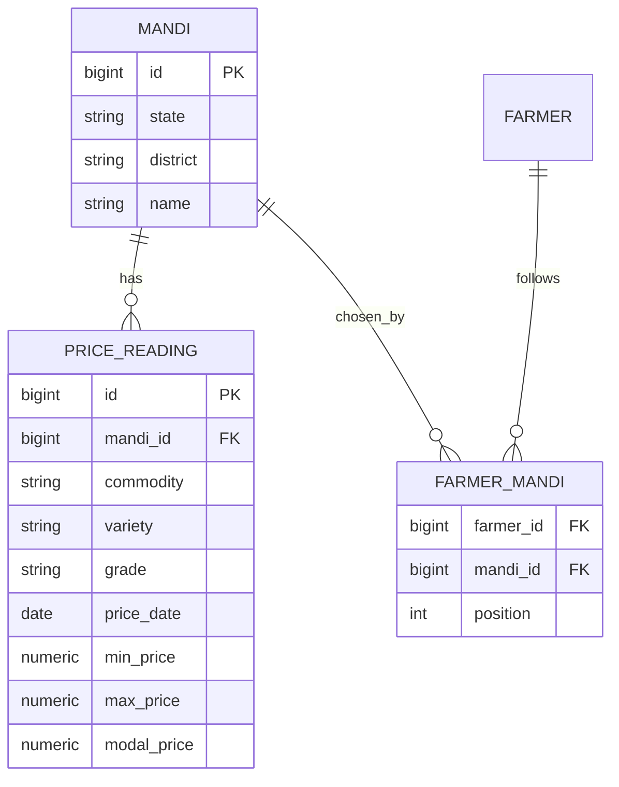

# Design

## Context

MyFarm's backend is FastAPI on Render's free instance (sleeps after 15 minutes idle, no scheduler) with Neon Postgres on the free plan (0.5 GB). Admin routes already exist behind an `X-Admin-Token` header (`routers/admin.py`). `crop_catalog` holds crop species; `land` carries a district and village. Tenancy is enforced by the base repository and a cross-tenant 404 test per endpoint (RLS is not available on Neon). See proposal.md for why and for what is out of scope.

## Goals / Non-Goals

**Goals:**
- A daily, idempotent ingest that runs on free tiers.
- Fast reads for the list, detail and history screens.
- A database that stays small without anyone tidying it.

**Non-Goals:**
- Backfill, alerts, intraday data, distance, other states.

## Decisions

1. **The feed contract (from the dataset's API tab) and what is still open.** The source is the data.gov.in dataset "Current Daily Price of Various Commodities from Various Markets (Mandi)" (Agmarknet), resource `9ef84268-d588-465a-a308-a864a43d0070`. The endpoint shown on the dataset's API tab is `https://api.data.gov.in/resource/9ef84268-d588-465a-a308-a864a43d0070?` followed by the query parameters below (a third-party page claiming this host was retired on 30 Sep 2026 is contradicted by the tab). The documented query parameters are:

   | Parameter | Use |
   |---|---|
   | `api-key` (required) | the free key, sent as a query parameter |
   | `format` (required) | `json` (also `xml`, `csv`) |
   | `offset`, `limit` | paging: records to skip, and the page size |
   | `filters[state.keyword]` | exact state, for example `Maharashtra` |
   | `filters[district]`, `filters[market]`, `filters[commodity]`, `filters[variety]`, `filters[grade]` | exact-match filters, ANDed |

   The response (a real sample from 17 Oct 2026) is an envelope `{status, total, count, limit, offset, records[]}` with `updated_date` at the top. Each record has `state`, `district`, `market`, `commodity`, `variety`, `grade`, `arrival_date` (a `dd/mm/yyyy` string), and numeric `min_price`, `max_price`, `modal_price`. All 10 sampled records were dated the day of the update, and `total` was 14,962 for all of India, so the feed carries the current day, not a history. That is why we store each day ourselves. Names are the feed's own spellings (for example "Soyabean", "Paddy(Common)", "Banana - Green", and states such as "Keralam"), so every filter value is copied from the feed, never guessed.

   Still open, so task 1.1 narrows to these: (a) the maximum `limit`; (b) the exact feed spellings of Maharashtra and of our crops' commodities (for example Onion, Tomato); (c) that our key works from Render. The sample above, trimmed, becomes the test fixture.
2. **Maharashtra only, for now.** The feed has no call that lists distinct states, districts or markets, so the pickers read our own `mandi` table, which the ingest fills from the rows it sees. Covering other states would mean either storing about 3 to 4 thousand rows a day (too much for Neon's free tier) or storing prices only for followed mandis; both are deferred.
3. **Ingest by commodity, not by mandi.** One request series per mapped commodity, filtered with `filters[state.keyword]=Maharashtra` and `filters[commodity]=<name>`, paged with `offset` and `limit`, so the number of calls follows the number of commodities, not markets. Mandis are discovered from the rows: `mandi` is upserted on (state, district, name). This is why there is no mandi seed and why search covers every market the feed reports.
4. **Idempotent storage.** `price_reading` has a unique key (mandi, commodity, variety, grade, price date), where the price date is the record's `arrival_date` parsed from `dd/mm/yyyy`. The feed reports several grades for one variety on one day, so grade is part of the key; the ingest upserts on it, so reruns and retries are safe. Prices are stored as the feed gives them (per quintal, `Numeric(10,2)`).
5. **Trigger by GitHub Actions.** A scheduled workflow (daily, after the feed normally updates) calls `POST /api/v1/admin/prices/ingest` with the admin token. Waking a sleeping Render instance takes about a minute, so the workflow retries with a generous timeout. The workflow fails visibly when the call fails, which is the alert. A manual `workflow_dispatch` allows a rerun.
6. **Retention of 400 days**, pruned at the end of each successful ingest. At roughly a thousand rows a day this caps the table near 400k rows, tens of MB.
7. **Commodity price is the median across varieties and grades** of that day's modal prices: simple, and robust to a single odd row. If a later screen needs varieties or grades, the stored rows already have them.
8. **Commodity mapping** is a nullable `price_commodity` column on `crop_catalog`, set by the migration for the crops MyFarm ships (for example Onion to "Onion"). A crop with null shows "No price".
9. **Chosen mandis** live in `farmer_mandi` (farmer, mandi, position), unique per (farmer, mandi), limited to five by the API. Replacing the list is one transactional call. The default (up to three mandis in the farm's district that have a price for one of the farmer's crops) is computed on read when the farmer has no rows and is not stored, so it improves as data arrives.
10. **Endpoints** (farmer-authenticated unless noted): `POST /api/v1/admin/prices/ingest` (admin token); `GET /api/v1/mandis/districts` and `GET /api/v1/mandis?district=&q=&commodity=&limit=` (Maharashtra only, so there is no state picker; a state list and filter can be added if coverage widens); `GET` and `PUT /api/v1/me/mandis`; `GET /api/v1/prices/latest`; `GET /api/v1/prices/history?mandi_id=&commodity=&days=7|30|365`. Price and mandi data are shared reference data, readable by any signed-in farmer; only `farmer_mandi` is tenant-scoped.

## Risks / Trade-offs

- **No API access** is the main risk (decision 1). Mitigation: the spike comes first and costs one task.
- **The feed lags or skips days**, and some mandis post rarely. The API returns the reading date and the app shows "Updated <date>"; history shows only real days.
- **A Render cold start or a failed run** loses a day, and a lost day cannot be recovered without a backfill. Accepted; the workflow can be rerun the same day.
- **Free-tier limits**: a daily write burst on Neon is small. If the readings table grows beyond expectations, shorten the retention.
- **Name mismatches** between the feed's commodity names and `price_commodity` would silently return "No price". The ingest logs commodities that matched no rows so a wrong name is noticed.
