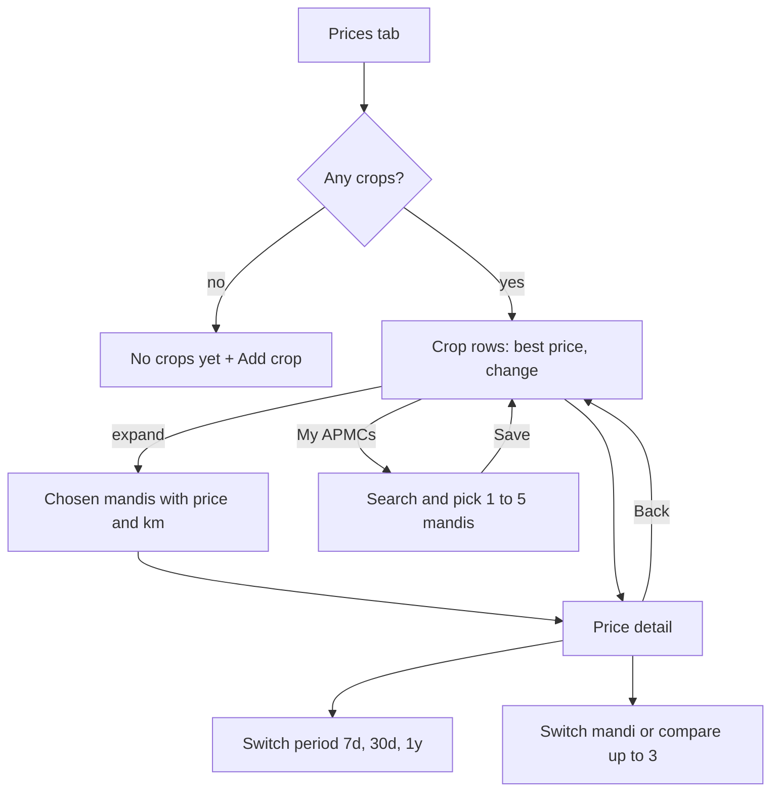

## Why

A farmer growing onion or tomato wants to know what their crop is fetching at the mandis near them, and whether now is a good time to sell. The prototype answers this with a Prices page, a price detail with charts, and a mandi picker. With the data layer from `market-price-data` in place, this change builds those screens. Roadmap task 4.2.

## What Changes

- **Prices page** (new sidebar and tab destination): one row for each crop on the farm showing the best price among the farmer's chosen mandis, per quintal, with the percentage change from the previous reading and the best mandi's name. Selecting the row's arrow shows each chosen mandi with its price, its district, the difference from the best, and a "Best" badge. A crop no mandi trades shows "Not traded"; a crop with no price at all shows "No price". A reading older than today shows "Updated <date>". An empty farm shows "No crops yet" with an Add crop button.
- **Price detail:** the crop and mandi, the latest price with "Updated" time, a "Below average", "Near average" or "Above average" badge, change facts, a line chart for 7 days, 30 days or 1 year with lowest, average and highest, mandi chips to switch market, and a Compare card to overlay up to three other mandis. When there is no new reading today the page says so.
- **My APMCs picker:** the farmer's chosen mandis (one to five) and a District filter, a search box and a "trades my crop" filter to find a Maharashtra mandi and add it, saved per farmer. A farmer who has never chosen starts with up to three mandis in their district that trade their crops.
- **No distance:** the data has no coordinates, so the prototype's "km away" is replaced by the mandi's district.
- **Days, not hours:** the prototype's intraday "Day" view is dropped; periods are 7 days, 30 days and 1 year.
- **History grows over time:** a period shows only the days that have readings, with a short note when the history is shorter than the period.
- Alerts and watchlists are not part of this change; the detail's Alerts card and the list tabs arrive with `price-alerts-and-watchlist`.

Prototype screens: `prices`, `pricedetail`, `apmcs` in `design/prototype/myfarm-prototype.html`.

## Capabilities

### New Capabilities
- `market-prices-screens`: the Prices page, the price detail and the My APMCs picker.

### Modified Capabilities
- `app-shell`: a Prices entry in the sidebar and bottom tabs, and route titles.

## Impact

- Frontend: new `features/prices/` with list, detail and picker pages, a prices service over the read API from `market-price-data`, a small chart component, route data and titles, i18n keys (mr, hi, en), specs.
- Backend: none beyond what `market-price-data` adds.
- Depends on `market-price-data` being merged and having run at least once.

## Non-goals

- Price alerts, watchlists and their banners (4.3).
- Intraday charts, forecasts or buyer offers.
- Selling flow or any link from a price to a recorded sale.
- Offline use; like the rest of the app this is online-only.
- A refresh or fetch button: prices are fetched by the self-hosted runner in India (`market-price-data`), and the pages only read what is stored.

## User journey

