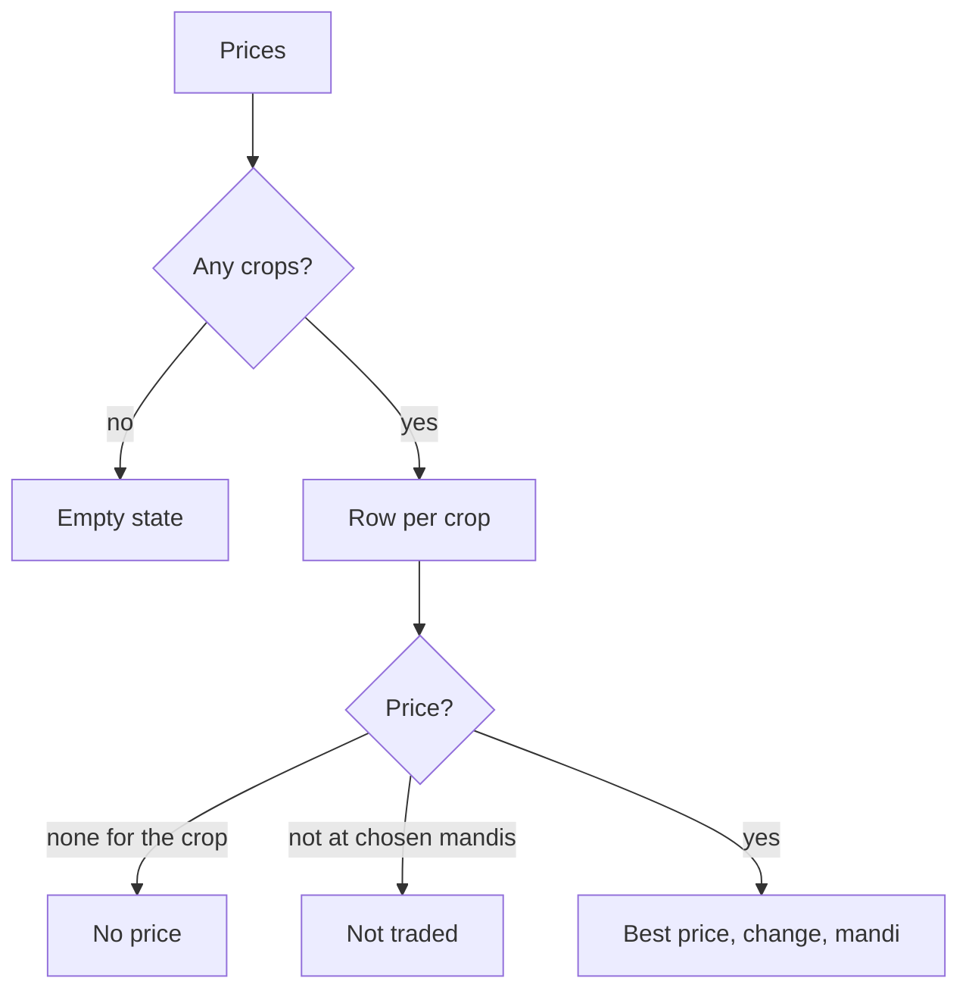

# market-prices-screens Specification

## Purpose
A farmer sees what each of their crops is fetching at the mandis they follow, opens one crop at one mandi to see its price over time, and chooses which mandis to follow.

## ADDED Requirements

### Requirement: Prices page
The Prices page SHALL show one row for each crop on the farm. A row SHALL show the crop's icon and name, the best price among the farmer's chosen mandis in rupees per quintal, the percentage change from the previous reading, and the best mandi's name. A change of zero SHALL read "No change". A price from an earlier day than today SHALL add "Updated <date>" to the row. A crop with no price commodity SHALL show "No price". A crop that none of the chosen mandis has a price for SHALL show "Not traded at your APMCs" and a "Change APMCs" button. With no crops the page SHALL show "No crops yet" and an Add crop button. A line under the heading SHALL say prices are per quintal and come from the mandis the farmer chose.

#### Scenario: Best of the chosen mandis
- **WHEN** onion is 2150 at Lasalgaon and 2040 at Nashik, both chosen, and Lasalgaon was 2020 on the previous reading
- **THEN** the onion row shows ₹2,150, +6.4% and Lasalgaon as the best mandi

#### Scenario: Stale price
- **WHEN** the latest onion reading is from three days ago
- **THEN** the row shows the price with "Updated" and that date

#### Scenario: No price commodity
- **WHEN** a crop has no matching price commodity
- **THEN** its row shows "No price" and no figure

#### Scenario: No crops
- **WHEN** the farm has no crops
- **THEN** the page shows "No crops yet" with an Add crop button

### Requirement: Mandis behind a price
A crop row SHALL expand to list each chosen mandi with its name and district, its price, the difference from the best price, and a "Best" badge on the highest. A chosen mandi with no price for the crop SHALL still be listed as "Not traded". Selecting a mandi SHALL open the price detail for that crop at that mandi.

#### Scenario: Expand
- **WHEN** the farmer expands the onion row
- **THEN** each chosen mandi is listed with its price, the best one has the "Best" badge, and the others show how much lower they are

#### Scenario: Not traded at one mandi
- **WHEN** a chosen mandi has no onion reading
- **THEN** it is listed as "Not traded" below the priced mandis

### Requirement: Price detail
The price detail SHALL show the crop and the mandi, the latest price per quintal with its reading date, a badge of "Below average", "Near average" or "Above average" comparing the latest price with the 30-day average (below by more than 3% is below, above by more than 3% is above), and the lowest, average and highest price for the selected period. A period control SHALL offer 7 days, 30 days and 1 year, starting on 30 days. The chart SHALL show one point for each day that has a reading. When the history is shorter than the period the page SHALL say it has fewer days than the period. Chips SHALL switch to another chosen mandi that has a price for the crop. When the latest reading is not from today the page SHALL say there is no new price today and give the last update date.

#### Scenario: Below average
- **WHEN** the latest price is 5% under the 30-day average
- **THEN** the badge reads "Below average"

#### Scenario: Short history
- **WHEN** only 4 days of readings exist and the period is 30 days
- **THEN** the chart shows 4 points and a note says only 4 days of history exist yet

#### Scenario: Switch period
- **WHEN** the farmer selects 7 days
- **THEN** the chart and the lowest, average and highest update to the last 7 days

#### Scenario: Switch mandi
- **WHEN** the farmer selects another mandi chip
- **THEN** the price, chart and figures show that mandi

### Requirement: Compare mandis
The price detail SHALL let the farmer add up to three other mandis that have a price for the crop and draw them on the same chart as separate lines with a legend of each mandi's latest price and its change over the period. Colours SHALL differ in more than hue so lines can be told apart.

#### Scenario: Add a comparison
- **WHEN** the farmer adds Pimpalgaon to the onion chart at Lasalgaon
- **THEN** a second line appears and the legend lists both mandis with their latest price and change

#### Scenario: Limit
- **WHEN** three comparison mandis are already added
- **THEN** the remaining mandi chips are disabled

### Requirement: My APMCs
A My APMCs page SHALL list the farmer's chosen mandis with a way to remove each, and a finder to add more: a District filter, a name search, and a "trades my crops" switch, with each result showing the mandi's name and district. The farmer SHALL be able to follow from one to five mandis; at five the finder SHALL say the limit is reached, and the last remaining mandi SHALL NOT be removable. Saving SHALL return to Prices with the new list. A farmer who has never chosen SHALL see the default mandis for their district, marked as suggested.

#### Scenario: Add a mandi
- **WHEN** the farmer filters to Nashik, finds Pimpalgaon and adds it
- **THEN** it appears in their list and Prices uses it after saving

#### Scenario: Limit of five
- **WHEN** the farmer already follows five mandis
- **THEN** adding is disabled with a message that the limit is reached

#### Scenario: Keep one
- **WHEN** the farmer follows only one mandi
- **THEN** it cannot be removed and is marked "Keep one"

#### Scenario: First visit
- **WHEN** a farmer in Nashik district who has never chosen opens My APMCs
- **THEN** up to three Nashik-district mandis are shown as suggested

### Requirement: Loading and failure states
While prices load, each screen SHALL show a loading state, and when they cannot be loaded SHALL show a short error with a Retry button. A crop price shows only when the price service replies; the screen SHALL NOT show invented or example prices. When the farmer has no saved district and has chosen no mandi, the Prices page SHALL send them to My APMCs with a message that they need to pick a mandi.

#### Scenario: Failure
- **WHEN** the prices request fails
- **THEN** the page shows an error with Retry and no prices

#### Scenario: Nothing chosen
- **WHEN** the farmer has no district and no chosen mandi
- **THEN** the Prices page asks them to pick a mandi and links to My APMCs
