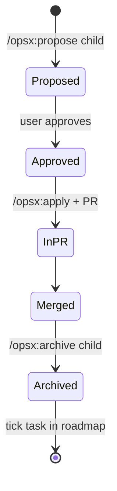

# Design

## Context

- **Prototype:** a single HTML file that renders a desktop frame (sidebar) and a phone frame (bottom tabs). It holds its own CSS tokens (`--s-*` spacing, `--r-*` radii, `--shadow-*`, colour and type tokens), a translation table (`TR`), and mock data. Its screens are login, home, lands, crops, crop detail, add crop, activity log, add activity, activity detail, add expense, add sale, prices, price detail, APMCs, alerts, watchlist, weather, reports, profile and the assistant chat.
- **Design system page:** documents every component, including brand, banners, activity statuses, the filter bar, settings rows and the empty-land card.
- **App today:**
  - Angular 20, standalone components with signals, and Bootstrap 5 themed through `_bootstrap-variables.scss` and `_design-system.scss` (Outfit font, "premium" look).
  - Routes cover home, login, map (lands), crops, activities, weather, profile, reports and a not-found page.
  - The chat bot is a side panel.
  - i18n has `en` and `hi`.
  - There are no prices, sales or watchlists.

## Goals / Non-Goals

**Goals**
- Reach visual and behavioural parity with the prototype on desktop and phone.
- Ship in small, reviewable PRs. Each one is a single child change that you approve before any code.
- Keep the app usable after every PR. Old and new screens may coexist briefly, but no route breaks.

**Non-Goals**
- The ones listed in the proposal: the Lands and Crops merge, the Daily brief, onboarding and the board.

## Decisions

1. **Tokens go into Bootstrap first.**
   - Prototype colours, radii, spacing, shadows and fonts are mapped onto Bootstrap Sass variables and CSS custom properties in `_bootstrap-variables.scss`, so existing `btn`, `card` and `badge` usage changes look before any template is touched.
   - Custom CSS is only for components Bootstrap lacks: Warli art, the filter bar, settings rows, banners and the fallow card.
   - Alternative: rewrite the styles from scratch. Rejected because it breaks every screen at once.
2. **The shell comes before the screens.** The sidebar, bottom tabs and header (with the avatar that opens Profile) are built once in `layout/`. The prototype's `TITLES` and `PARENT` maps become route `data` (`title`, `parent`) that drives the header title and the back button.
3. **One child change per prototype screen or feature.** Each child links the prototype screen, lists the design-system components it uses, and adds its own spec delta. A child that needs backend work carries those tasks in the same change, so the API and UI land together.
4. **Marathi first.** `mr` is already in `SUPPORTED_LANGUAGES` with a complete translation file; task 1.5 makes it the default for new farmers and for devices that have not chosen, and aligns the wording with the prototype's `TR` table. Children add their own keys in all three languages and must not hard-code English; the translation check (added in 1.5) enforces it.
5. **Linking child changes to the roadmap.** Each child is created with `openspec new change <name> --goal "prototype-adoption-roadmap: <phase>"`. When a child is archived, its task in `tasks.md` is ticked. The roadmap is archived last, after the parity review.
6. **Light and dark themes.** Both prototype palettes (`:root` and `[data-theme="dark"]`) map onto Bootstrap 5.3 colour modes (`data-bs-theme` on `<html>`). The setting has three values: System (the default, follows `prefers-color-scheme`), Light and Dark. It lives under Profile → App → Theme, as in the prototype. Components use CSS variables only, never hard-coded colours, so both themes work on every screen.
7. **Sequencing.** Phases run in order, and children within a phase can run in parallel unless the proposal diagram shows an arrow between them. Profile ships before Lands and Crops, because water source, irrigation and farming method move fields between those screens.

## Risks / Trade-offs

- **The look changes globally when tokens swap, before screens are redone.** Mitigation: the tokens PR includes a visual pass on every route and fixes only what breaks.
- **Market prices need a data source.** APMC price feeds may be unavailable or rate-limited. Mitigation: the market-prices child starts with `/opsx:explore` to choose the source, and the phase can ship sales first.
- **Moving fields** (water source to the land; irrigation and farming method to the crop) needs a backend migration with a data copy. Mitigation: the profile-settings child owns the migration and the old fields are dropped one PR later.
- **Scope creep from the prototype's mock data.** Only behaviour shown in the prototype is in scope. Anything else becomes a new child change.

## Open Questions

- Which price data source should be used (Agmarknet, data.gov.in, or a manual feed)? This is decided in the market-prices child.
- Should sale and price alerts be push (PWA) notifications or in-app banners only? This is decided in banners-and-notifications.
