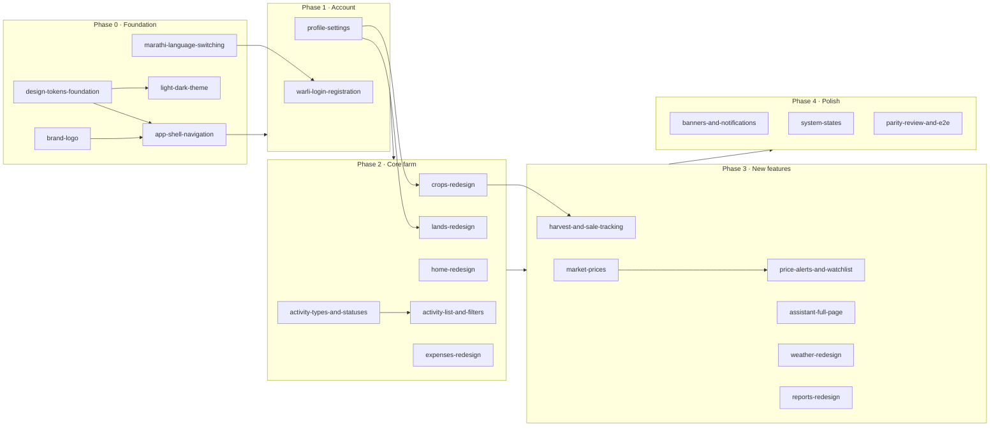

# Proposal

## Why

The interactive prototype (`design/prototype/myfarm-prototype.html`) and its design system (`design/prototype/myfarm-design-system.html`) now define how MyFarm should look and behave. That means a native, Marathi-first farmer aesthetic, Warli art, the leaf logo, and several new features. The Angular app still uses the older "premium" Bootstrap look (Outfit font, generic cards) and lacks prices, sales and the redesigned flows. Adopting the whole prototype is too large for one change, so this parent change holds the roadmap: the order, the dependencies and the definition of done. Each step ships as its own child change.

## What Changes

This change ships no code. It is an umbrella for the following child changes, grouped into phases. Each child change is created with `/opsx:propose` when its phase starts, carries a `goal` starting with `prototype-adoption-roadmap:` in its `.openspec.yaml`, and is ticked off in `tasks.md` once archived.

- **Phase 0, Foundation:** design tokens and shared components, light and dark themes, the brand logo, the app shell and navigation, and Marathi with language switching. Every later screen depends on these.
- **Phase 1, Account:** Warli login and registration, and the Profile settings list with its edit dialog.
- **Phase 2, Core farm screens:** the Home redesign, Lands with the fallow empty state, Crops and crop detail, activity types and statuses, the activity list with its filter bar, and expenses.
- **Phase 3, New features:** harvest and sale tracking (the existing empty change), market prices, price alerts and watchlist, the full-page assistant, the Weather redesign and the Reports redesign.
- **Phase 4, Polish and parity check:** banners and notifications, error, 404, offline and loading states, PWA icons, accessibility, and an updated e2e golden path. The phase ends with a screen-by-screen parity review against the prototype.

## Capabilities

This roadmap declares no requirements of its own (`skip_specs: true`). The capabilities below are created or modified by the child changes.

### New Capabilities

- `design-system`: tokens, typography, shared UI components (child: design-tokens-foundation, brand-logo)
- `app-theme`: light and dark themes with a System / Light / Dark setting (child: light-dark-theme)
- `app-shell`: desktop sidebar, phone bottom tabs, header, back and title rules (child: app-shell-navigation)
- `localization`: Marathi-first language switching (child: marathi-language-switching)
- `auth-onboarding`: Warli login and registration (child: warli-login-registration)
- `farmer-profile`: settings list and edit dialog (child: profile-settings)
- `land-management`, `crop-management`, `activity-tracking`, `expense-tracking`: core farm screens (Phase 2 children)
- `harvest-sales`, `market-prices`, `price-alerts`: new features (Phase 3 children)
- `notifications`: banners (child: banners-and-notifications)

### Modified Capabilities

- `assistant-chat-history`, `assistant-data-answers`, `assistant-intent-routing`: changed by assistant-full-page
- `assistant-daily-brief`: unchanged for now; the Daily brief card is parked

## Non-goals

- Merging the Lands and Crops tabs. The merge options were reviewed and dropped, so they stay separate.
- The Home Daily brief card and the onboarding checklist. Both are parked until a new design is chosen.
- Backend Stage 6 (server-side weather key, photo attachments) and Stage 7 (phone OTP). They stay on their own track unless a child change needs them.
- Tracking work on the GitHub Project board.

## Impact

- **Frontend:** `projects/home/src/styles/**` (token swap from the Outfit/premium theme), `layout/**`, every `features/**` screen, the `projects/shared` components, `public/i18n/*.json` (adds `mr`), and the PWA icons.
- **Backend:**
  - New tables and endpoints for sales, prices, watchlists and alerts.
  - Water source moves to the land, and irrigation and farming method move to the crop.
  - Activity statuses grow to five.

  Each of these is described in its own child change.
- **Docs:** `ROADMAP.md` §4 points here, and the child changes replace ad-hoc plans.
