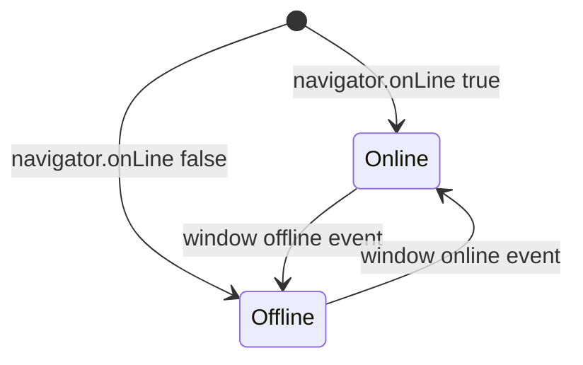

# Design

## Context

- `HttpService` wraps every call in `withLoader` and `withErrorToast`, so the global `<lib-loader-outlet>` (in the shared library, placed in `app-layout.html`) already shows while any request runs; its text is a hard-coded "Loading..." and it uses the `--mf-*` tokens.
- The empty-state pattern exists in the app as `.empty-state` (`styles/components/_empty-state.scss`): round leaf icon, display-font title, muted line, optional action. Lists use it.
- `NotFoundComponent` has its own centred layout, Bootstrap rounded-pill button and scoped CSS, wired to the `**` route; keys `notFound.*` carry the old wording.
- Pages with a full-page spinner: activity detail, crop dashboard, activity dashboard, activity list, prices list, price detail and My APMCs. Only the activity page has its own "could not load" box; the others report failures through the toast.
- The app is online-only (no outbox) and registers a service worker for the shell.
- The shared banner component with kinds and stacking does not exist yet (roadmap 5.1), so there is no `.bn` in the app.

## Decisions

**1. Build on `.empty-state`, not a new pattern.** Not found, could not load and loading are all the same card with a different icon, text and button, so they look like every empty list. Two small presentation components live in `features/shared/states/`:
- `app-page-loading`: spinner (Bootstrap `spinner-border`, which already honours reduced motion), the title "Loading…" and a short line; `role="status"`.
- `app-load-error`: warning icon, title, line and a primary button; emits `retry`. No service injected; the page decides what retry means.
`NotFoundComponent` is rewritten on `.empty-state` directly (it only needs a router link).

**2. Retry belongs to the page.** `app-load-error` only raises `retry`. The activity page calls its existing `reload(id)`; a future page does the same. No global retry mechanism, no automatic retries (non-goal), which keeps a failed request from being repeated behind the farmer's back.

**3. Adoption is limited to full-page spinners.** The seven pages above replace their spinner block with `app-page-loading`; buttons' inline spinners and the review popup are untouched. Only the activity page swaps its error box for `app-load-error`, since the others have no inline error today.

**4. Overlay stays, text and style change.** `LoaderOutletComponent` gains a `label` input (default "Loading..." so the shared library stays dependency-free); `app-layout` passes the translated `common.loading`. The card uses the token surface, border and radius from the design system. Which requests show it is unchanged (non-goal).

**5. A `ConnectionService` and an offline banner.**

- `ConnectionService` (`providedIn: 'root'`) exposes `online` as a readonly signal, initialised from `navigator.onLine` and updated from the window `online` and `offline` events (listeners removed on destroy; no `effect()`).
- `app-offline-banner` reads `online` and renders the Problem-style banner (Bootstrap `alert` classes shaped like the design system's `.bn.k-critical`: icon chip, small label, bold title, one muted line, `role="alert"`, no close button). It sits at the top of `#main-content` in `app-main` for signed-in users and above the router outlet in the signed-out branch, so it never changes the layout grid.
- When 5.1 lands, this banner is re-expressed through the shared banner component as the "problem" kind; the text and rules do not change.
- `navigator.onLine` can be true on a network that goes nowhere; the banner is a hint, and failed requests still show the existing error toast.

**6. Strings.** `notFound.*` changes to the approved wording; new `states.*` keys hold loading, error and offline text in en, hi and mr. The translation check must pass.

## Risks and trade-offs

- **False "online".** Captive portals or dead links leave `onLine` true; the banner then stays hidden while requests fail with toasts. Accepted: no probe requests (they would add traffic and false alarms).
- **Banner height shifts content** when it appears. Accepted, it is meant to be noticed; it does not overlap the header or tab bar.
- **Seven pages touched** for the loading card. Each is a small template swap with its spec asserting the card; if a page's markup differs, it keeps its spinner and is listed in the PR.

## Migration

None. Rollback is reverting the frontend.

## Open questions

None blocking. Assumed: the loading line reads "Getting your farm ready." everywhere; a page-specific line can be passed later.
