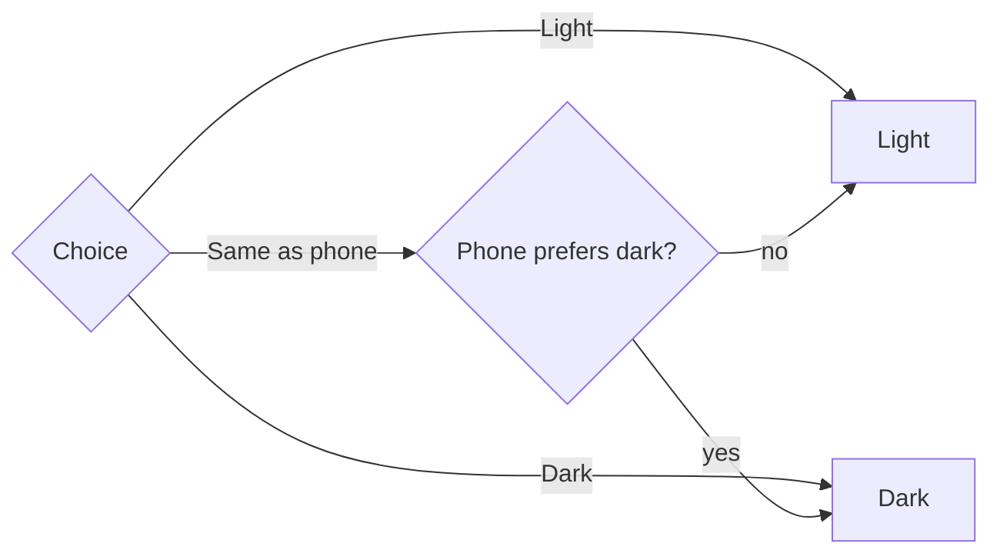

# app-theme Specification

## Purpose
The app lets a farmer choose how it looks: Light, Dark, or Same as phone. The choice is remembered on the device and applied before the first screen draws, so the app never flashes the wrong theme.

## Requirements

### Requirement: Farmers can choose Same as phone, Light or Dark
The app SHALL offer a Theme setting in the Profile screen with three choices: Same as phone, Light and Dark. Same as phone SHALL be the default for a device that has never chosen. Changing the choice SHALL apply immediately, without a save button, a reload or a sign-in.

#### Scenario: Default on a new device
- **WHEN** a farmer opens the app on a device with no saved choice
- **THEN** the Theme setting shows Same as phone as selected, and the app uses the phone's current light or dark setting

#### Scenario: Choosing Dark
- **WHEN** a farmer selects Dark in Profile
- **THEN** every screen switches to the dark palette at once, the Dark option shows as selected, and no reload is needed

#### Scenario: Choosing Light on a dark phone
- **WHEN** the phone is set to dark and the farmer selects Light
- **THEN** the app renders in the light palette

#### Scenario: Setting is reachable without a mouse
- **WHEN** a farmer uses only the keyboard or a screen reader on the Theme setting
- **THEN** each choice can be focused and selected, and the selected choice is announced as selected

### Requirement: Same as phone follows the device while the app is open
When the choice is Same as phone, the app SHALL switch between light and dark whenever the device's own setting changes, without a reload.

#### Scenario: Phone switches to dark at night
- **WHEN** the choice is Same as phone, the app is open in light, and the device changes to dark
- **THEN** the app switches to the dark palette without a reload

#### Scenario: Chosen theme ignores the device
- **WHEN** the choice is Light or Dark and the device setting changes
- **THEN** the app keeps the chosen theme

### Requirement: The choice is remembered on the device and applied before first paint
The app SHALL store the farmer's choice on the device and SHALL apply the resulting theme before any screen is drawn, including the login page and after a reload. The choice SHALL survive signing out and signing in again, and SHALL NOT be sent to the server. If the device cannot store it (for example private browsing), the app SHALL still work and use Same as phone.

#### Scenario: Reload keeps the choice
- **WHEN** a farmer chooses Dark and reloads the app
- **THEN** the first frame drawn is already dark, with no flash of the light theme

#### Scenario: Sign out and back in
- **WHEN** a farmer signs out and signs in again on the same device
- **THEN** the same theme choice is still active, including on the login page

#### Scenario: Another tab changes the choice
- **WHEN** the choice is changed in one open tab
- **THEN** other open tabs of the app switch to the same theme

#### Scenario: Storage is unavailable
- **WHEN** the device blocks local storage
- **THEN** the app loads normally, uses Same as phone, and the Theme setting still works for the current visit

### Requirement: Browser and built-in controls follow the theme
The app SHALL tell the browser which theme is active so that browser-drawn parts match it: the address bar colour on phones, scrollbars, text selection, and built-in form controls such as date pickers and select menus.

#### Scenario: Dark address bar
- **WHEN** the app is dark on a phone browser that supports a theme colour
- **THEN** the address bar colour matches the dark page background

#### Scenario: Built-in controls in dark
- **WHEN** a date picker or select menu opens while the app is dark
- **THEN** it is drawn in the dark style, not as a bright white panel

### Requirement: Charts and map controls follow the theme
Parts that cannot take their colours from CSS alone SHALL still follow the active theme. The weather history chart SHALL redraw with the new palette when the theme changes. The map's zoom buttons, attribution and popups SHALL use the theme's colours.

#### Scenario: Chart after switching theme
- **WHEN** the weather history chart is on screen and the theme changes
- **THEN** the chart's lines, grid, labels and tooltip are redrawn in the new theme's colours without a reload

#### Scenario: Map controls in dark
- **WHEN** the map is shown in the dark theme
- **THEN** its zoom buttons, attribution and popups use dark surfaces with readable text, not white

### Requirement: Every screen is readable in both themes
In both themes, every screen SHALL keep text readable against its background and SHALL NOT show bright light-theme surfaces in the dark theme or the reverse. This applies to login, home, lands, crops, crop detail, add crop, activities (dashboard, list, detail, create), weather, profile, reports and the not-found page, at desktop and phone widths.

#### Scenario: Dark theme has no bright patches
- **WHEN** any listed screen is shown in the dark theme
- **THEN** cards, tables, forms, dialogs, toasts, the sidebar and the header use dark surfaces, and body text keeps enough contrast to read

#### Scenario: Light theme is unchanged
- **WHEN** any listed screen is shown in the light theme
- **THEN** it looks the same as before this change
