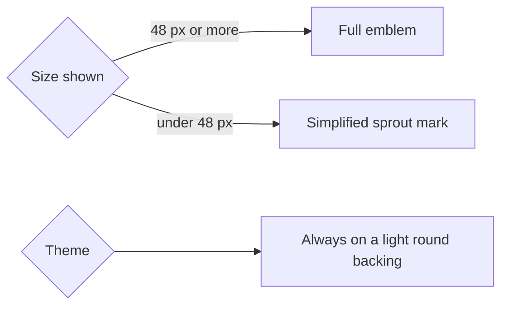

# brand-identity Specification

## Purpose
The MyFarm logo is the app's identity: the sprout emblem inside a leaf ring. It must look right in the app header, on the login page, in the browser tab and as the installed-app icon, at every size and in both themes.

## Requirements

### Requirement: The MyFarm logo is the app's brand mark
Everywhere the app shows its own brand mark, it SHALL show the MyFarm logo and not a generic icon. This covers the header or sidebar brand and the login page. The mark SHALL be a single reusable component so every placement looks the same.

#### Scenario: Header shows the logo
- **WHEN** a signed-in farmer opens any screen
- **THEN** the header or sidebar brand shows the MyFarm logo next to the app name, not a tree icon

#### Scenario: Login shows the logo
- **WHEN** the login page is shown
- **THEN** the brand area shows the MyFarm logo at a larger size above the app name

#### Scenario: Logo loads without layout shift
- **WHEN** the page loads on a slow connection
- **THEN** space for the logo is reserved at its final size, so nothing moves when the image arrives

### Requirement: Small sizes use a simplified mark
The full emblem SHALL be used at 48 px and larger. Below 48 px, including the favicon and browser tab, the app SHALL use a simplified sprout mark in the same ring, because the emblem's fine detail cannot be read when small.

#### Scenario: Large placement
- **WHEN** the logo is shown at 48 px or larger
- **THEN** it is the full emblem with sprout, sun, field and roots

#### Scenario: Small placement
- **WHEN** the logo is shown smaller than 48 px
- **THEN** it is the simplified sprout mark, and it is recognisable as the same brand

#### Scenario: Browser tab
- **WHEN** the app is open in a browser tab
- **THEN** the tab icon is the simplified mark, not the Angular logo or a blank page icon

### Requirement: The logo is visible in both themes
In the light and dark themes the full emblem SHALL be drawn on a light round backing so its dark ring and soil stay visible. The backing colour SHALL come from a design token and SHALL be the same in both themes.

#### Scenario: Dark theme
- **WHEN** the app is in the dark theme
- **THEN** the emblem is fully visible, with its ring, sprout and roots clear against a light round backing, not blended into the dark page

#### Scenario: Light theme
- **WHEN** the app is in the light theme
- **THEN** the emblem looks the same as in dark, on the same backing

### Requirement: Installed-app and browser icons use the logo
The favicon, the Apple touch icon and every installed-app (PWA) icon listed in the web manifest SHALL be the MyFarm logo. The manifest SHALL include icons for both normal and maskable use, with the maskable versions keeping the emblem inside the safe zone so it is not cropped when the phone applies a circle or rounded-square shape. Every icon listed in the manifest SHALL exist at its stated size.

#### Scenario: Installing on Android
- **WHEN** a farmer installs the app to their home screen
- **THEN** the home-screen icon is the MyFarm logo, fully visible inside the shape the phone applies

#### Scenario: Apple home screen
- **WHEN** a farmer adds the app to an iPhone home screen
- **THEN** the icon is the MyFarm logo on a solid background, with no transparent corners

#### Scenario: Manifest lists real files
- **WHEN** the icon check runs
- **THEN** it fails if any manifest icon file is missing or its pixel size differs from the size the manifest states

### Requirement: The logo is accessible
When the logo appears next to the app name, it SHALL be treated as decoration and hidden from screen readers so the name is not read twice. When it appears alone, it SHALL have the text alternative "MyFarm".

#### Scenario: Logo beside the name
- **WHEN** a screen reader reads the header
- **THEN** it reads the app name once and skips the logo image

#### Scenario: Logo alone
- **WHEN** the logo is shown without the app name next to it
- **THEN** the image has the text alternative "MyFarm"

### Requirement: Brand assets are generated from one master
All raster logo sizes and icons SHALL be generated from a single high-resolution master image kept in the repository, by a repeatable script, so a logo update means replacing one file and running one command.

#### Scenario: Regenerating
- **WHEN** a developer runs the brand build command
- **THEN** every emblem size, installed-app icon, Apple touch icon and favicon is rewritten from the master and the small mark, with the same results every time
