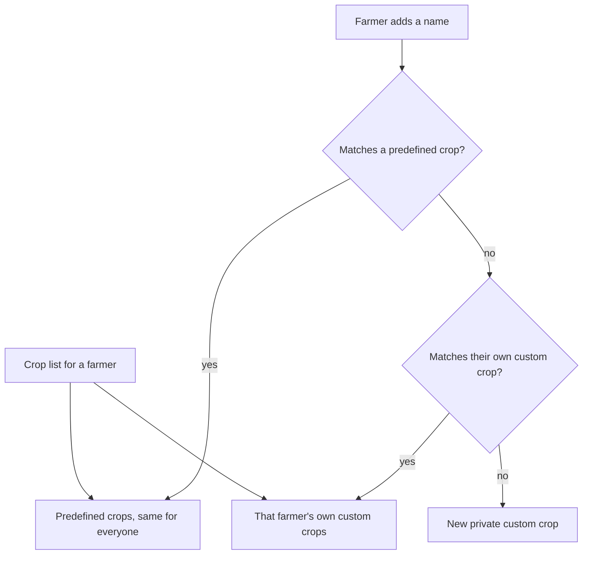

# crop-catalog Specification

## Purpose
Farmers choose the crop they grow from a ready list of common crops in their own language, and add a crop of their own only when it is missing.

## Requirements

### Requirement: Predefined crop list
The app SHALL offer a predefined list of common crops that is the same for every farmer, in the groups Cereals, Pulses, Oilseeds, Cash crops, Vegetables, Fruits and Other. The list SHALL include at least Wheat, Rice, Maize, Jowar, Bajra, Tur, Gram, Moong, Urad, Soybean, Groundnut, Sunflower, Mustard, Cotton, Sugarcane, Turmeric, Onion, Tomato, Potato, Brinjal, Cabbage, Cauliflower, Okra, Green chilli, Garlic, Ginger, Capsicum, Grapes, Pomegranate, Banana, Mango, Orange, Papaya and Guava. A farmer with no crops of their own SHALL still see the whole list.

#### Scenario: New farmer sees the list
- **WHEN** a farmer with no crops opens the crop list
- **THEN** all predefined crops appear in their groups

#### Scenario: Same list for everyone
- **WHEN** two farmers open the crop list
- **THEN** both see the same predefined crops

### Requirement: Names in the farmer's language
Each predefined crop SHALL show its name in the app's current language (Marathi, Hindi or English). A custom crop SHALL show the name the farmer typed. Search SHALL match the name in the current language, the English name, and the other names farmers commonly use for the crop (such as "kanda" or "pyaz" for Onion, or "til" for Sesame, written in English letters or in Marathi or Hindi), ignoring case and extra spaces. Typing one of those other names exactly SHALL NOT offer to add a new crop.

#### Scenario: Marathi names
- **WHEN** the app language is Marathi
- **THEN** Onion shows as कांदा and Pomegranate as डाळिंब

#### Scenario: Search in either language
- **WHEN** the language is Marathi and the farmer searches "onion" or "कांदा"
- **THEN** Onion is found in both cases

#### Scenario: Search by another common name
- **WHEN** the language is English and the farmer searches "kanda" or "til"
- **THEN** Onion is found for "kanda" and Sesame for "til", and "Add new crop" is not offered

### Requirement: Add a custom crop
A farmer SHALL be able to add a crop that is not in the list by typing its name. The name SHALL be trimmed, SHALL NOT be empty, and SHALL be at most 100 characters. Adding a name that matches a predefined crop, in any case, SHALL use that predefined crop and SHALL NOT create a copy. Adding a name that matches the farmer's own custom crop, in any case, SHALL use that one.

#### Scenario: New custom crop
- **WHEN** the farmer adds "Dragon fruit" and it is not in the list
- **THEN** a custom crop "Dragon fruit" is created for that farmer and chosen

#### Scenario: Matches a predefined crop
- **WHEN** the farmer adds "onion" in lower case
- **THEN** the predefined Onion is chosen and no new crop is created

#### Scenario: Matches their own custom crop
- **WHEN** the farmer adds "dragon fruit" after adding "Dragon fruit"
- **THEN** the same custom crop is chosen

#### Scenario: Empty or too long
- **WHEN** the farmer adds a blank name or one over 100 characters
- **THEN** it is refused and no crop is created

### Requirement: Custom crops are private
A custom crop SHALL be listed only for the farmer who added it. Another farmer SHALL NOT see it in their list, and two farmers MAY each have a custom crop with the same name.

#### Scenario: Not visible to others
- **WHEN** farmer A adds "Dragon fruit"
- **THEN** farmer B's crop list does not contain it

#### Scenario: Same name for two farmers
- **WHEN** farmers A and B each add "Dragon fruit"
- **THEN** each has their own custom crop with that name

### Requirement: Existing crops keep working
Crops a farmer already has SHALL keep their crop type and show the new name. Corn SHALL become Maize and Soybeans SHALL become Soybean. A crop name that a farmer typed in earlier and that is not in the predefined list SHALL become that farmer's custom crop when only one farmer uses it, and SHALL be removed from the list when no crop uses it.

#### Scenario: Renamed crops
- **WHEN** a farmer has a crop saved as Corn
- **THEN** it shows as Maize and its activities and expenses are unchanged

#### Scenario: Unused earlier name
- **WHEN** an earlier typed name is used by no crop
- **THEN** it no longer appears in anyone's list
