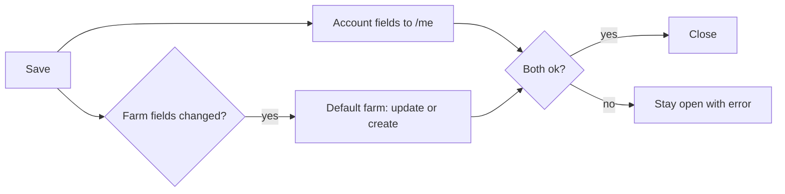

# farm-profile-persistence Specification

## Purpose
Profile and farm settings entered in the profile dialog are stored on the backend, so they survive reloads and appear on any device.

## Requirements

### Requirement: Farm settings persist to the default farm
Saving location details (village, district, state, pincode) from Profile SHALL store them on the farmer's default farm, which is the farmer's lowest-id farm. If the farmer has no farm, one SHALL be created on first save. Profile SHALL NOT send farm name, area, water source, irrigation, farming method, setup completed or primary crops.

#### Scenario: Save then reload
- **WHEN** a farmer saves village "Sinnar" and pincode "422103" and reloads the app
- **THEN** Profile shows "Sinnar" and "422103"

#### Scenario: First save creates the farm
- **WHEN** a farmer with no farm saves a village
- **THEN** a farm holding that village exists afterwards

#### Scenario: Another device
- **WHEN** the same farmer signs in elsewhere
- **THEN** the same location details are shown

#### Scenario: Other farm fields untouched
- **WHEN** a farmer saves a pincode on a farm that already has a name and area
- **THEN** the farm's name and area are unchanged

### Requirement: Primary crops are stored by catalog id
The farm SHALL hold its primary crops as catalog ids. Updating them SHALL replace the full set, ignore duplicates and reject unknown ids.

#### Scenario: Replace crops
- **WHEN** a farm with crops [1,2] is updated with `crop_catalog_ids` [2,3]
- **THEN** the farm's crops are exactly [2,3]

#### Scenario: Unknown crop id
- **WHEN** an update contains a crop id not in the catalog
- **THEN** the request is rejected as invalid and the farm is unchanged

#### Scenario: Omitted crops
- **WHEN** an update does not include `crop_catalog_ids`
- **THEN** the farm's crops are unchanged

### Requirement: Role persists as a label
The profile update SHALL accept a role from the app's role list (farmer, farm_owner, agronomist, farm_worker, student, researcher, gardener) and return it on later reads. It SHALL NOT affect access.

#### Scenario: Valid role
- **WHEN** a farmer saves role "agronomist" and reloads
- **THEN** the profile shows "agronomist"

#### Scenario: Invalid role
- **WHEN** an update contains an unlisted role
- **THEN** the request is rejected as invalid

### Requirement: Phone is read-only in the profile
The profile SHALL show the phone number but not allow editing it.

#### Scenario: Phone field
- **WHEN** the profile dialog opens
- **THEN** the phone is displayed read-only and is not sent in any save

### Requirement: Save reports its outcome
The edit dialog SHALL stay open with a saving state until the write finishes, show an error if it fails, and close with a success message only when it succeeds.

#### Scenario: Failure
- **WHEN** the update fails
- **THEN** the dialog stays open, an error is shown, and the entered value is kept

#### Scenario: Double submit
- **WHEN** Save is pressed while a save is in progress
- **THEN** no second save is started

### Requirement: Water source belongs to the land
A land SHALL hold an optional `water_source`, readable and writable through the land API. The migration SHALL copy each farm's `water_source` onto every land of that farm.

#### Scenario: Set on a land
- **WHEN** a land is updated with water_source "Borewell"
- **THEN** reading the land returns "Borewell"

#### Scenario: Migration copy
- **WHEN** a farm with water_source "Canal" and two lands is migrated
- **THEN** both lands have water_source "Canal"

### Requirement: Irrigation and farming method belong to the crop
A crop SHALL hold an optional `irrigation_type` and an optional `farming_method`, readable and writable through the crop API. The migration SHALL copy the farm's values onto every crop of that farm's lands.

#### Scenario: Set on a crop
- **WHEN** a crop is created with irrigation_type "Drip" and farming_method "Organic"
- **THEN** reading the crop returns both values

#### Scenario: Left blank
- **WHEN** a crop is created without them
- **THEN** both are null

#### Scenario: Migration copy
- **WHEN** a farm with irrigation "Drip" and method "Organic" and three crops is migrated
- **THEN** all three crops have those values
