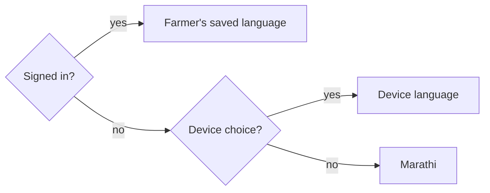

# localization Specification

## Purpose
The app speaks the farmer's language: Marathi by default, with Hindi and English available. The choice is made on the login page or in Profile, applies at once, is remembered, and covers every word on screen, as well as dates, numbers and money.

## Requirements

### Requirement: Marathi is the default language
The app SHALL offer Marathi, Hindi and English. Marathi SHALL be used for a device that has not chosen a language and for a new farmer's profile, unless the farmer chose another language before registering.

#### Scenario: First visit
- **WHEN** someone opens the app on a device that has never chosen a language
- **THEN** the login page is shown in Marathi with Marathi selected

#### Scenario: Choosing another language first
- **WHEN** a new farmer selects English on the login page and then registers
- **THEN** their profile is saved with English and the app continues in English

#### Scenario: Existing farmer keeps their language
- **WHEN** a farmer whose saved language is English signs in on a device that was set to Marathi
- **THEN** the app switches to English, because the saved profile language wins after sign-in

### Requirement: The language can be chosen before and after signing in
The login page SHALL show a language switch with the choices मराठी, हिंदी and English. Profile SHALL keep the language setting. Changing the language SHALL apply immediately without a reload. The choice made before sign-in SHALL be remembered on the device. A change made in Profile SHALL be saved to the farmer's profile and SHALL also become the device's language.

#### Scenario: Switch on the login page
- **WHEN** a visitor selects हिंदी on the login page
- **THEN** the page text changes to Hindi at once, and a reload keeps Hindi

#### Scenario: Switch in Profile
- **WHEN** a signed-in farmer changes the language in Profile
- **THEN** every screen changes at once, the profile stores the new language, and signing out and back in keeps it

#### Scenario: Switch is reachable by keyboard
- **WHEN** a keyboard or screen-reader user reaches the language switch
- **THEN** each language can be selected, and the selected one is announced as selected

### Requirement: Every piece of text follows the language
All text the app shows SHALL be available in Marathi, Hindi and English and SHALL change with the language: screen text, buttons, labels, placeholders, titles, accessible names, toast and error messages, empty states, and chart and map labels. No text SHALL be written directly into a template or component without a translation. If a translation is somehow missing, the English text SHALL be shown, never a raw key.

#### Scenario: A screen in Marathi
- **WHEN** the language is Marathi and the farmer opens login, Home, Lands, Crops, Activity, Reports, Weather or Profile
- **THEN** all text on the screen, including buttons and field labels, is in Marathi except proper nouns and farmer-entered data

#### Scenario: Messages in code
- **WHEN** a toast or error appears while the language is Hindi
- **THEN** it is shown in Hindi

#### Scenario: Missing translation falls back
- **WHEN** a string has no entry in the selected language
- **THEN** its English text is shown, not the key

### Requirement: Wording uses farmer vocabulary
Marathi and Hindi wording SHALL use the everyday words farmers use, following the prototype's glossary, rather than formal or literal translations. Where the app and the glossary differ, the glossary wins.

#### Scenario: Marathi terms
- **WHEN** the language is Marathi
- **THEN** activity is "कामे", harvest is "काढणी", the rice crop is "भात", notes are "नोंदी", and logging an activity is "काम नोंदवा"

#### Scenario: Crop and activity names
- **WHEN** a crop or activity type from the reference data is shown in Marathi
- **THEN** its Marathi name is used, for example कांदा for Onion and फवारणी for Spray Application

### Requirement: Dates, numbers and money follow the language
Dates SHALL show month and day names in the selected language. Numbers and money SHALL use Indian digit grouping (for example ₹1,24,500) and Western digits (0 to 9) in every language. The date and number format SHALL change together with the language.

#### Scenario: Marathi date
- **WHEN** the language is Marathi and a date of 1 October 2026 is shown in the "dd MMM yyyy" style
- **THEN** it reads with the Marathi month name, for example "01 ऑक्टो 2026"

#### Scenario: Indian grouping
- **WHEN** an amount of 124500 rupees is shown in any language
- **THEN** it reads "₹1,24,500"

#### Scenario: English dates unchanged
- **WHEN** the language is English
- **THEN** dates keep their current English format

### Requirement: The document language follows the app language
The page's `lang` attribute SHALL always match the selected language so that browsers choose correct fonts, line breaking and screen-reader voices.

#### Scenario: Attribute follows the switch
- **WHEN** the language changes from Marathi to English
- **THEN** the page's `lang` attribute changes from `mr` to `en` without a reload

### Requirement: Longer text still fits
Marathi and Hindi text is often longer than English. Buttons, tabs, headers and cards SHALL stay readable and usable without clipped text or horizontal scrolling in all three languages, at phone and desktop widths.

#### Scenario: Phone tab labels
- **WHEN** the language is Marathi on a 375 px wide phone
- **THEN** every tab label is fully visible and nothing overflows

### Requirement: Translation completeness is checked automatically
The three translation files SHALL contain exactly the same keys, with no empty values, and every placeholder (such as `{{count}}`) in a string SHALL appear in its translations. An automated check SHALL fail the lint step when they differ.

#### Scenario: Key missing in one language
- **WHEN** a key exists in the English file but not in the Marathi file
- **THEN** the translation check fails and names the key and the language

#### Scenario: Placeholder lost
- **WHEN** an English string has `{{count}}` but its Hindi translation does not
- **THEN** the translation check fails and names the key
